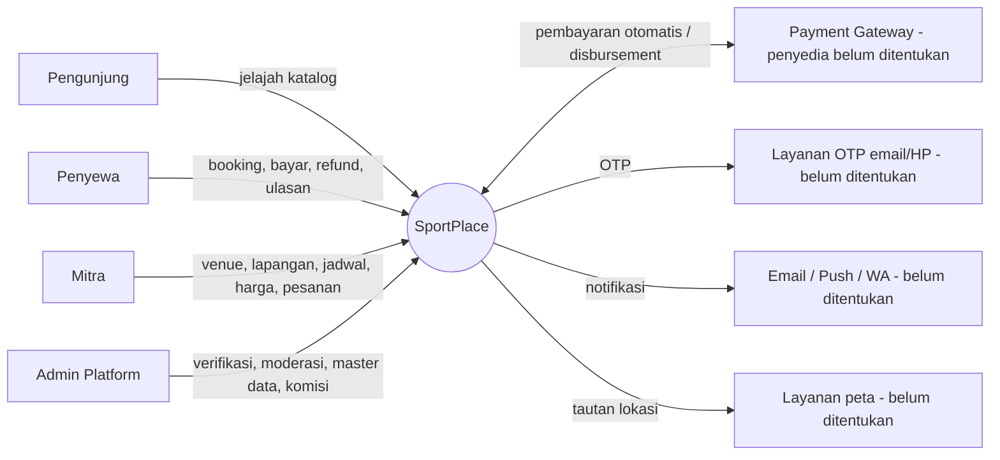
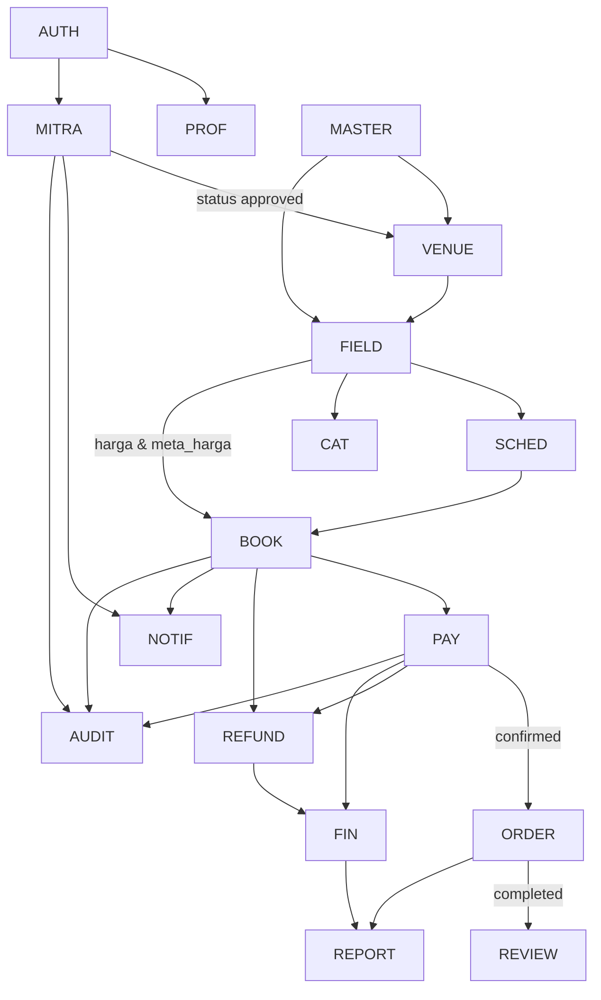
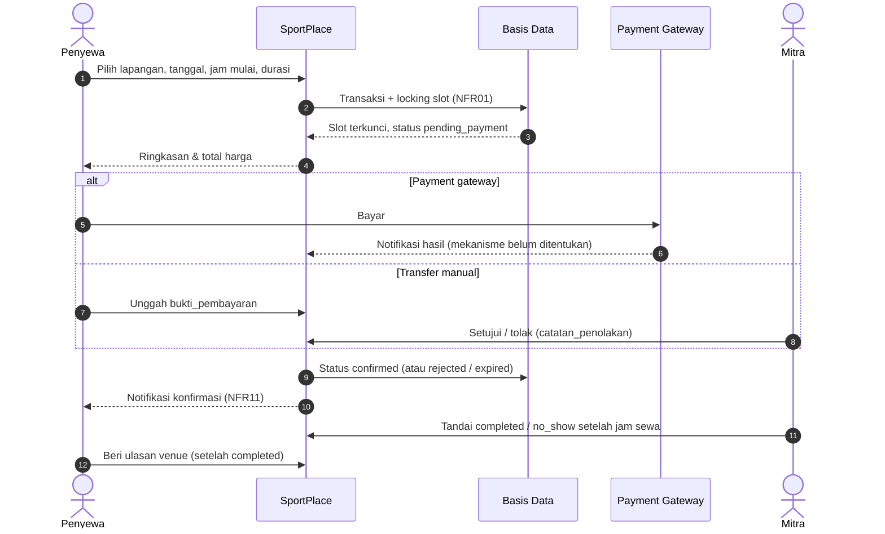
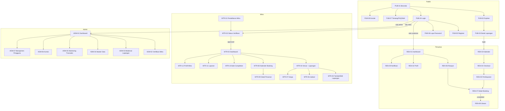
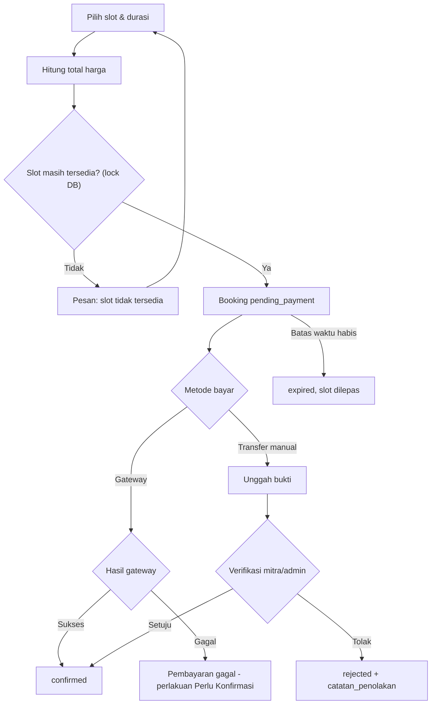
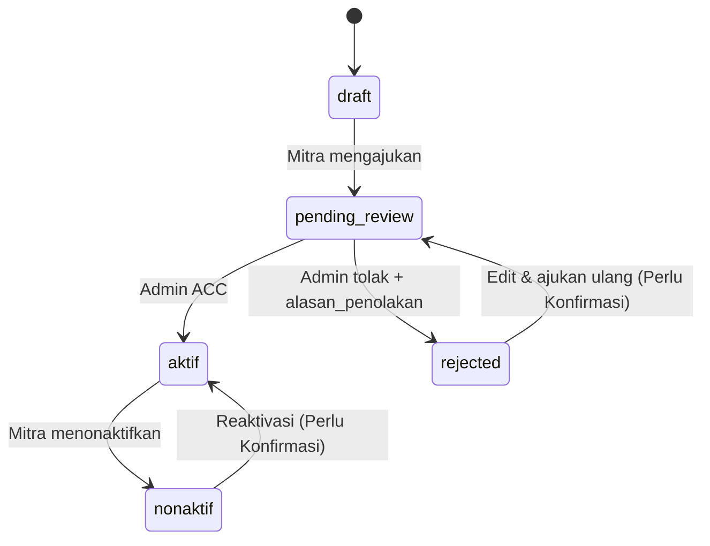
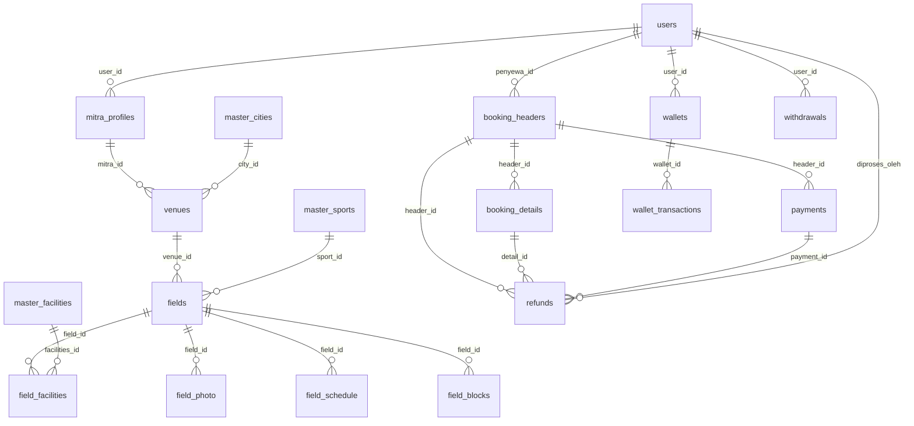
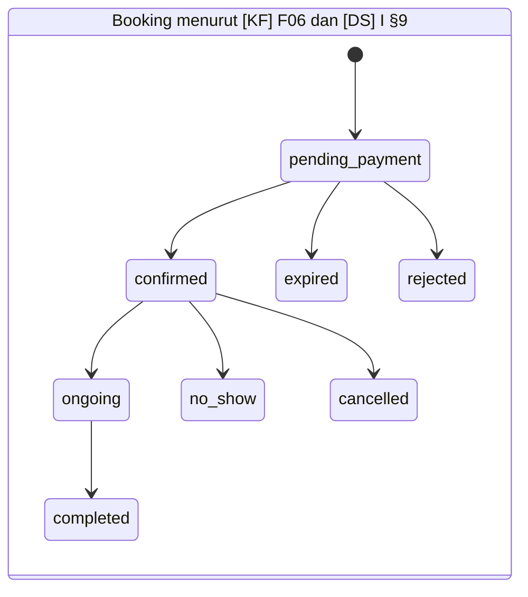
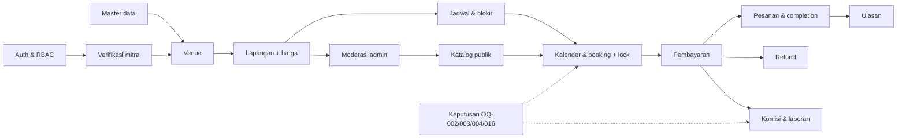

# Product Requirements Document (PRD) — SportPlace

> Platform Penyewaan Lapangan Olahraga (Multi Cabang Olahraga)

---

## Daftar Isi

1. [Informasi Dokumen](#1-informasi-dokumen)
2. [Ringkasan Eksekutif](#2-ringkasan-eksekutif)
3. [Latar Belakang dan Permasalahan](#3-latar-belakang-dan-permasalahan)
4. [Tujuan Produk dan Indikator Keberhasilan](#4-tujuan-produk-dan-indikator-keberhasilan)
5. [Ruang Lingkup Produk](#5-ruang-lingkup-produk)
6. [Stakeholder, Aktor, dan Persona Pengguna](#6-stakeholder-aktor-dan-persona-pengguna)
7. [Gambaran Sistem dan Arsitektur Fungsional](#7-gambaran-sistem-dan-arsitektur-fungsional)
8. [Navigasi dan Struktur Halaman](#8-navigasi-dan-struktur-halaman)
9. [User Journey dan Alur Pengguna](#9-user-journey-dan-alur-pengguna)
10. [Functional Requirements](#10-functional-requirements)
11. [Business Rules](#11-business-rules)
12. [Role-Based Access Control dan Authorization](#12-role-based-access-control-dan-authorization)
13. [Data Requirements dan Pemetaan ke ERD](#13-data-requirements-dan-pemetaan-ke-erd)
14. [UI/UX Requirements, Pemetaan Figma, dan Analisis Konsistensi Antar-Sumber](#14-uiux-requirements-pemetaan-figma-dan-analisis-konsistensi-antar-sumber)
15. [Integrasi dan External Dependencies](#15-integrasi-dan-external-dependencies)
16. [Non-Functional Requirements](#16-non-functional-requirements)
17. [Error Handling dan Edge Cases](#17-error-handling-dan-edge-cases)
18. [Acceptance Criteria dan Definition of Done](#18-acceptance-criteria-dan-definition-of-done)
19. [Requirements Traceability Matrix](#19-requirements-traceability-matrix)
20. [Prioritas, Dependencies, dan Rekomendasi Implementasi](#20-prioritas-dependencies-dan-rekomendasi-implementasi)
21. [RAID — Risks, Assumptions, Issues, Dependencies](#21-raid--risks-assumptions-issues-dependencies)
22. [Open Questions](#22-open-questions)
23. [Referensi, Lampiran, dan Glosarium](#23-referensi-lampiran-dan-glosarium)

---

## Konvensi Dokumen

| Label | Arti |
|---|---|
| **Terkonfirmasi** | Dinyatakan secara eksplisit dalam minimal satu sumber dan tidak bertentangan dengan sumber lain. |
| **Usulan** | Rekomendasi penyusun PRD (analis); **Usulan — perlu validasi** sebelum menjadi keputusan. |
| **Perlu Konfirmasi** | Disebut dalam sumber tetapi tidak lengkap, ambigu, atau bertentangan antar-sumber. |
| **Tidak Dapat Diverifikasi** | Tidak dapat diperiksa karena sumber tidak dapat diakses (khususnya Figma). |

Kode sumber yang dipakai di seluruh dokumen:

| Kode | Sumber | Keterangan rujukan |
|---|---|---|
| **[KF]** | Dokumen Kebutuhan Fungsional (Google Doc) | Bagian: `KF-Daftar` (daftar fitur per aktor 1–3), `KF-Hal` (daftar halaman A–D), `F01`–`F21`, `NFR01`–`NFR11`, `KF-Catatan` (Catatan Tambahan), `KF-Komentar[a]` (komentar pada F19) |
| **[DS]** | `desain.md` — *Design System — SportPlace* | Bagian I §1–§16 (warna), Bagian II §1–§21 (tipografi) |
| **[ERD]** | File SQL ERD (database `sportplace`) | Nama tabel dan kolom, contoh `ERD:booking_headers.status` |
| **[FIG]** | Figma `DPBPP` | **Tidak Dapat Diverifikasi** — akses ditolak (lihat §1.4) |
| **[BRIEF]** | Brief/arahan pengguna kepada penyusun | Contoh: penyebutan kerangka kerja Laravel |

---

## 1. Informasi Dokumen

### 1.1 Identitas Dokumen

| Atribut | Nilai |
|---|---|
| Nama produk | **SportPlace** — nama ditemukan pada [DS] judul dokumen dan nama database `sportplace` pada [ERD]. [KF] menyebut "Sistem Penyewaan Lapangan Olahraga (Multi Cabang Olahraga)". Nama berkas Figma adalah `DPBPP` (makna singkatan **Perlu Konfirmasi**). |
| Jenis produk | Aplikasi web platform pemesanan (booking) lapangan olahraga multi-cabang dengan tiga aktor. |
| Kerangka kerja | Laravel — berdasarkan [BRIEF]; **tidak disebut** di keempat sumber. Versi Laravel, PHP, dan basis data **Perlu Konfirmasi** (SQL ERD memakai sintaks MySQL/MariaDB). |
| Versi dokumen | 0.1 |
| Status dokumen | **Draft — Ready for Review** (belum disetujui stakeholder) |
| Tanggal penyusunan | 24 Oktober 2026 |
| Penyusun | Grok Bot (peran: Senior PM / System Analyst / Architect) atas permintaan I Dewa Made Ary Dwisaputra |
| Pemilik produk | `[Belum ditentukan]` |
| Penyetuju | `[Belum ditentukan]` |

### 1.2 Tujuan Dokumen

Menjadi acuan tunggal kebutuhan produk bagi developer, UI/UX designer, QA engineer, dan stakeholder, dengan cara: (a) mengintegrasikan empat sumber referensi; (b) menerjemahkannya menjadi persyaratan yang dapat diuji; (c) mengungkap celah, ketidaksesuaian, dan keputusan yang harus dikonfirmasi sebelum implementasi.

### 1.3 Target Pembaca

| Pembaca | Bagian yang paling relevan |
|---|---|
| Product Owner / Stakeholder | §2–§6, §11, §20–§22 |
| Backend Developer (Laravel) | §7, §10–§13, §15–§17 |
| Frontend Developer / UI/UX Designer | §8, §9, §14 |
| QA Engineer | §10 (Acceptance Criteria), §16–§19 |

### 1.4 Inventarisasi Sumber Referensi (Tahap 1)

| Kode | Judul / identitas | Lokasi | Status akses | Cakupan yang dibaca | Catatan penting |
|---|---|---|---|---|---|
| [KF] | Kebutuhan Fungsional & Non-Fungsional — Sistem Penyewaan Lapangan Olahraga (Multi Cabang Olahraga) | <https://docs.google.com/document/d/1AmdcWspZ1pQNqZbMSGDrt0mtXc8AK-M4Nex7aiDbPSQ/edit> | **Dapat diakses penuh** (melalui ekspor teks publik `export?format=txt`) | Seluruh isi: daftar fitur per aktor, daftar halaman A–D, F01–F21, NFR01–NFR11, Catatan Tambahan, tautan Lucidchart & Figma, salinan Design System, dan satu komentar | Komentar `[a]` pada F19: *"ini nggak bisa komisinya fix"*. F07 berupa kalimat yang tidak lengkap. Dokumen juga memuat salinan Design System yang sama dengan [DS]. |
| [DS] | Design System — SportPlace (Sistem Warna & Sistem Tipografi revisi Poppins) | Berkas unggahan `desain.md` | **Dapat diakses penuh** | Seluruh Bagian I (§1–§16 + core palette + CSS variables) dan Bagian II (§1–§21) | **Temuan kritis:** `desain.md` adalah **design system visual** (warna & tipografi), **bukan** dokumen desain sistem/arsitektur. Tidak memuat arsitektur, modul, alur sistem, maupun keputusan teknis backend. Namun memuat daftar **status booking, status ketersediaan, status pembayaran/refund** yang relevan untuk analisis. |
| [ERD] | Skrip SQL database `sportplace` (17 tabel) | Berkas unggahan `.sql` | **Dapat diakses penuh** | Seluruh `CREATE TABLE` dan `ALTER TABLE` | Kolom `users.alamat` ditambah, diganti nama, lalu **dihapus** — status akhir: tidak ada kolom alamat pada `users`. Terdapat salah ketik nama (`succes`, `complated_at` (ejaan `vanues` sudah diperbaiki menjadi `venues`)). Lucidchart tidak dibuka karena SQL dinyatakan cukup oleh brief. |
| [ERD-Lucid] | Lucidchart ERD | <https://lucid.app/lucidchart/20613b56-e8cf-4f59-b18d-c9e38f80aad8/edit> | **Tidak dibuka** (sesuai brief, SQL dianggap cukup) | — | Kesetaraan Lucidchart dengan SQL **Tidak Dapat Diverifikasi**. |
| [FIG] | Figma `DPBPP` | <https://www.figma.com/design/VKw5HiSobSvVyxVME1Yfbz/DPBPP?node-id=0-1> | **GAGAL diakses** | Tidak ada | Konektor Figma (akun `ary`, `arysaputraadewamade@gmail.com`) mengembalikan pesan *"Looks like you don't have edit access to this file"* untuk `get_metadata` (daftar halaman dan node `0:1`) serta `get_screenshot`. Ambil-halaman publik diblokir (HTTP 403 CloudFront / timeout). **Tidak ada halaman, frame, komponen, maupun state Figma yang telah diperiksa.** |

> **Konsekuensi keterbatasan Figma:** Seluruh pemetaan halaman di §8 dan §14 disusun dari daftar halaman `KF-Hal` dan dari token UI di [DS]. Kolom "Referensi Figma" diisi **Tidak Dapat Diverifikasi**. Pemetaan Figma wajib dilengkapi setelah pemilik berkas memberikan akses (lihat OQ-001).

### 1.5 Ringkasan Perubahan

| Versi | Tanggal | Perubahan | Oleh |
|---|---|---|---|
| 0.1 | 24-10-2026 | Draft awal dari [KF], [DS], [ERD]; Figma belum dapat diakses | Grok Bot |

---

## 2. Ringkasan Eksekutif

| Aspek | Ringkasan | Sumber |
|---|---|---|
| Gambaran produk | SportPlace adalah platform web penyewaan lapangan olahraga multi-cabang (futsal, badminton, basket, tenis, dll.) yang mempertemukan **Penyewa**, **Pemilik Lapangan (Mitra)**, dan **Admin Platform**. | [KF] pembuka; [DS] pembuka |
| Masalah utama | Sumber tidak menuliskan pernyataan masalah secara eksplisit. Masalah yang tersirat dari kebutuhan: risiko pemesanan ganda (*double booking*), listing fiktif/menyesatkan, verifikasi pembayaran, dan pengelolaan jadwal/harga lapangan. | F04, F17, NFR01 |
| Solusi | Katalog lapangan terverifikasi, kalender ketersediaan *real-time*, booking dengan penguncian slot sementara, pembayaran gateway/transfer manual, alat operasional mitra (venue, lapangan, jadwal, harga, pesanan, laporan), serta tata kelola admin (verifikasi, moderasi, master data, transaksi, komisi, refund, pengguna). | F01–F21 |
| Target pengguna | Penyewa (pengguna umum), Mitra/Pemilik Lapangan, Admin Platform. | [KF]; [ERD] `users.role` |
| Nilai utama | Bagi penyewa: menemukan & memesan lapangan secara pasti. Bagi mitra: kanal penjualan dan alat operasional. Bagi platform: pendapatan komisi dan kualitas listing. | F02–F05, F09–F15, F19 |
| Ruang lingkup umum | Web aplikasi responsif *mobile-first* (NFR06, NFR07) dengan modul autentikasi, katalog, booking, pembayaran, refund, ulasan, manajemen mitra/venue/lapangan, laporan, master data, dan administrasi. | §5 |

**Temuan kritis (lihat §14.8 dan §21):**

1. `desain.md` bukan dokumen desain sistem, sehingga keputusan arsitektur belum terdokumentasi.
2. Figma tidak dapat diakses; seluruh kebutuhan UI belum terverifikasi terhadap desain.
3. Status booking berbeda di tiga tempat ([KF] F06, [DS] §9, [ERD] `booking_headers.status` dan `booking_details.status_item`).
4. ERD belum mendukung beberapa fitur yang wajib: ulasan/rating, bukti transfer manual, pengaturan komisi, suspend/banned, OTP, notifikasi, dan audit log.
5. Kebijakan komisi bertentangan: F19 (per mitra/per cabang olahraga) vs. komentar dokumen (komisi tetap).

---

## 3. Latar Belakang dan Permasalahan

### 3.1 Konteks Pengembangan

[KF] menetapkan sistem penyewaan lapangan olahraga multi-cabang dengan tiga aktor utama. [DS] menegaskan karakter produk sebagai *"platform booking lapangan multi-cabang olahraga"* dengan area produk **Public/Marketplace, Renter, Partner, Admin Platform** ([DS] II §1, §11). Tidak ada statistik pasar atau data organisasi di sumber; PRD ini tidak menambahkannya.

### 3.2 Permasalahan yang Tersirat dari Sumber

| ID | Permasalahan | Dampak | Bukti sumber | Status |
|---|---|---|---|---|
| PB-01 | Dua penyewa dapat memesan slot yang sama secara bersamaan | Konflik jadwal, kerugian kepercayaan | F04, NFR01 | Terkonfirmasi |
| PB-02 | Listing lapangan fiktif atau menyesatkan | Penyewa dirugikan, reputasi platform | F17 | Terkonfirmasi |
| PB-03 | Verifikasi pembayaran manual dan status pembayaran yang tidak jelas | Booking tertahan / sengketa | F05, F12, F20 | Terkonfirmasi |
| PB-04 | Mitra membutuhkan pengaturan jam operasional, blokir jadwal, dan harga berbeda (peak/off-peak) | Kalender tidak akurat bila tidak dikelola | F10, F11 | Terkonfirmasi |
| PB-05 | Sengketa: pembatalan sepihak, lapangan tidak sesuai, gagal bayar | Perlu mekanisme refund | F20 | Terkonfirmasi |
| PB-06 | Mitra dan akun yang melanggar ketentuan | Perlu verifikasi dan sanksi akun | F08, F16, F21 | Terkonfirmasi |

### 3.3 Alasan Solusi Diperlukan

Solusi terpusat diperlukan agar ketersediaan, pembayaran, dan verifikasi berada dalam satu sumber kebenaran dengan kontrol konkurensi (NFR01), RBAC (NFR02), dan jejak audit (NFR10). Alasan bisnis lebih lanjut (mis. model pendapatan) di luar komisi platform (F15, F19) **Perlu Konfirmasi**.

---

## 4. Tujuan Produk dan Indikator Keberhasilan

### 4.1 Tujuan Produk

| ID | Tujuan | Sumber | Status |
|---|---|---|---|
| OBJ-01 | Penyewa dapat menemukan lapangan aktif berdasarkan cabang olahraga, kota, harga, dan rating | F02 | Terkonfirmasi |
| OBJ-02 | Penyewa dapat memesan dan membayar slot tanpa *double booking* | F03–F05, NFR01 | Terkonfirmasi |
| OBJ-03 | Proses booking dapat diselesaikan dalam kurang dari 5 langkah ("idealnya") | NFR06 | Terkonfirmasi (sebagai target ideal) |
| OBJ-04 | Mitra dapat mengelola venue, lapangan, jadwal, harga, pesanan, dan laporan pendapatan | F08–F15 | Terkonfirmasi |
| OBJ-05 | Admin dapat menjamin kualitas listing dan tata kelola platform | F16–F21 | Terkonfirmasi |
| OBJ-06 | Modul kalender dan booking tersedia minimal 99% *uptime* | NFR05 | Terkonfirmasi |
| OBJ-07 | Kalender ketersediaan dimuat maksimal 2–3 detik | NFR03 | Terkonfirmasi (rentang perlu dipastikan, lihat NFR-PERF-001) |

### 4.2 Indikator Keberhasilan (Usulan — perlu validasi)

Sumber hanya menetapkan target untuk NFR03 (2–3 detik), NFR05 (uptime ≥ 99%), dan NFR06 (< 5 langkah). Metrik lain di bawah adalah **Usulan**; target numeriknya **belum ditetapkan**.

| ID | Metrik | Definisi | Cara pengukuran | Target | Status |
|---|---|---|---|---|---|
| KPI-01 | Tingkat penyelesaian booking | Persentase booking `pending_payment` yang menjadi `confirmed` | Hitung transisi status booking per periode | TBD | Usulan |
| KPI-02 | Tingkat booking kedaluwarsa | Persentase booking yang berakhir `expired` | Hitung status `expired` / total booking dibuat | TBD | Usulan |
| KPI-03 | Jumlah langkah booking | Jumlah layar/aksi dari pemilihan slot sampai pembayaran | Uji usabilitas / analitik alur | < 5 langkah (NFR06) | Terkonfirmasi (target), metode Usulan |
| KPI-04 | Waktu muat kalender | Waktu respons halaman kalender ketersediaan | APM / uji beban | ≤ 2–3 detik (NFR03) | Terkonfirmasi (target), metode Usulan |
| KPI-05 | Uptime modul booking | Persentase waktu modul kalender & booking dapat diakses | Monitoring *uptime* | ≥ 99% (NFR05) | Terkonfirmasi |
| KPI-06 | Insiden double booking | Jumlah slot yang terpesan lebih dari satu kali | Query integritas data | TBD (Usulan: 0) | Usulan |
| KPI-07 | Waktu verifikasi mitra & listing | Rentang waktu pengajuan → keputusan admin | Selisih waktu pengajuan dan keputusan (memerlukan kolom waktu, lihat GAP-15) | TBD | Usulan |
| KPI-08 | Waktu verifikasi pembayaran manual | Rentang waktu unggah bukti → keputusan mitra/admin | Selisih waktu (memerlukan data, lihat GAP-02) | TBD | Usulan |
| KPI-09 | Tingkat refund | Persentase booking dengan refund `completed` | `refunds` / booking terbayar | TBD | Usulan |
| KPI-10 | Kepuasan pengguna | Rata-rata rating ulasan venue | Rata-rata rating (memerlukan tabel ulasan, lihat GAP-01) | TBD | Usulan |
| KPI-11 | Tingkat penggunaan fitur | Persentase mitra aktif yang memakai bulk completion, blokir jadwal, harga peak | Analitik/log | TBD | Usulan |

---

## 5. Ruang Lingkup Produk

### 5.1 In Scope

| No | Kemampuan | Aktor | Sumber |
|---|---|---|---|
| 1 | Registrasi (pilih peran Penyewa atau Mitra), login, verifikasi OTP email/nomor HP, lupa/reset password | Penyewa, Mitra | F01, F08, `KF-Hal` A4–A6 |
| 2 | Profil pengguna dan pembaruan data | Penyewa | F01, `KF-Daftar` 3.3, `KF-Hal` B2 |
| 3 | Halaman publik: beranda, eksplorasi/pencarian, detail lapangan, Tentang Kami/FAQ/S&K, Kontak/Bantuan | Publik | `KF-Hal` A1–A8, F02 |
| 4 | Kalender ketersediaan *real-time* | Penyewa | F03, `KF-Hal` B3 |
| 5 | Booking, perhitungan harga otomatis, penguncian slot, kedaluwarsa | Penyewa, Sistem | F04, F06 |
| 6 | Pembayaran via payment gateway dan transfer manual (unggah bukti) | Penyewa | F05, `KF-Hal` B5 |
| 7 | Riwayat, detail, pembatalan booking; invoice; kode booking/QR check-in | Penyewa | F06, `KF-Hal` B6–B7 |
| 8 | Pengajuan refund (≥ 24 jam sebelum jadwal) | Penyewa | `KF-Daftar` 3.1 |
| 9 | Ulasan & rating venue setelah booking `completed` | Penyewa | F07, `KF-Daftar` 3.4, `KF-Hal` B8 |
| 10 | Notifikasi (halaman notifikasi; email/push/WA otomatis) | Penyewa, Mitra | NFR11, `KF-Hal` B9 |
| 11 | Pendaftaran mitra, unggah dokumen legalitas, status verifikasi, pengajuan ulang | Mitra | F08, `KF-Daftar` 2.1, `KF-Hal` C1–C2, C12 |
| 12 | Manajemen venue (buat, ajukan, edit, nonaktifkan) | Mitra | `KF-Daftar` 2.2, `KF-Hal` C4 |
| 13 | Manajemen lapangan (buat, ajukan, edit, nonaktifkan, foto, fasilitas) | Mitra | F09, `KF-Daftar` 2.3, `KF-Hal` C5 |
| 14 | Jadwal operasional, durasi slot, blokir jadwal | Mitra | F10, `KF-Hal` C6 |
| 15 | Harga dinamis peak/off-peak (`meta_harga`) | Mitra | F11, `KF-Hal` C7 |
| 16 | Verifikasi pembayaran manual | Mitra (dan Admin, lihat F05) | F05, F12, `KF-Hal` C9 |
| 17 | Pesanan masuk, kalender booking, konfirmasi kehadiran, `no_show`, penyelesaian per transaksi/bulk | Mitra | F13, F14, `KF-Hal` C8, C10 |
| 18 | Dashboard & laporan pendapatan mitra (filter harian/bulanan, ekspor) | Mitra | F15, `KF-Hal` C3, C11 |
| 19 | Verifikasi mitra, moderasi venue dan lapangan | Admin | F16, F17, `KF-Daftar` 1.4–1.6 |
| 20 | Master data kota, cabang olahraga, fasilitas (tambah, edit, nonaktifkan) | Admin | F18, `KF-Daftar` 1.1–1.3 |
| 21 | Monitoring transaksi, pendapatan platform, unduh laporan keuangan, penarikan profit, pengaturan komisi | Admin | F19, `KF-Daftar` 1.7, `KF-Hal` D5–D6 |
| 22 | Penyelesaian sengketa & refund | Admin | F20 |
| 23 | Manajemen pengguna (suspend/banned) | Admin | F21, `KF-Hal` D7 |
| 24 | Dashboard admin (total mitra, lapangan, transaksi) | Admin | `KF-Hal` D1 |

### 5.2 Out of Scope

Sumber **tidak** menyebutkan secara eksplisit fitur yang dikecualikan. Satu-satunya indikasi adalah `KF-Catatan`: fitur **wallet/saldo mitra** dan **dynamic pricing otomatis berbasis demand** disebut sebagai kemungkinan yang "masih bisa disesuaikan tergantung skala bisnis".

| Item | Posisi | Status |
|---|---|---|
| Dynamic pricing otomatis berbasis demand | Tidak termasuk kebutuhan saat ini; harga peak/off-peak diatur manual oleh mitra (F11) | Perlu Konfirmasi |
| Wallet/saldo mitra | Disebut sebagai opsi di `KF-Catatan`, **tetapi tabel `wallets`, `wallet_transactions`, `withdrawals` sudah ada di [ERD]** | Perlu Konfirmasi (OQ-006) |
| Aplikasi mobile native | Tidak disebut; NFR06/NFR07 hanya menyebut antarmuka responsif dan browser | Perlu Konfirmasi |
| Fitur lain yang tidak disebut | Tidak boleh disimpulkan sebagai dikecualikan; ruang lingkup di luar sistem perlu dikonfirmasi | Perlu Konfirmasi |

### 5.3 Batasan dan Ketergantungan

| ID | Batasan / ketergantungan | Sumber | Status |
|---|---|---|---|
| CON-01 | Platform dibangun dengan Laravel | [BRIEF] | Perlu Konfirmasi (versi) |
| CON-02 | Basis data relasional dengan skema `sportplace` (sintaks MySQL) | [ERD] | Terkonfirmasi |
| CON-03 | HTTPS/TLS, hashing bcrypt/argon2, token JWT, RBAC | NFR02 | Terkonfirmasi (JWT vs sesi Laravel Perlu Konfirmasi) |
| CON-04 | Integrasi payment gateway wajib PCI-DSS | NFR02 | Terkonfirmasi; penyedia belum ditentukan |
| CON-05 | Kepatuhan UU PDP dan regulasi transaksi elektronik Indonesia | NFR09 | Terkonfirmasi |
| CON-06 | Browser modern: Chrome, Safari, Firefox, Edge; desktop/tablet/mobile | NFR07 | Terkonfirmasi |
| CON-07 | Antarmuka *mobile-first* | NFR06, [DS] II §6 | Terkonfirmasi |
| CON-08 | Font tunggal Poppins; token warna & tipografi [DS] | [DS] | Terkonfirmasi |
| CON-09 | Kode modular: autentikasi, booking, pembayaran, admin dipisahkan | NFR08 | Terkonfirmasi |
| DEP-01 | Penyedia payment gateway (pembayaran otomatis, kemungkinan disbursement) | F05, [ERD] `payments.pg_transaction_id`, `withdrawals.pg_disbursement_id` | Penyedia Perlu Konfirmasi |
| DEP-02 | Penyedia OTP email / SMS | F01 | Perlu Konfirmasi |
| DEP-03 | Kanal notifikasi email / push / WhatsApp | NFR11 | Perlu Konfirmasi |
| DEP-04 | Layanan peta (lokasi pada detail lapangan) | `KF-Hal` A3, [ERD] `venues.map_url` | Perlu Konfirmasi |
| DEP-05 | Akses Figma | [FIG] | Tidak Dapat Diverifikasi |

---

## 6. Stakeholder, Aktor, dan Persona Pengguna

### 6.1 Pemetaan Nama Aktor Antar-Sumber

| Aktor PRD | [KF] | [DS] | [ERD] `users.role` | Status |
|---|---|---|---|---|
| **Penyewa** | "User", "Penyewa", "pengguna umum" | Penyewa, Renter | `customer` | Terkonfirmasi (sinonim) |
| **Mitra** | "Mitra", "Pemilik Lapangan", "mitra/vendor" | Pemilik Lapangan, Partner | `mitra` | Terkonfirmasi |
| **Admin** | "Admin", "Admin Platform" | Admin Platform | `admin` | Terkonfirmasi |
| **Pengunjung (Publik)** | "Halaman Publik (Belum Login)" | Public / Marketplace | — (tidak berperan di tabel) | Terkonfirmasi sebagai konteks akses, bukan peran tersimpan |
| **Sistem** (penjadwal/otomasi) | Kedaluwarsa otomatis, notifikasi otomatis | Status `expired` "slot dilepas otomatis" | — | Terkonfirmasi sebagai aktor non-manusia |
| **Payment Gateway** | "payment gateway (otomatis)" | "Payment gateway sedang mengonfirmasi transaksi" | `payments.pg_transaction_id` | Terkonfirmasi sebagai sistem eksternal |

> Tidak ditemukan peran operator, super admin, atau staf mitra di sumber mana pun. PRD ini tidak menambahkannya.

### 6.2 Profil Aktor

#### Pengunjung (Publik, belum login)
- **Peran:** menjelajah katalog tanpa autentikasi.
- **Tujuan:** menemukan lapangan dan informasi platform.
- **Fitur:** beranda, eksplorasi, detail lapangan, login, register, lupa password, Tentang/FAQ/S&K, Kontak/Bantuan (`KF-Hal` A1–A8).
- **Batasan:** tidak dapat booking (Usulan — perlu validasi: wajib login sebelum checkout; `KF-Hal` B menempatkan kalender/checkout pada aktor Penyewa).
- **Ketergantungan:** data listing yang telah disetujui Admin.

#### Penyewa (`customer`)
- **Peran:** memesan dan membayar sewa lapangan.
- **Tujuan:** mendapat slot sesuai olahraga, lokasi, waktu, dan harga.
- **Kebutuhan:** kalender akurat, harga transparan, pembayaran mudah, pembatalan/refund jelas.
- **Fitur:** F01–F07, refund (`KF-Daftar` 3.1), `KF-Hal` B1–B9.
- **Batasan:** hanya data booking miliknya; refund hanya ≥ 24 jam sebelum jadwal.
- **Ketergantungan:** Mitra (jadwal, verifikasi manual, penyelesaian booking), Admin (refund, sengketa).

#### Mitra / Pemilik Lapangan (`mitra`)
- **Peran:** menyediakan dan mengelola venue/lapangan.
- **Tujuan:** menjual slot lapangan dan memantau pendapatan.
- **Fitur:** F08–F15, `KF-Daftar` 2.1–2.4, `KF-Hal` C1–C12.
- **Batasan:** tidak dapat menambah lapangan sebelum `approved` (F08); listing tayang setelah disetujui Admin (F17); hanya data miliknya (`KF-Hal` C4 "semua lapangan milik mitra").
- **Ketergantungan:** Admin (verifikasi, moderasi, komisi), Penyewa.

#### Admin Platform (`admin`)
- **Peran:** pengelola sistem dengan **akses penuh lintas mitra dan wilayah** ([KF] bagian 3).
- **Tujuan:** tata kelola, kualitas listing, keuangan platform.
- **Fitur:** F16–F21, `KF-Daftar` 1.1–1.7, `KF-Hal` D1–D7, verifikasi pembayaran manual (F05 "manual oleh pemilik/admin").
- **Batasan:** tidak disebutkan. Usulan — perlu validasi: tindakan Admin tercatat di audit log (NFR10).

### 6.3 Persona (Usulan — perlu validasi)

Sumber tidak memuat persona. Persona berikut hanya merangkum kebutuhan dari sumber, tanpa demografi rekaan.

| Persona | Aktor | Kebutuhan inti (dari sumber) |
|---|---|---|
| P-01 "Penyewa via smartphone" | Penyewa | Booking cepat di mobile (< 5 langkah), kalender jelas (NFR06, F03) |
| P-02 "Pengelola venue" | Mitra | Jadwal, blokir maintenance, harga peak, bulk completion, laporan (F10–F15) |
| P-03 "Moderator platform" | Admin | Antrian verifikasi mitra/listing, master data, sengketa (F16–F21) |

### 6.4 Tabel Perbandingan Peran dan Hak Akses (Ringkas)

| Area | Pengunjung | Penyewa | Mitra | Admin |
|---|---|---|---|---|
| Katalog & detail lapangan | Diizinkan | Diizinkan | Belum ditentukan | Belum ditentukan |
| Booking & pembayaran | Tidak diizinkan | Diizinkan | Belum ditentukan | Tidak diizinkan (Usulan) |
| Refund – pengajuan | Tidak diizinkan | Bersyarat (≥ 24 jam) | Tidak diizinkan | Tidak diizinkan |
| Refund – pemrosesan | Tidak diizinkan | Tidak diizinkan | Belum ditentukan | Diizinkan |
| Ulasan venue | Tidak diizinkan | Bersyarat (`completed`) | Tidak diizinkan | Belum ditentukan |
| Venue/lapangan – kelola | Tidak diizinkan | Tidak diizinkan | Bersyarat (milik sendiri, `approved`) | Lihat/moderasi |
| Verifikasi pembayaran manual | Tidak diizinkan | Tidak diizinkan | Bersyarat (lapangan miliknya) | Diizinkan |
| Master data | Tidak diizinkan | Tidak diizinkan | Tidak diizinkan | Diizinkan |
| Komisi & keuangan platform | Tidak diizinkan | Tidak diizinkan | Tidak diizinkan | Diizinkan |
| Suspend/banned | Tidak diizinkan | Tidak diizinkan | Tidak diizinkan | Diizinkan |

Matriks rinci tersedia di §12.

---

## 7. Gambaran Sistem dan Arsitektur Fungsional

> **Catatan:** `desain.md` tidak memuat arsitektur. Diagram di bawah disusun dari modul yang tersirat di [KF] dan NFR08 (pemisahan modul autentikasi, booking, pembayaran, admin), serta tabel [ERD]. Struktur komponen Laravel **bukan keputusan final** — status **Usulan — perlu validasi**.

### 7.1 Diagram Konteks

### 7.2 Modul Fungsional

| Kode modul | Nama | Tanggung jawab | Tabel ERD utama | Sumber |
|---|---|---|---|---|
| AUTH | Autentikasi & Akun | Registrasi, login, OTP, reset password, peran | `users` | F01, NFR02, `KF-Hal` A4–A6 |
| PROF | Profil Pengguna | Data profil penyewa | `users` | F01, `KF-Daftar` 3.3 |
| CAT | Katalog Publik | Beranda, eksplorasi, detail lapangan/venue, konten statis | `venues`, `fields`, `field_photo`, `field_facilities`, master | F02, `KF-Hal` A |
| MASTER | Master Data | Kota, cabang olahraga, fasilitas | `master_cities`, `master_sports`, `master_facilities` | F18 |
| MITRA | Kemitraan | Pendaftaran, verifikasi, profil & dokumen mitra | `mitra_profiles` | F08, F16 |
| VENUE | Venue | CRUD, pengajuan, moderasi venue | `venues` | `KF-Daftar` 1.5, 2.2 |
| FIELD | Lapangan | CRUD, pengajuan, moderasi, harga | `fields`, `field_photo`, `field_facilities` | F09, F11, F17 |
| SCHED | Jadwal | Jadwal operasional, durasi slot, blokir | `field_schedule`, `field_blocks` | F10 |
| BOOK | Booking | Kalender, booking, penguncian, kedaluwarsa, riwayat, pembatalan | `booking_headers`, `booking_details` | F03, F04, F06 |
| PAY | Pembayaran | Gateway, transfer manual, verifikasi | `payments` | F05, F12 |
| ORDER | Pesanan Mitra | Pesanan masuk, kehadiran, no_show, completion | `booking_details` | F13, F14 |
| REFUND | Refund & Sengketa | Pengajuan dan pemrosesan refund | `refunds` | F20, `KF-Daftar` 3.1 |
| REVIEW | Ulasan | Ulasan & rating venue | **Belum ada** (GAP-01) | F07 |
| REPORT | Laporan & Dashboard | Dashboard per aktor, laporan pendapatan, ekspor | Turunan booking/payment | F15, F19, `KF-Hal` |
| FIN | Keuangan Platform | Komisi, pendapatan platform, penarikan | `wallets`, `wallet_transactions`, `withdrawals` | F19, `KF-Daftar` 1.7 |
| USER | Manajemen Pengguna | Suspend/banned | `users` (kolom status belum ada, GAP-08) | F21 |
| NOTIF | Notifikasi | Notifikasi otomatis & halaman notifikasi | **Belum ada** (GAP-13) | NFR11, `KF-Hal` B9 |
| CONTENT | Konten Informasi | Tentang/FAQ/S&K, Kontak/Bantuan | **Belum ada** | `KF-Hal` A7–A8 |
| AUDIT | Audit & Backup | Audit log perubahan status penting | **Belum ada** (GAP-14) | NFR10 |

### 7.3 Hubungan dan Ketergantungan Antar-Modul

### 7.4 Alur Informasi Utama (Booking hingga Ulasan)

### 7.5 Batas Tanggung Jawab

| Komponen | Bertanggung jawab atas | Tidak bertanggung jawab atas |
|---|---|---|
| SportPlace | Ketersediaan slot, status booking, perhitungan harga, verifikasi, RBAC, laporan | Pemrosesan kartu/dana (oleh payment gateway, PCI-DSS) |
| Payment Gateway | Otorisasi & penangkapan dana, kemungkinan disbursement | Status booking |
| Mitra | Kebenaran data venue/lapangan, jadwal, verifikasi transfer manual, penyelesaian sesi | Moderasi listing |
| Admin | Moderasi, master data, komisi, sengketa/refund, sanksi akun | Operasional harian lapangan |

---

## 8. Navigasi dan Struktur Halaman

> **Sumber halaman:** daftar halaman `KF-Hal` A–D. Figma **tidak dapat diakses**, sehingga kolom "Referensi Figma" bernilai **Tidak Dapat Diverifikasi** untuk semua halaman. Route belum disebut di sumber mana pun → "Belum ditentukan". Komponen yang tercantum adalah yang disebut di [KF]; komponen lain bertanda *(Usulan)*.

### 8.1 Halaman Publik (Belum Login)

| ID | Nama halaman | Route | Aktor | Tujuan | Komponen utama | Aksi | Kondisi akses | Ref. Figma |
|---|---|---|---|---|---|---|---|---|
| PUB-01 | Landing Page / Beranda | Belum ditentukan | Semua | Highlight lapangan populer, cabang olahraga, promo | Daftar lapangan populer, daftar cabang olahraga, promo | Buka detail, pilih cabang olahraga, ke eksplorasi | Publik | Tidak Dapat Diverifikasi |
| PUB-02 | Explore / Pencarian Lapangan | Belum ditentukan | Semua | Mencari lapangan | Filter cabang olahraga, kota, harga, rating; daftar hasil | Filter, buka detail | Publik; hanya lapangan `aktif` | Tidak Dapat Diverifikasi |
| PUB-03 | Detail Lapangan | Belum ditentukan | Semua | Informasi lapangan | Foto, fasilitas, harga, lokasi (peta), ulasan | Lihat kalender / booking (login diperlukan — Usulan) | Publik; lapangan `aktif` | Tidak Dapat Diverifikasi |
| PUB-04 | Login | Belum ditentukan | Pengunjung | Autentikasi | Form login *(field Usulan: email, password)* | Login, ke register, ke lupa password | Belum login | Tidak Dapat Diverifikasi |
| PUB-05 | Register | Belum ditentukan | Pengunjung | Membuat akun | Pilihan peran: Penyewa atau Mitra/Pemilik Lapangan; form data (`name`, `email`, `password`, `no_hp`) | Daftar, verifikasi OTP | Belum login | Tidak Dapat Diverifikasi |
| PUB-06 | Lupa / Reset Password | Belum ditentukan | Pengunjung | Pemulihan akun | Form email/no HP *(Usulan)*, form password baru | Minta reset, setel password baru | Belum login | Tidak Dapat Diverifikasi |
| PUB-07 | Tentang Kami / FAQ / Syarat & Ketentuan | Belum ditentukan | Semua | Informasi platform | Konten statis | Baca | Publik | Tidak Dapat Diverifikasi |
| PUB-08 | Kontak / Bantuan (Support) | Belum ditentukan | Semua | Bantuan | Informasi kontak; mekanisme form **Perlu Konfirmasi** | Hubungi | Publik | Tidak Dapat Diverifikasi |

### 8.2 Halaman Penyewa

| ID | Nama halaman | Route | Aktor | Tujuan | Komponen utama | Aksi | Kondisi akses | Ref. Figma |
|---|---|---|---|---|---|---|---|---|
| REN-01 | Dashboard Penyewa | Belum ditentukan | Penyewa | Ringkasan booking aktif & mendatang | Kartu booking aktif/mendatang | Buka detail booking | Login, role `customer` | Tidak Dapat Diverifikasi |
| REN-02 | Profil & Edit Profil | Belum ditentukan | Penyewa | Kelola data diri | Form `name`, `no_hp`, `email`, foto_profil (GAP-10) | Simpan | Login | Tidak Dapat Diverifikasi |
| REN-03 | Kalender Ketersediaan Lapangan | Belum ditentukan | Penyewa | Pilih tanggal & slot jam | Grid kalender dengan state Available, Booked, Blocked, Pending, Selected, Current Time, Unavailable ([DS] I §10) | Pilih tanggal, jam mulai, durasi | Login (Usulan); lapangan `aktif` | Tidak Dapat Diverifikasi |
| REN-04 | Checkout / Ringkasan Booking | Belum ditentukan | Penyewa | Konfirmasi pesanan | Total harga, durasi, syarat pembatalan | Lanjut bayar, kembali | Slot terkunci (`pending_payment`) | Tidak Dapat Diverifikasi |
| REN-05 | Pembayaran | Belum ditentukan | Penyewa | Membayar | Opsi unggah bukti transfer / redirect payment gateway | Bayar, unggah bukti | Booking `pending_payment` belum kedaluwarsa | Tidak Dapat Diverifikasi |
| REN-06 | Riwayat Booking | Belum ditentukan | Penyewa | Daftar booking | Filter status: pending, confirmed, completed, cancelled | Filter, buka detail | Login; data milik sendiri | Tidak Dapat Diverifikasi |
| REN-07 | Detail Booking | Belum ditentukan | Penyewa | Rincian booking | Invoice, opsi batalkan, kode booking/QR check-in | Batalkan, ajukan refund (Usulan lokasi), unduh invoice (Usulan) | Pemilik booking | Tidak Dapat Diverifikasi |
| REN-08 | Beri Ulasan & Rating | Belum ditentukan | Penyewa | Memberi ulasan venue | Rating, teks ulasan *(struktur Perlu Konfirmasi)* | Kirim ulasan | Muncul setelah status `completed` | Tidak Dapat Diverifikasi |
| REN-09 | Notifikasi | Belum ditentukan | Penyewa | Daftar notifikasi | Daftar notifikasi | Buka notifikasi | Login | Tidak Dapat Diverifikasi |

### 8.3 Halaman Mitra (Pemilik Lapangan)

| ID | Nama halaman | Route | Aktor | Tujuan | Komponen utama | Aksi | Kondisi akses | Ref. Figma |
|---|---|---|---|---|---|---|---|---|
| MTR-01 | Pendaftaran Mitra | Belum ditentukan | Calon mitra | Mendaftar sebagai mitra | Form data usaha + unggah dokumen legalitas (KTP, NPWP/SIUP jika ada) | Kirim pendaftaran | Login sebagai `mitra` (Usulan) | Tidak Dapat Diverifikasi |
| MTR-02 | Status Verifikasi Akun | Belum ditentukan | Mitra | Memantau persetujuan | Status `pending`/`approved`/`rejected`, alasan penolakan | Edit & ajukan ulang bila ditolak | Mitra belum `approved` | Tidak Dapat Diverifikasi |
| MTR-03 | Dashboard Mitra | Belum ditentukan | Mitra | Ringkasan bisnis | Ringkasan pendapatan, booking hari ini, rating rata-rata | Navigasi ke modul | Mitra `approved` | Tidak Dapat Diverifikasi |
| MTR-04 | Manajemen Venue (list) → Lapangan (list) | Belum ditentukan | Mitra | Kelola venue & lapangan miliknya | Daftar venue, daftar lapangan per venue | Tambah, edit, ajukan, nonaktifkan | Mitra `approved`; data milik sendiri | Tidak Dapat Diverifikasi |
| MTR-05 | Tambah/Edit Lapangan | Belum ditentukan | Mitra | CRUD lapangan | Form nama, cabang olahraga, foto, fasilitas, harga per jam | Simpan draft, ajukan | Mitra `approved` | Tidak Dapat Diverifikasi |
| MTR-05b | Tambah/Edit Venue | Belum ditentukan | Mitra | CRUD venue | Form nama venue, kota, alamat, peta, jam buka/tutup *(dari [ERD]; halaman tidak terdaftar terpisah di `KF-Hal`)* | Simpan, ajukan | Mitra `approved` (Perlu Konfirmasi) | Tidak Dapat Diverifikasi |
| MTR-06 | Pengaturan Jadwal Operasional & Slot | Belum ditentukan | Mitra | Atur jam & blokir | Jam buka/tutup per hari, durasi slot, blokir tanggal maintenance | Simpan jadwal, tambah/hapus blokir | Pemilik lapangan | Tidak Dapat Diverifikasi |
| MTR-07 | Pengaturan Harga | Belum ditentukan | Mitra | Harga peak/off-peak | Form harga per lapangan | Simpan | Pemilik lapangan | Tidak Dapat Diverifikasi |
| MTR-08 | Kalender Booking Masuk | Belum ditentukan | Mitra | Lihat reservasi per lapangan | Kalender reservasi per lapangan | Buka detail pesanan | Pemilik lapangan | Tidak Dapat Diverifikasi |
| MTR-09 | Detail Pesanan / Verifikasi Pembayaran | Belum ditentukan | Mitra | Verifikasi transfer manual | Detail pesanan, bukti transfer | Approve / reject transfer manual, konfirmasi kehadiran, `no_show` | Pemilik lapangan terkait | Tidak Dapat Diverifikasi |
| MTR-10 | Bulk Action Penyelesaian Booking | Belum ditentukan | Mitra | Tandai `completed` massal | Daftar booking terpilih | Tandai completed | Jam sewa berakhir | Tidak Dapat Diverifikasi |
| MTR-11 | Laporan Pendapatan & Transaksi | Belum ditentukan | Mitra | Rekap pendapatan | Filter harian/bulanan, tabel, ekspor | Filter, ekspor | Mitra `approved` | Tidak Dapat Diverifikasi |
| MTR-12 | Profil Mitra & Dokumen Legalitas | Belum ditentukan | Mitra | Kelola data mitra | Data mitra, dokumen | Edit, ajukan ulang | Mitra | Tidak Dapat Diverifikasi |

### 8.4 Halaman Admin Platform

| ID | Nama halaman | Route | Aktor | Tujuan | Komponen utama | Aksi | Kondisi akses | Ref. Figma |
|---|---|---|---|---|---|---|---|---|
| ADM-01 | Dashboard Admin | Belum ditentukan | Admin | Statistik platform | Total mitra, lapangan, transaksi | Navigasi | Role `admin` | Tidak Dapat Diverifikasi |
| ADM-02 | Verifikasi Pendaftaran Mitra Baru | Belum ditentukan | Admin | Review mitra | Daftar pengajuan, detail & dokumen | ACC, tolak dengan alasan | Admin | Tidak Dapat Diverifikasi |
| ADM-03 | Moderasi Listing Lapangan Baru | Belum ditentukan | Admin | Review lapangan | Daftar `draft`/`pending_review`, foto, deskripsi, harga | Approve, reject | Admin | Tidak Dapat Diverifikasi |
| ADM-03b | Moderasi Venue | Belum ditentukan | Admin | Review venue | Detail venue | ACC, tolak dengan alasan | Admin | Tidak Dapat Diverifikasi — **halaman tidak ada di `KF-Hal` D tetapi fitur ada di `KF-Daftar` 1.5** |
| ADM-04 | Manajemen Master Data | Belum ditentukan | Admin | Data referensi | Tab/daftar cabang olahraga, kota/wilayah, kategori fasilitas | Tambah, edit, nonaktifkan | Admin | Tidak Dapat Diverifikasi |
| ADM-05 | Monitoring Transaksi | Belum ditentukan | Admin | Semua transaksi lintas mitra | Tabel transaksi, status pembayaran/refund | Lihat, proses refund (Usulan lokasi), unduh laporan | Admin | Tidak Dapat Diverifikasi |
| ADM-06 | Pengaturan Komisi Platform | Belum ditentukan | Admin | Atur komisi | Form komisi (struktur **Perlu Konfirmasi**, lihat OQ-004) | Simpan | Admin | Tidak Dapat Diverifikasi |
| ADM-07 | Manajemen Pengguna | Belum ditentukan | Admin | Sanksi akun | Daftar penyewa & mitra | Suspend, banned | Admin | Tidak Dapat Diverifikasi |
| ADM-08 | Pendapatan Platform & Penarikan | Belum ditentukan | Admin | Pendapatan & tarik profit | Ringkasan pendapatan, tombol tarik, unduh laporan keuangan | Tarik, unduh | Admin | Tidak Dapat Diverifikasi — **fitur di `KF-Daftar` 1.7, halaman tidak terdaftar terpisah (mungkin bagian ADM-05)** |
| ADM-09 | Sengketa & Refund | Belum ditentukan | Admin | Tangani komplain & refund | Daftar refund/komplain | Proses, tolak, selesaikan | Admin | Tidak Dapat Diverifikasi — **fitur F20, halaman tidak terdaftar** |

### 8.5 Diagram Navigasi (Usulan — perlu validasi)

---

## 9. User Journey dan Alur Pengguna

### UJ-01 — Registrasi dan Verifikasi Akun Penyewa

| Elemen | Uraian |
|---|---|
| Aktor | Pengunjung → Penyewa |
| Tujuan | Memiliki akun terverifikasi |
| Prasyarat | Belum memiliki akun dengan email yang sama (`users.email` UNIQUE) |
| Pemicu | Pengunjung membuka PUB-05 Register |
| Langkah & respons | 1) Pilih peran "Penyewa" → sistem menampilkan form. 2) Isi `name`, `email`, `password`, `no_hp` → sistem memvalidasi. 3) Kirim → sistem menyimpan `users` dengan `role = customer` dan mengirim OTP email/HP (F01). 4) Masukkan OTP → sistem memverifikasi akun. |
| Titik keputusan | OTP valid / tidak valid; kanal OTP email atau HP (Perlu Konfirmasi) |
| Alur alternatif | Pilih peran Mitra → UJ-04 |
| Gagal | Email sudah terdaftar → pesan galat; OTP salah/kedaluwarsa → minta kirim ulang (Usulan) |
| Postcondition | Akun `customer` terverifikasi dan dapat login |

### UJ-02 — Mencari Lapangan dan Booking

| Elemen | Uraian |
|---|---|
| Aktor | Penyewa |
| Tujuan | Mendapat slot lapangan terkonfirmasi |
| Prasyarat | Login; lapangan berstatus `aktif` |
| Pemicu | Membuka PUB-02 Explore |
| Langkah & respons | 1) Filter cabang olahraga/kota/harga/rating → sistem menampilkan lapangan `aktif` (F02). 2) Buka detail (PUB-03) → foto, fasilitas, harga, peta, ulasan. 3) Buka kalender (REN-03) → slot tersedia/terisi/diblokir sesuai jadwal & durasi slot (F03). 4) Pilih tanggal, jam mulai, durasi → sistem menghitung total otomatis termasuk peak/off-peak (F04). 5) Konfirmasi (REN-04) → sistem mengunci slot dalam transaksi DB, status `pending_payment` (F04, NFR01). 6) Lanjut ke pembayaran (UJ-03). |
| Titik keputusan | Slot masih tersedia saat dikunci? |
| Alur alternatif | Penyewa mengubah durasi → harga dihitung ulang |
| Gagal | Slot direbut pengguna lain → sistem menolak dan meminta memilih slot lain; durasi melewati jam tutup/blokir → ditolak |
| Postcondition | Booking `pending_payment` dengan slot terkunci sementara |

### UJ-03 — Pembayaran (Gateway / Transfer Manual)

| Elemen | Uraian |
|---|---|
| Aktor | Penyewa, Payment Gateway, Mitra/Admin |
| Tujuan | Booking menjadi `confirmed` |
| Prasyarat | Booking `pending_payment` belum kedaluwarsa |
| Pemicu | Penyewa membuka REN-05 |
| Langkah & respons | Gateway: redirect ke gateway → hasil diterima sistem → status `confirmed`. Manual: unggah `bukti_pembayaran` → menunggu verifikasi → mitra/admin menyetujui → `confirmed` (F05, F12). |
| Titik keputusan | Metode; hasil verifikasi |
| Alur alternatif | Ganti metode pembayaran (Perlu Konfirmasi) |
| Gagal | Gateway gagal; bukti ditolak (`rejected` + catatan); batas waktu habis → `expired` |
| Postcondition | `confirmed` + notifikasi konfirmasi (NFR11), atau `rejected`/`expired` |

### UJ-04 — Pendaftaran dan Verifikasi Mitra

| Elemen | Uraian |
|---|---|
| Aktor | Calon Mitra, Admin |
| Tujuan | Mitra `approved` agar dapat mengelola lapangan |
| Prasyarat | Akun dengan peran mitra (urutan pembuatan akun vs profil mitra Perlu Konfirmasi) |
| Pemicu | Register memilih "Daftar sebagai Mitra" (PUB-05) → MTR-01 |
| Langkah & respons | 1) Isi data usaha, `no_ktp`, `npwp`, unggah dokumen legalitas → sistem menyimpan `mitra_profiles.status = pending` (F08). 2) Mitra melihat MTR-02. 3) Admin meninjau di ADM-02 (F16). 4) Admin ACC → `approved`; atau tolak dengan `alasan_penolakan` → `rejected`. 5) Notifikasi status verifikasi (NFR11). |
| Titik keputusan | Keputusan admin |
| Alur alternatif | Ditolak → mitra mengedit data dan mengajukan ulang (`KF-Daftar` 2.1) → `pending` |
| Gagal | Dokumen tidak valid (format/ukuran — Perlu Konfirmasi) |
| Postcondition | Mitra `approved` dapat membuat venue/lapangan |

### UJ-05 — Listing Venue dan Lapangan hingga Tayang

| Elemen | Uraian |
|---|---|
| Aktor | Mitra, Admin |
| Tujuan | Lapangan berstatus `aktif` dan tampil publik |
| Prasyarat | Mitra `approved` |
| Pemicu | Mitra membuka MTR-04 |
| Langkah & respons | 1) Buat venue (`draft`) → ajukan (`pending_review`) → Admin ACC (`aktif`) / tolak (`rejected` + alasan). 2) Buat lapangan (`draft`) dengan cabang olahraga, harga per jam, fasilitas, foto → atur jadwal (MTR-06) dan harga (MTR-07) → ajukan (`pending_review`). 3) Admin moderasi (ADM-03) → `aktif` / `rejected`. |
| Titik keputusan | Keputusan moderasi; apakah lapangan boleh diajukan sebelum venue `aktif` (Perlu Konfirmasi, OQ-010) |
| Alur alternatif | Ditolak → edit → ajukan ulang (Perlu Konfirmasi untuk venue/lapangan) |
| Gagal | Data wajib kosong; master data nonaktif dipilih |
| Postcondition | Lapangan `aktif` tampil di PUB-02 |

### UJ-06 — Operasional Pesanan Mitra

| Elemen | Uraian |
|---|---|
| Aktor | Mitra |
| Tujuan | Mengelola booking pada lapangannya sampai selesai |
| Prasyarat | Ada booking pada lapangan milik mitra |
| Pemicu | Mitra membuka MTR-08 / MTR-09 |
| Langkah & respons | 1) Lihat daftar/kalender booking (F13). 2) Verifikasi transfer manual bila ada (F12). 3) Saat jadwal, konfirmasi kehadiran atau tandai `no_show` (F13). 4) Setelah jam sewa berakhir, tandai `completed` per transaksi atau bulk (F14, MTR-10). |
| Titik keputusan | Hadir / tidak hadir |
| Alur alternatif | Bulk completion untuk banyak booking |
| Gagal | Menandai `completed` sebelum jam berakhir → ditolak sistem |
| Postcondition | Booking `completed` → penyewa dapat memberi ulasan |

### UJ-07 — Pembatalan dan Refund

| Elemen | Uraian |
|---|---|
| Aktor | Penyewa, Admin |
| Tujuan | Membatalkan booking dan memperoleh pengembalian dana sesuai kebijakan |
| Prasyarat | Booking terbayar; waktu pengajuan ≥ 24 jam sebelum jadwal main (`KF-Daftar` 3.1) |
| Pemicu | Penyewa memilih "Batalkan" pada REN-07 |
| Langkah & respons | 1) Sistem menampilkan kebijakan pembatalan (F06). 2) Penyewa mengisi alasan, metode refund, rekening tujuan (`refunds`). 3) Sistem membuat refund `pending`. 4) Admin memproses (F20): `processing` → `completed` atau `rejected`; `diproses_oleh` terisi. |
| Titik keputusan | Batas 24 jam; keputusan admin |
| Alur alternatif | Sengketa karena pembatalan sepihak mitra / lapangan tidak sesuai → Admin memproses refund (F20); mekanisme pengajuan komplain Perlu Konfirmasi |
| Gagal | < 24 jam → pengajuan ditolak; refund gagal diproses → status gagal ([DS] "Refund failed") — tidak ada di enum ERD |
| Postcondition | Refund `completed`/`rejected`; status booking menjadi `cancelled` (Perlu Konfirmasi) |

### UJ-08 — Memberi Ulasan Venue

| Elemen | Uraian |
|---|---|
| Aktor | Penyewa |
| Tujuan | Memberi rating & ulasan venue |
| Prasyarat | Booking `completed` (`KF-Hal` B8, F14) |
| Pemicu | Halaman REN-08 muncul / dibuka |
| Langkah & respons | Isi rating & ulasan → sistem menyimpan (tabel belum ada, GAP-01) → ulasan tampil di PUB-03 |
| Titik keputusan | Apakah satu ulasan per booking (Perlu Konfirmasi) |
| Gagal | Booking belum `completed` → tidak diizinkan |
| Postcondition | Rating rata-rata venue diperbarui (dashboard mitra, filter rating) |

### UJ-09 — Pengelolaan Master Data, Komisi, dan Pengguna oleh Admin

| Elemen | Uraian |
|---|---|
| Aktor | Admin |
| Tujuan | Menjaga data referensi dan tata kelola |
| Prasyarat | Login sebagai `admin` |
| Pemicu | Membuka ADM-04 / ADM-06 / ADM-07 |
| Langkah & respons | Tambah/edit/nonaktifkan kota, cabang olahraga, fasilitas (F18); atur komisi (F19, Perlu Konfirmasi); suspend/banned pengguna (F21) |
| Gagal | Data duplikat (Usulan validasi); akun admin sendiri tidak boleh di-banned (Usulan) |
| Postcondition | Data referensi aktif tersedia di form mitra dan filter publik |

### UJ-10 — Laporan Pendapatan dan Penarikan

| Elemen | Uraian |
|---|---|
| Aktor | Mitra, Admin |
| Tujuan | Memantau pendapatan; admin menarik profit |
| Prasyarat | Ada transaksi terbayar |
| Pemicu | MTR-11 / ADM-05 / ADM-08 |
| Langkah & respons | Mitra memfilter harian/bulanan dan mengunduh laporan setelah dipotong komisi (F15). Admin melihat pendapatan platform, menarik sesuai profit, mengunduh laporan keuangan (`KF-Daftar` 1.7) → `withdrawals` + `wallet_transactions` (Perlu Konfirmasi). |
| Gagal | Nominal tarik melebihi saldo/profit → ditolak; disbursement gagal → `withdrawals.status = failed` + `alasan_gagal` |
| Postcondition | Laporan terunduh; penarikan tercatat |

---

## 10. Functional Requirements

> **Catatan umum**
> - Sumber tidak menetapkan prioritas MoSCoW. Seluruh prioritas ditulis sebagai **"Usulan prioritas — perlu validasi"** beserta usulan kategorinya.
> - Kolom **Interaksi UI** merujuk ID halaman §8. Seluruh referensi Figma **Tidak Dapat Diverifikasi**.
> - Acceptance Criteria ditulis dalam format *Given/When/Then* dengan ID `AC-<FR-ID>-<nn>` dan diindeks di §18.
> - Nama tabel/kolom ditulis persis seperti di [ERD] (termasuk ejaan `succes`, `complated_at` (ejaan `vanues` sudah diperbaiki menjadi `venues`)).

### 10.1 Modul AUTH — Autentikasi & Akun

#### FR-AUTH-001 — Registrasi Akun dengan Pemilihan Peran

- **Deskripsi:** Sistem menyediakan registrasi akun dengan pilihan peran **Penyewa** atau **Mitra/Pemilik Lapangan**.
- **Tujuan:** Memungkinkan pengguna baru mengakses fitur sesuai perannya.
- **Aktor:** Pengunjung.
- **Prioritas:** Usulan prioritas — perlu validasi (Must Have).
- **Prasyarat:** Pengguna belum login.
- **Pemicu:** Pengunjung membuka PUB-05 dan memilih peran.
- **Alur utama:**
  1. Pengunjung memilih peran Penyewa atau Mitra.
  2. Pengunjung mengisi `name`, `email`, `password`, `no_hp`.
  3. Sistem memvalidasi input dan keunikan email.
  4. Sistem menyimpan `users` dengan `role = customer` (Penyewa) atau `role = mitra` (Mitra); password disimpan dalam bentuk hash (NFR02).
  5. Sistem memulai verifikasi OTP (FR-AUTH-002).
- **Alur alternatif:** Peran Mitra → setelah akun dibuat diarahkan ke Pendaftaran Mitra (FR-MITRA-001). Urutan pasti **Perlu Konfirmasi** (OQ-008).
- **Alur kegagalan:** Email sudah terdaftar → pesan galat pada field email, data tidak disimpan. Input tidak valid → pesan per field.
- **Aturan bisnis:** BR-029, BR-026.
- **Validasi:** `name` wajib, maks. 100 karakter; `email` wajib, format email, maks. 255, unik; `password` wajib (aturan kompleksitas **Perlu Konfirmasi**); `no_hp` wajib, maks. 20 karakter. Peran `admin` tidak boleh dipilih lewat registrasi publik (Usulan).
- **Data yang terlibat:** `users.name`, `users.email` (UNIQUE), `users.password`, `users.no_hp`, `users.role` (ENUM `admin`,`mitra`,`customer`, default `customer`). **Catatan:** `users.password` bertanda `UNIQUE` di ERD — tidak lazim untuk hash password (GAP-20).
- **Hak akses:** Publik (belum login).
- **Interaksi UI:** PUB-05.
- **Output:** Akun baru berstatus belum terverifikasi (penyimpanan status verifikasi belum ada di ERD, GAP-09).
- **Acceptance Criteria:**
  - **AC-FR-AUTH-001-01** — *Given* pengunjung di halaman Register, *When* memilih "Penyewa" dan mengirim data valid dengan email baru, *Then* tercipta satu baris `users` dengan `role = customer` dan password tidak tersimpan sebagai teks asli.
  - **AC-FR-AUTH-001-02** — *Given* email sudah terdaftar, *When* registrasi dikirim, *Then* sistem menolak dan menampilkan pesan pada field email tanpa membuat baris baru.
  - **AC-FR-AUTH-001-03** — *Given* pengunjung memilih "Mitra", *When* registrasi berhasil, *Then* `users.role = mitra`.
  - **AC-FR-AUTH-001-04** — *Given* permintaan registrasi berisi `role = admin`, *When* dikirim, *Then* sistem tidak membuat akun admin. *(Usulan)*
- **Dependensi:** FR-AUTH-002, layanan OTP (INT-02).
- **Sumber:** F01, F08, `KF-Hal` A5, [ERD] `users`.

#### FR-AUTH-002 — Verifikasi Akun dengan OTP

- **Deskripsi:** Sistem memverifikasi akun melalui OTP yang dikirim ke email atau nomor HP.
- **Tujuan:** Memastikan kepemilikan kontak pengguna.
- **Aktor:** Penyewa (dan Mitra — penerapan pada Mitra **Perlu Konfirmasi**).
- **Prioritas:** Usulan prioritas — perlu validasi (Must Have).
- **Prasyarat:** Akun baru telah dibuat.
- **Pemicu:** Registrasi berhasil / pengguna meminta kirim ulang OTP.
- **Alur utama:** 1. Sistem membuat dan mengirim OTP. 2. Pengguna memasukkan OTP. 3. Sistem memvalidasi OTP. 4. Sistem menandai akun terverifikasi.
- **Alur alternatif:** Kirim ulang OTP (Usulan).
- **Alur kegagalan:** OTP salah atau kedaluwarsa → pesan galat; batas percobaan **Perlu Konfirmasi**.
- **Aturan bisnis:** BR-026.
- **Validasi:** Panjang OTP, masa berlaku, jumlah percobaan — **Perlu Konfirmasi**.
- **Data yang terlibat:** **Kebutuhan data belum terpetakan** — tidak ada kolom status verifikasi maupun tabel OTP (GAP-09).
- **Hak akses:** Pemilik akun.
- **Interaksi UI:** PUB-05 (lanjutan), layar OTP tidak terdaftar di `KF-Hal` (Perlu Konfirmasi).
- **Output:** Akun terverifikasi.
- **Acceptance Criteria:**
  - **AC-FR-AUTH-002-01** — *Given* akun belum terverifikasi dan OTP valid belum kedaluwarsa, *When* pengguna memasukkan OTP tersebut, *Then* akun tercatat terverifikasi.
  - **AC-FR-AUTH-002-02** — *Given* OTP salah, *When* dikirim, *Then* akun tetap belum terverifikasi dan pesan galat tampil.
- **Dependensi:** INT-02 (penyedia OTP), GAP-09.
- **Sumber:** F01.

#### FR-AUTH-003 — Login dan Pengalihan Berdasarkan Peran

- **Deskripsi:** Pengguna login dengan kredensial dan diarahkan ke area sesuai `users.role`.
- **Tujuan:** Identifikasi pengguna (autentikasi) sebagai dasar otorisasi.
- **Aktor:** Penyewa, Mitra, Admin.
- **Prioritas:** Usulan prioritas — perlu validasi (Must Have).
- **Prasyarat:** Akun ada; (Usulan) akun terverifikasi dan tidak di-suspend/banned.
- **Pemicu:** Kirim form PUB-04.
- **Alur utama:** 1. Isi email & password. 2. Sistem mencocokkan hash. 3. Sistem menerbitkan sesi/token (JWT menurut NFR02; mekanisme Laravel **Perlu Konfirmasi**). 4. Redirect: `customer` → REN-01; `mitra` → MTR-02 bila belum `approved`, MTR-03 bila `approved`; `admin` → ADM-01.
- **Alur alternatif:** Login ketika diarahkan dari halaman booking → kembali ke halaman asal (Usulan).
- **Alur kegagalan:** Kredensial salah → pesan generik tanpa membedakan email/password (Usulan). Akun suspend/banned → ditolak dengan pesan (BR-018; data belum ada, GAP-08).
- **Aturan bisnis:** BR-018, BR-026.
- **Validasi:** Email & password wajib.
- **Data yang terlibat:** `users.email`, `users.password`, `users.role`, `mitra_profiles.status`.
- **Hak akses:** Publik.
- **Interaksi UI:** PUB-04.
- **Output:** Sesi terautentikasi.
- **Acceptance Criteria:**
  - **AC-FR-AUTH-003-01** — *Given* kredensial benar untuk `role = customer`, *When* login, *Then* pengguna diarahkan ke Dashboard Penyewa.
  - **AC-FR-AUTH-003-02** — *Given* mitra dengan `mitra_profiles.status = pending`, *When* login, *Then* pengguna diarahkan ke halaman Status Verifikasi.
  - **AC-FR-AUTH-003-03** — *Given* password salah, *When* login, *Then* sesi tidak dibuat dan pesan galat tampil.
- **Dependensi:** FR-USER-001 (status akun).
- **Sumber:** F01, NFR02, `KF-Hal` A4.

#### FR-AUTH-004 — Lupa dan Reset Password

- **Deskripsi:** Pengguna dapat meminta reset password dan menetapkan password baru.
- **Tujuan:** Pemulihan akses akun.
- **Aktor:** Penyewa, Mitra, Admin (cakupan Admin Perlu Konfirmasi).
- **Prioritas:** Usulan prioritas — perlu validasi (Must Have).
- **Prasyarat:** Akun terdaftar.
- **Pemicu:** Klik "Lupa Password" di PUB-04.
- **Alur utama:** 1. Masukkan email (kanal HP Perlu Konfirmasi). 2. Sistem mengirim tautan/kode reset. 3. Pengguna menetapkan password baru. 4. Sistem menyimpan hash baru.
- **Alur alternatif:** —
- **Alur kegagalan:** Token tidak valid/kedaluwarsa → pesan galat. Email tidak terdaftar → respons netral (Usulan, mencegah enumerasi akun).
- **Aturan bisnis:** —
- **Validasi:** Password baru mengikuti aturan FR-AUTH-001.
- **Data yang terlibat:** `users.password`; token reset **belum terpetakan** (GAP-11).
- **Hak akses:** Publik.
- **Interaksi UI:** PUB-06.
- **Output:** Password diperbarui.
- **Acceptance Criteria:**
  - **AC-FR-AUTH-004-01** — *Given* token reset valid, *When* pengguna menetapkan password baru, *Then* login dengan password lama gagal dan dengan password baru berhasil.
  - **AC-FR-AUTH-004-02** — *Given* token kedaluwarsa, *When* digunakan, *Then* password tidak berubah.
- **Dependensi:** INT-03 (email).
- **Sumber:** `KF-Hal` A6.

#### FR-AUTH-005 — Logout

- **Deskripsi:** Pengguna dapat mengakhiri sesi.
- **Tujuan:** Keamanan akun.
- **Aktor:** Semua pengguna login.
- **Prioritas:** Usulan prioritas — perlu validasi (Must Have). **Status: Usulan** — tidak disebut di sumber.
- **Prasyarat:** Login. **Pemicu:** Klik logout.
- **Alur utama:** Sistem mencabut sesi/token lalu mengarahkan ke PUB-01.
- **Alur alternatif / kegagalan:** —
- **Aturan bisnis / Validasi:** —
- **Data yang terlibat:** Tidak ada perubahan ERD.
- **Hak akses:** Pengguna login. **Interaksi UI:** Navbar/sidebar (Tidak Dapat Diverifikasi).
- **Output:** Sesi berakhir.
- **Acceptance Criteria:** **AC-FR-AUTH-005-01** — *Given* pengguna login, *When* logout, *Then* akses ke halaman terproteksi mengarah ke Login.
- **Dependensi:** FR-AUTH-003. **Sumber:** Usulan analis (turunan NFR02).

### 10.2 Modul PROF — Profil Pengguna

#### FR-PROF-001 — Melihat dan Memperbarui Profil

- **Deskripsi:** Penyewa dapat melihat dan memperbarui data profil: `name`, `no_hp`, `email`, `foto_profil`.
- **Tujuan:** Data kontak akurat untuk booking dan notifikasi.
- **Aktor:** Penyewa (Mitra mengelola data mitra via FR-MITRA-004).
- **Prioritas:** Usulan prioritas — perlu validasi (Must Have).
- **Prasyarat:** Login.
- **Pemicu:** Buka REN-02 lalu simpan.
- **Alur utama:** 1. Sistem menampilkan data saat ini. 2. Pengguna mengubah field. 3. Sistem memvalidasi. 4. Sistem menyimpan. 5. Pesan berhasil.
- **Alur alternatif:** Perubahan email/no HP memicu verifikasi ulang OTP (**Perlu Konfirmasi**).
- **Alur kegagalan:** Email bentrok dengan akun lain → ditolak.
- **Aturan bisnis:** BR-029.
- **Validasi:** Sama dengan FR-AUTH-001; foto: format & ukuran **Perlu Konfirmasi**.
- **Data yang terlibat:** `users.name`, `users.email`, `users.no_hp`; **`foto_profil` tidak ada di ERD** (GAP-10).
- **Hak akses:** Hanya pemilik akun.
- **Interaksi UI:** REN-02.
- **Output:** Profil diperbarui.
- **Acceptance Criteria:**
  - **AC-FR-PROF-001-01** — *Given* penyewa login, *When* mengubah `name` dan menyimpan, *Then* nilai baru tampil di profil.
  - **AC-FR-PROF-001-02** — *Given* email yang dimasukkan dipakai akun lain, *When* disimpan, *Then* perubahan ditolak.
  - **AC-FR-PROF-001-03** — *Given* penyewa A login, *When* mencoba mengubah profil penyewa B, *Then* sistem menolak (HTTP 403 — Usulan).
- **Dependensi:** GAP-10.
- **Sumber:** F01, `KF-Daftar` 3.3, `KF-Hal` B2.

### 10.3 Modul MASTER — Master Data

> Tiga FR berikut berpola sama; perbedaan ada pada atribut data.

#### FR-MASTER-001 — Manajemen Master Kota

- **Deskripsi:** Admin dapat menambah, mengedit, dan menonaktifkan data kota.
- **Tujuan:** Referensi lokasi venue dan filter pencarian.
- **Aktor:** Admin.
- **Prioritas:** Usulan prioritas — perlu validasi (Must Have).
- **Prasyarat:** Login Admin.
- **Pemicu:** Aksi pada ADM-04.
- **Alur utama:** 1. Admin membuka daftar kota. 2. Tambah/edit `nama_kota`, `provinsi`. 3. Sistem memvalidasi. 4. Simpan. 5. Nonaktifkan → `status_kota = nonaktif`.
- **Alur alternatif:** Mengaktifkan kembali (**Perlu Konfirmasi** — sumber hanya menyebut "menonaktifkan").
- **Alur kegagalan:** Field wajib kosong → galat.
- **Aturan bisnis:** BR-019.
- **Validasi:** `nama_kota` wajib, maks. 50; `provinsi` wajib, maks. 50; keunikan kombinasi nama+provinsi (Usulan).
- **Data yang terlibat:** `master_cities(id, nama_kota, provinsi, status_kota ENUM aktif/nonaktif default aktif)`; dirujuk `venues.city_id`.
- **Hak akses:** Admin.
- **Interaksi UI:** ADM-04.
- **Output:** Kota tersedia/tidak tersedia sebagai pilihan.
- **Acceptance Criteria:**
  - **AC-FR-MASTER-001-01** — *Given* Admin mengisi data kota valid, *When* menyimpan, *Then* kota baru berstatus `aktif`.
  - **AC-FR-MASTER-001-02** — *Given* kota berstatus `nonaktif`, *When* Mitra membuat venue, *Then* kota tersebut tidak muncul sebagai pilihan. *(Usulan perilaku)*
  - **AC-FR-MASTER-001-03** — *Given* pengguna non-Admin, *When* mengakses manajemen kota, *Then* akses ditolak.
- **Dependensi:** FR-VENUE-001, FR-CAT-002.
- **Sumber:** `KF-Daftar` 1.1, F18, [ERD] `master_cities`.

#### FR-MASTER-002 — Manajemen Master Fasilitas

- **Deskripsi:** Admin dapat menambah, mengedit, dan menonaktifkan fasilitas.
- **Tujuan:** Daftar fasilitas standar untuk lapangan (contoh dari F09: parkir, toilet, kantin).
- **Aktor:** Admin. **Prioritas:** Usulan prioritas — perlu validasi (Must Have).
- **Prasyarat / Pemicu:** Login Admin; aksi di ADM-04.
- **Alur utama:** Sama dengan FR-MASTER-001 dengan field `nama`, `kategori`, `icon_url`.
- **Alur alternatif / kegagalan:** Sama dengan FR-MASTER-001; unggah ikon gagal → galat.
- **Aturan bisnis:** BR-019.
- **Validasi:** `nama` wajib maks. 100; `kategori` wajib ∈ {`peralatan`,`keamanan`,`umum`}; `icon_url` wajib maks. 255.
- **Data yang terlibat:** `master_facilities(id, nama, kategori, icon_url, status_fasilitas)`; dirujuk `field_facilities.facilities_id`.
- **Hak akses:** Admin. **Interaksi UI:** ADM-04 ("kategori fasilitas").
- **Output:** Fasilitas tersedia di form lapangan.
- **Acceptance Criteria:**
  - **AC-FR-MASTER-002-01** — *Given* kategori di luar enum, *When* disimpan, *Then* ditolak.
  - **AC-FR-MASTER-002-02** — *Given* fasilitas dinonaktifkan, *When* Mitra membuka form lapangan, *Then* fasilitas tersebut tidak dapat dipilih untuk lapangan baru. *(Usulan; perlakuan untuk lapangan lama Perlu Konfirmasi)*
- **Dependensi:** FR-FIELD-001. **Sumber:** `KF-Daftar` 1.2, F18, [ERD] `master_facilities`.
- **Catatan:** `KF-Hal` D4 menyebut "kategori fasilitas", sedangkan ERD menyimpan kategori sebagai ENUM tetap — admin **tidak** dapat menambah kategori baru tanpa perubahan skema (KS-17).

#### FR-MASTER-003 — Manajemen Master Cabang Olahraga

- **Deskripsi:** Admin dapat menambah, mengedit, dan menonaktifkan cabang olahraga.
- **Tujuan:** Klasifikasi lapangan dan filter pencarian.
- **Aktor:** Admin. **Prioritas:** Usulan prioritas — perlu validasi (Must Have).
- **Prasyarat / Pemicu:** Login Admin; aksi di ADM-04.
- **Alur utama:** Sama dengan FR-MASTER-001 dengan field `nama_olahraga`, `slug`, `icon_url`.
- **Alur alternatif:** Slug dibuat otomatis dari nama (Usulan).
- **Alur kegagalan:** Slug duplikat → ditolak (Usulan; ERD tidak memasang UNIQUE).
- **Aturan bisnis:** BR-019.
- **Validasi:** `nama_olahraga` wajib maks. 30; `slug` wajib maks. 40; `icon_url` wajib maks. 255.
- **Data yang terlibat:** `master_sports(id, nama_olahraga, slug, icon_url, status_olahraga)`; dirujuk `fields.sport_id`.
- **Hak akses:** Admin. **Interaksi UI:** ADM-04; ditampilkan pada PUB-01, PUB-02.
- **Output:** Cabang olahraga tersedia sebagai pilihan & filter.
- **Acceptance Criteria:**
  - **AC-FR-MASTER-003-01** — *Given* data valid, *When* disimpan, *Then* cabang olahraga baru muncul di filter PUB-02 bila berstatus `aktif`.
  - **AC-FR-MASTER-003-02** — *Given* `nama_olahraga` lebih dari 30 karakter, *When* disimpan, *Then* ditolak.
- **Dependensi:** FR-FIELD-001, FR-CAT-002. **Sumber:** `KF-Daftar` 1.3, F18, [ERD] `master_sports`.

### 10.4 Modul MITRA — Kemitraan

#### FR-MITRA-001 — Pendaftaran Mitra dan Unggah Dokumen Legalitas

- **Deskripsi:** Calon mitra mengisi data usaha dan mengunggah dokumen legalitas (KTP, NPWP/SIUP jika ada). Profil tersimpan berstatus `pending`.
- **Tujuan:** Verifikasi legalitas pemilik lapangan sebelum berjualan.
- **Aktor:** Mitra.
- **Prioritas:** Usulan prioritas — perlu validasi (Must Have).
- **Prasyarat:** Akun `role = mitra` (FR-AUTH-001).
- **Pemicu:** Kirim form MTR-01.
- **Alur utama:** 1. Mitra mengisi data. 2. Unggah dokumen. 3. Sistem memvalidasi. 4. Simpan `mitra_profiles` dengan `status = pending`. 5. Tampilkan MTR-02. 6. Notifikasi ke Admin (Usulan).
- **Alur alternatif:** —
- **Alur kegagalan:** Dokumen tidak valid / gagal unggah → galat, data tidak dikirim.
- **Aturan bisnis:** BR-002, BR-004.
- **Validasi:** `no_ktp` wajib maks. 20; `npwp` maks. 24 — **ERD: NOT NULL, sedangkan F08 "NPWP/SIUP jika ada"** (KS-07, Perlu Konfirmasi); format/ukuran file **Perlu Konfirmasi**.
- **Data yang terlibat:** `mitra_profiles(user_id, no_ktp, npwp, status, alasan_penolakan)`. **Belum terpetakan:** berkas dokumen KTP/NPWP/SIUP, nomor SIUP, "data usaha" (nama usaha, dsb.) — GAP-12.
- **Hak akses:** Pengguna `mitra` atas profilnya sendiri.
- **Interaksi UI:** MTR-01, MTR-02.
- **Output:** Pengajuan mitra `pending`.
- **Acceptance Criteria:**
  - **AC-FR-MITRA-001-01** — *Given* pengguna `mitra` tanpa profil, *When* mengirim data dan dokumen valid, *Then* tercipta `mitra_profiles` dengan `status = pending`.
  - **AC-FR-MITRA-001-02** — *Given* `no_ktp` kosong, *When* dikirim, *Then* ditolak.
  - **AC-FR-MITRA-001-03** — *Given* mitra `pending`, *When* mencoba membuat lapangan, *Then* sistem menolak (BR-002).
- **Dependensi:** FR-AUTH-001, penyimpanan berkas (INT-06), GAP-12.
- **Sumber:** F08, `KF-Hal` C1, [ERD] `mitra_profiles`.

#### FR-MITRA-002 — Status Verifikasi Akun Mitra

- **Deskripsi:** Mitra dapat melihat status verifikasi (`pending`/`approved`/`rejected`) beserta alasan penolakan.
- **Tujuan:** Transparansi proses verifikasi.
- **Aktor:** Mitra. **Prioritas:** Usulan prioritas — perlu validasi (Must Have).
- **Prasyarat:** Profil mitra ada. **Pemicu:** Login / membuka MTR-02.
- **Alur utama:** Sistem membaca `mitra_profiles.status` dan menampilkan status serta `alasan_penolakan` bila `rejected`.
- **Alur alternatif:** `rejected` → tombol edit & ajukan ulang (FR-MITRA-004).
- **Alur kegagalan:** —
- **Aturan bisnis:** BR-002, BR-005.
- **Validasi:** —
- **Data yang terlibat:** `mitra_profiles.status`, `mitra_profiles.alasan_penolakan`.
- **Hak akses:** Pemilik profil. **Interaksi UI:** MTR-02.
- **Output:** Informasi status.
- **Acceptance Criteria:** **AC-FR-MITRA-002-01** — *Given* `status = rejected` dengan alasan, *When* mitra membuka MTR-02, *Then* status dan alasan tampil serta aksi ajukan ulang tersedia.
- **Dependensi:** FR-MITRA-003. **Sumber:** `KF-Hal` C2, F08.

#### FR-MITRA-003 — Verifikasi Pendaftaran Mitra oleh Admin

- **Deskripsi:** Admin meninjau daftar pengajuan mitra beserta dokumen, melihat detail, lalu ACC (`approved`) atau menolak dengan alasan.
- **Tujuan:** Hanya mitra sah yang dapat berjualan.
- **Aktor:** Admin. **Prioritas:** Usulan prioritas — perlu validasi (Must Have).
- **Prasyarat:** Ada profil `pending`.
- **Pemicu:** Admin membuka ADM-02.
- **Alur utama:** 1. Daftar pengajuan `pending`. 2. Lihat detail & dokumen. 3. ACC → `status = approved`; atau 4. Tolak → isi alasan → `status = rejected`, `alasan_penolakan` terisi. 5. Notifikasi status ke mitra (NFR11). 6. Catat audit (NFR10).
- **Alur alternatif:** —
- **Alur kegagalan:** Tolak tanpa alasan → ditolak sistem. Profil sudah diputus admin lain → pesan konflik (Usulan).
- **Aturan bisnis:** BR-004, BR-022, BR-027, BR-028.
- **Validasi:** `alasan_penolakan` wajib saat menolak, maks. 255 karakter. [KF] menyebut "pesan_penolakan"; ERD memakai `alasan_penolakan` (KS-08).
- **Data yang terlibat:** `mitra_profiles.status`, `mitra_profiles.alasan_penolakan`, `users` (data akun); log audit **belum terpetakan** (GAP-14).
- **Hak akses:** Admin.
- **Interaksi UI:** ADM-02.
- **Output:** Mitra `approved`/`rejected`.
- **Acceptance Criteria:**
  - **AC-FR-MITRA-003-01** — *Given* profil `pending`, *When* Admin ACC, *Then* `status = approved` dan mitra dapat membuat venue/lapangan.
  - **AC-FR-MITRA-003-02** — *Given* Admin menolak tanpa mengisi alasan, *When* dikirim, *Then* ditolak dan status tetap `pending`.
  - **AC-FR-MITRA-003-03** — *Given* Admin menolak dengan alasan, *When* dikirim, *Then* `status = rejected` dan alasan tersimpan.
- **Dependensi:** NOTIF, AUDIT. **Sumber:** F16, `KF-Daftar` 1.4, `KF-Hal` D2.

#### FR-MITRA-004 — Edit Data Mitra dan Pengajuan Ulang

- **Deskripsi:** Mitra dapat mengedit data mitra dan mengajukan peninjauan ulang bila sebelumnya ditolak.
- **Tujuan:** Memperbaiki pengajuan yang ditolak.
- **Aktor:** Mitra. **Prioritas:** Usulan prioritas — perlu validasi (Must Have).
- **Prasyarat:** Profil ada.
- **Pemicu:** Simpan di MTR-12 / klik "Ajukan Ulang" di MTR-02.
- **Alur utama:** 1. Edit data. 2. Validasi. 3. Simpan. 4. Bila `rejected` dan mitra mengajukan ulang → `status = pending`.
- **Alur alternatif:** Mitra `approved` mengubah data legalitas → perlu verifikasi ulang? **Perlu Konfirmasi** (OQ-009).
- **Alur kegagalan:** Validasi gagal → galat.
- **Aturan bisnis:** BR-005.
- **Validasi:** Sama dengan FR-MITRA-001.
- **Data yang terlibat:** `mitra_profiles.*`; nilai `alasan_penolakan` lama setelah pengajuan ulang (dihapus/dipertahankan) **Perlu Konfirmasi**.
- **Hak akses:** Pemilik profil. **Interaksi UI:** MTR-02, MTR-12.
- **Output:** Data diperbarui / pengajuan ulang.
- **Acceptance Criteria:** **AC-FR-MITRA-004-01** — *Given* profil `rejected`, *When* mitra mengedit dan mengajukan ulang, *Then* `status = pending` dan pengajuan muncul kembali di ADM-02.
- **Dependensi:** FR-MITRA-003. **Sumber:** `KF-Daftar` 2.1, `KF-Hal` C12.

### 10.5 Modul VENUE

> Nama tabel `vanues` dan kolom `*_vanue` pada ERD telah diperbaiki menjadi `venues` / `*_venue` (KS-20).

#### FR-VENUE-001 — Membuat Venue

- **Deskripsi:** Mitra membuat venue berisi nama, kota, alamat lengkap, tautan peta, jam buka & tutup. Venue baru berstatus `draft`.
- **Tujuan:** Wadah lapangan milik mitra.
- **Aktor:** Mitra. **Prioritas:** Usulan prioritas — perlu validasi (Must Have).
- **Prasyarat:** Mitra `approved` (penerapan BR-002 pada venue **Perlu Konfirmasi**; F08 hanya menyebut lapangan).
- **Pemicu:** "Tambah Venue" di MTR-04.
- **Alur utama:** 1. Isi form. 2. Pilih kota `aktif`. 3. Validasi. 4. Simpan `venues` `status_venue = draft`, `mitra_id` = profil mitra login.
- **Alur alternatif:** Langsung ajukan (FR-VENUE-002).
- **Alur kegagalan:** Jam tutup ≤ jam buka → galat (Usulan; venue lintas tengah malam Perlu Konfirmasi).
- **Aturan bisnis:** BR-023, BR-025.
- **Validasi:** `city_id` wajib & `aktif`; `nama_venue` maks. 200 (**ERD: nullable** — Usulan wajib, KS-21); `alamat_lengkap` wajib; `map_url` opsional maks. 255; `jam_buka`, `jam_tutup` wajib.
- **Data yang terlibat:** `venues(mitra_id → mitra_profiles.id, city_id → master_cities.id, nama_venue, alamat_lengkap, map_url, jam_buka, jam_tutup, status_venue, alasan_penolakan)`. Deskripsi venue tidak ada di ERD (GAP-17).
- **Hak akses:** Mitra. **Interaksi UI:** MTR-04, MTR-05b.
- **Output:** Venue `draft`.
- **Acceptance Criteria:**
  - **AC-FR-VENUE-001-01** — *Given* mitra `approved`, *When* menyimpan venue valid, *Then* venue tersimpan `draft` dengan `mitra_id` miliknya.
  - **AC-FR-VENUE-001-02** — *Given* `alamat_lengkap` kosong, *When* disimpan, *Then* ditolak.
- **Dependensi:** FR-MASTER-001. **Sumber:** `KF-Daftar` 2.2, [ERD] `venues`.

#### FR-VENUE-002 — Mengajukan Venue untuk Ditinjau

- **Deskripsi:** Mitra mengajukan venue `draft` (atau `rejected` — Perlu Konfirmasi) sehingga menjadi `pending_review`.
- **Aktor:** Mitra. **Prioritas:** Usulan prioritas — perlu validasi (Must Have).
- **Tujuan / Pemicu:** Venue ditinjau Admin; klik "Ajukan".
- **Prasyarat:** Venue milik mitra; data wajib lengkap.
- **Alur utama:** Validasi kelengkapan → `status_venue = pending_review` → muncul di antrian Admin.
- **Alur alternatif / kegagalan:** Data belum lengkap → ditolak dengan daftar field yang kurang.
- **Aturan bisnis:** BR-025. **Validasi:** Status awal ∈ {`draft`,`rejected`}.
- **Data yang terlibat:** `venues.status_venue`.
- **Hak akses:** Pemilik venue. **Interaksi UI:** MTR-04.
- **Output:** Venue `pending_review`.
- **Acceptance Criteria:** **AC-FR-VENUE-002-01** — *Given* venue `draft` lengkap, *When* diajukan, *Then* `status_venue = pending_review`.
- **Dependensi:** FR-VENUE-005. **Sumber:** `KF-Daftar` 2.2.

#### FR-VENUE-003 — Mengedit Venue

- **Deskripsi:** Mitra mengedit data venue miliknya.
- **Aktor:** Mitra. **Prioritas:** Usulan prioritas — perlu validasi (Must Have).
- **Tujuan / Pemicu:** Memperbarui informasi; simpan di form venue.
- **Prasyarat:** Venue milik mitra.
- **Alur utama:** Ubah → validasi → simpan.
- **Alur alternatif:** Edit venue `aktif` — apakah kembali `pending_review`? **Perlu Konfirmasi** (OQ-011).
- **Alur kegagalan:** Validasi gagal.
- **Aturan bisnis:** BR-023. **Validasi:** Sama dengan FR-VENUE-001.
- **Data yang terlibat:** `venues.*`. **Hak akses:** Pemilik venue. **Interaksi UI:** MTR-05b.
- **Output:** Venue diperbarui.
- **Acceptance Criteria:** **AC-FR-VENUE-003-01** — *Given* mitra A, *When* mencoba mengedit venue milik mitra B, *Then* ditolak.
- **Dependensi:** — **Sumber:** `KF-Daftar` 2.2.

#### FR-VENUE-004 — Menonaktifkan Venue

- **Deskripsi:** Mitra menonaktifkan venue → `status_venue = nonaktif`.
- **Aktor:** Mitra. **Prioritas:** Usulan prioritas — perlu validasi (Should Have).
- **Tujuan / Pemicu:** Menghentikan penayangan; klik "Nonaktifkan" dengan konfirmasi.
- **Prasyarat:** Venue milik mitra, `aktif`.
- **Alur utama:** Konfirmasi → `nonaktif` → venue & lapangannya tidak tampil publik (cascade ke lapangan **Perlu Konfirmasi**).
- **Alur alternatif:** —
- **Alur kegagalan:** Ada booking `confirmed` mendatang → perlakuan **Perlu Konfirmasi** (OQ-012).
- **Aturan bisnis:** BR-001, BR-025. **Validasi:** —
- **Data yang terlibat:** `venues.status_venue`, `fields.status_lapangan`, `booking_details`.
- **Hak akses:** Pemilik venue. **Interaksi UI:** MTR-04.
- **Output:** Venue `nonaktif`.
- **Acceptance Criteria:** **AC-FR-VENUE-004-01** — *Given* venue `aktif`, *When* dinonaktifkan, *Then* lapangan di venue tersebut tidak muncul di hasil PUB-02.
- **Dependensi:** FR-CAT-002. **Sumber:** `KF-Daftar` 2.2.

#### FR-VENUE-005 — Moderasi Venue oleh Admin

- **Deskripsi:** Admin melihat detail venue, menyetujui (`aktif`), atau menolak dengan alasan (`rejected`).
- **Aktor:** Admin. **Prioritas:** Usulan prioritas — perlu validasi (Must Have).
- **Tujuan:** Mencegah listing fiktif.
- **Prasyarat:** Venue `pending_review`. **Pemicu:** Aksi di ADM-03b.
- **Alur utama:** Lihat detail → ACC → `aktif`; atau tolak + alasan → `rejected`. Notifikasi ke mitra (NFR11).
- **Alur alternatif:** —
- **Alur kegagalan:** Tolak tanpa alasan → ditolak.
- **Aturan bisnis:** BR-004, BR-025.
- **Validasi:** `alasan_penolakan` wajib saat tolak, maks. 255.
- **Data yang terlibat:** `venues.status_venue`, `venues.alasan_penolakan`.
- **Hak akses:** Admin. **Interaksi UI:** ADM-03b (halaman tidak tercantum di `KF-Hal` D — KS-10).
- **Output:** Venue `aktif`/`rejected`.
- **Acceptance Criteria:**
  - **AC-FR-VENUE-005-01** — *Given* venue `pending_review`, *When* Admin ACC, *Then* `status_venue = aktif`.
  - **AC-FR-VENUE-005-02** — *Given* Admin menolak dengan alasan, *When* dikirim, *Then* `status_venue = rejected` dan alasan tampil bagi mitra.
- **Dependensi:** NOTIF. **Sumber:** `KF-Daftar` 1.5.

### 10.6 Modul FIELD — Lapangan

#### FR-FIELD-001 — Membuat Lapangan (Draft)

- **Deskripsi:** Mitra menambah lapangan pada venue miliknya berisi `nama_lapangan`, cabang olahraga, fasilitas, foto, dan `harga_perjam`. Lapangan baru tersimpan `draft`.
- **Tujuan:** Menyediakan unit yang dapat dipesan.
- **Aktor:** Mitra. **Prioritas:** Usulan prioritas — perlu validasi (Must Have).
- **Prasyarat:** Mitra `approved` (BR-002); venue milik mitra.
- **Pemicu:** Simpan di MTR-05.
- **Alur utama:** 1. Pilih venue. 2. Isi nama, pilih cabang olahraga `aktif`, harga per jam. 3. Pilih fasilitas `aktif`. 4. Unggah foto, tandai foto utama. 5. Validasi. 6. Simpan `fields` (`status_lapangan = draft`), `field_facilities`, `field_photo`.
- **Alur alternatif:** Simpan tanpa foto sebagai draft (Usulan).
- **Alur kegagalan:** Mitra belum `approved` → ditolak; unggah foto gagal → galat per foto.
- **Aturan bisnis:** BR-002, BR-003, BR-023, BR-031.
- **Validasi:** `nama_lapangan` wajib maks. 100; `sport_id` wajib & `aktif`; `harga_perjam` wajib, numerik > 0 (Usulan batas); `foto_url` maks. 255; jumlah/format/ukuran foto **Perlu Konfirmasi**.
- **Data yang terlibat:** `fields(venue_id, sport_id, nama_lapangan, harga_perjam, meta_harga, status_lapangan, alasan_penolakan)`, `field_facilities(field_id, facilities_id)`, `field_photo(field_id, foto_url, is_primary)`. **Catatan:** F09 menyebut "alamat" pada lapangan; di ERD alamat berada di `venues.alamat_lengkap` (KS-11). Deskripsi lapangan tidak ada di ERD padahal F17 meninjau "deskripsi" (GAP-17).
- **Hak akses:** Mitra pemilik venue. **Interaksi UI:** MTR-05.
- **Output:** Lapangan `draft`.
- **Acceptance Criteria:**
  - **AC-FR-FIELD-001-01** — *Given* mitra `approved` dengan venue miliknya, *When* menyimpan lapangan valid, *Then* `fields.status_lapangan = draft` dan fasilitas/foto tersimpan.
  - **AC-FR-FIELD-001-02** — *Given* mitra `pending`/`rejected`, *When* menyimpan lapangan, *Then* ditolak.
  - **AC-FR-FIELD-001-03** — *Given* lapangan `draft`, *When* pengunjung mencari, *Then* lapangan tidak muncul.
- **Dependensi:** FR-MITRA-003, FR-VENUE-001, FR-MASTER-002/003. **Sumber:** F09, `KF-Daftar` 2.3, `KF-Hal` C5.

#### FR-FIELD-002 — Mengajukan Lapangan untuk Moderasi

- **Deskripsi:** Mitra mengajukan lapangan `draft` → `pending_review`.
- **Aktor:** Mitra. **Prioritas:** Usulan prioritas — perlu validasi (Must Have).
- **Prasyarat:** Data wajib lengkap; jadwal (FR-SCHED-001) telah diatur (Usulan). Status venue yang disyaratkan **Perlu Konfirmasi** (OQ-010).
- **Pemicu:** Klik "Ajukan".
- **Alur utama:** Validasi kelengkapan → `pending_review` → masuk ADM-03.
- **Alur alternatif:** Ajukan ulang setelah `rejected` (Perlu Konfirmasi).
- **Alur kegagalan:** Data kurang → daftar kekurangan ditampilkan.
- **Aturan bisnis:** BR-025. **Validasi:** Status awal ∈ {`draft`,`rejected`}.
- **Data yang terlibat:** `fields.status_lapangan`.
- **Hak akses:** Pemilik. **Interaksi UI:** MTR-04, MTR-05.
- **Output:** Lapangan `pending_review`.
- **Acceptance Criteria:** **AC-FR-FIELD-002-01** — *Given* lapangan `draft` lengkap, *When* diajukan, *Then* status menjadi `pending_review` dan muncul di antrian ADM-03.
- **Dependensi:** FR-FIELD-005. **Sumber:** `KF-Daftar` 2.3, F17.

#### FR-FIELD-003 — Mengedit Lapangan

- **Deskripsi:** Mitra mengedit data lapangan (nama, cabang olahraga, fasilitas, foto, harga).
- **Aktor:** Mitra. **Prioritas:** Usulan prioritas — perlu validasi (Must Have).
- **Prasyarat:** Lapangan milik mitra. **Pemicu:** Simpan di MTR-05.
- **Alur utama:** Ubah → validasi → simpan; sinkronisasi `field_facilities` dan `field_photo`.
- **Alur alternatif:** Edit lapangan `aktif` — perlu moderasi ulang? **Perlu Konfirmasi** (OQ-011). Perubahan harga tidak memengaruhi booking yang sudah dibuat (Usulan; `booking_details.harga_slot` menyimpan harga saat booking).
- **Alur kegagalan:** Validasi gagal.
- **Aturan bisnis:** BR-023. **Validasi:** Sama dengan FR-FIELD-001.
- **Data yang terlibat:** `fields`, `field_facilities`, `field_photo`, `booking_details.harga_slot`.
- **Hak akses:** Pemilik. **Interaksi UI:** MTR-05.
- **Output:** Lapangan diperbarui.
- **Acceptance Criteria:** **AC-FR-FIELD-003-01** — *Given* booking `confirmed` dengan `harga_slot` X, *When* mitra mengubah `harga_perjam`, *Then* `harga_slot` booking tersebut tetap X.
- **Dependensi:** — **Sumber:** `KF-Daftar` 2.3, F09.

#### FR-FIELD-004 — Menonaktifkan Lapangan

- **Deskripsi:** Mitra menonaktifkan lapangan → `status_lapangan = nonaktif`.
- **Aktor:** Mitra. **Prioritas:** Usulan prioritas — perlu validasi (Should Have).
- **Prasyarat:** Lapangan milik mitra. **Pemicu:** Klik "Nonaktifkan" + konfirmasi.
- **Alur utama:** Konfirmasi → `nonaktif` → tidak tampil publik dan tidak dapat dibooking.
- **Alur alternatif:** —
- **Alur kegagalan:** Booking mendatang `confirmed` → perlakuan **Perlu Konfirmasi** (OQ-012).
- **Aturan bisnis:** BR-001. **Validasi:** —
- **Data yang terlibat:** `fields.status_lapangan`.
- **Hak akses:** Pemilik. **Interaksi UI:** MTR-04.
- **Output:** Lapangan `nonaktif`.
- **Acceptance Criteria:** **AC-FR-FIELD-004-01** — *Given* lapangan `nonaktif`, *When* penyewa membuka URL kalendernya, *Then* booking tidak dapat dibuat.
- **Dependensi:** FR-BOOK-002. **Sumber:** `KF-Daftar` 2.3.

#### FR-FIELD-005 — Moderasi Listing Lapangan oleh Admin

- **Deskripsi:** Admin meninjau lapangan `draft`/`pending_review` (foto, deskripsi, harga) lalu menyetujui (`aktif`) atau menolak dengan alasan (`rejected`).
- **Tujuan:** Mencegah listing fiktif atau menyesatkan.
- **Aktor:** Admin. **Prioritas:** Usulan prioritas — perlu validasi (Must Have).
- **Prasyarat:** Lapangan diajukan. **Pemicu:** Aksi di ADM-03.
- **Alur utama:** Daftar antrian → lihat detail → ACC (`aktif`) atau tolak + alasan (`rejected`) → notifikasi ke mitra (NFR11) → audit (Usulan).
- **Alur alternatif:** F17 menyebut Admin meninjau status `draft` juga — apakah Admin boleh meninjau lapangan yang belum diajukan? **Perlu Konfirmasi** (KS-12).
- **Alur kegagalan:** Tolak tanpa alasan → ditolak.
- **Aturan bisnis:** BR-001, BR-004, BR-025.
- **Validasi:** `alasan_penolakan` wajib saat tolak, maks. 255.
- **Data yang terlibat:** `fields.status_lapangan`, `fields.alasan_penolakan`, `field_photo`, `fields.harga_perjam`, `fields.meta_harga`.
- **Hak akses:** Admin. **Interaksi UI:** ADM-03.
- **Output:** Lapangan `aktif` (tayang) atau `rejected`.
- **Acceptance Criteria:**
  - **AC-FR-FIELD-005-01** — *Given* lapangan `pending_review`, *When* Admin ACC, *Then* `status_lapangan = aktif` dan lapangan muncul di PUB-02.
  - **AC-FR-FIELD-005-02** — *Given* Admin menolak dengan alasan, *When* dikirim, *Then* `status_lapangan = rejected` dan `alasan_penolakan` terlihat oleh mitra.
- **Dependensi:** NOTIF. **Sumber:** F17, `KF-Daftar` 1.6, `KF-Hal` D3.

#### FR-FIELD-006 — Pengaturan Harga Dinamis (Peak / Off-Peak)

- **Deskripsi:** Mitra mengatur `harga_peak` (weekend/jam ramai) dan `harga_off_peak` (weekday/jam sepi) per lapangan, disimpan di `fields.meta_harga` (JSON); `harga_perjam` sebagai harga dasar.
- **Tujuan:** Harga berbeda menurut waktu.
- **Aktor:** Mitra. **Prioritas:** Usulan prioritas — perlu validasi (Should Have).
- **Prasyarat:** Lapangan milik mitra. **Pemicu:** Simpan di MTR-07.
- **Alur utama:** 1. Isi harga peak/off-peak dan definisi periode peak. 2. Validasi. 3. Simpan ke `meta_harga`.
- **Alur alternatif:** Tanpa `meta_harga` → `harga_perjam` berlaku untuk semua slot (Usulan).
- **Alur kegagalan:** Harga negatif / definisi periode tumpang-tindih → galat.
- **Aturan bisnis:** BR-008.
- **Validasi:** Struktur JSON, definisi "jam ramai", dan prioritas aturan **Perlu Konfirmasi** (OQ-005).
- **Data yang terlibat:** `fields.harga_perjam` (DOUBLE NOT NULL), `fields.meta_harga` (JSON NULL).
- **Hak akses:** Pemilik. **Interaksi UI:** MTR-07.
- **Output:** Harga tersimpan dan dipakai FR-BOOK-002.
- **Acceptance Criteria:** **AC-FR-FIELD-006-01** — *Given* harga peak P untuk Sabtu, *When* penyewa memilih slot Sabtu, *Then* total memakai P per jam.
- **Dependensi:** FR-BOOK-002. **Sumber:** F11, `KF-Daftar` 2.3, `KF-Hal` C7.

### 10.7 Modul SCHED — Jadwal Operasional

#### FR-SCHED-001 — Jadwal Operasional Harian dan Durasi Slot

- **Deskripsi:** Mitra menentukan per hari: buka/tutup, `jam_buka`, `jam_tutup`, dan `durasi` slot per lapangan.
- **Tujuan:** Dasar pembentukan slot kalender.
- **Aktor:** Mitra. **Prioritas:** Usulan prioritas — perlu validasi (Must Have).
- **Prasyarat:** Lapangan milik mitra. **Pemicu:** Simpan di MTR-06.
- **Alur utama:** 1. Untuk tiap `hari`, set `status_hari` (`buka`/`tutup`), jam, durasi. 2. Validasi. 3. Simpan `field_schedule`.
- **Alur alternatif:** Salin jadwal ke semua hari (Usulan).
- **Alur kegagalan:** `jam_tutup` ≤ `jam_buka`; jam di luar jam venue (Usulan, KS-14).
- **Aturan bisnis:** BR-020.
- **Validasi:** `hari` TINYINT — pemetaan angka ke hari (0–6 / 1–7) **Perlu Konfirmasi**; satu baris per hari per lapangan (Usulan); `durasi` bertipe TIME.
- **Data yang terlibat:** `field_schedule(field_id, hari, jam_buka, jam_tutup, durasi, status_hari)`; `venues.jam_buka/jam_tutup`.
- **Hak akses:** Pemilik. **Interaksi UI:** MTR-06.
- **Output:** Jadwal mingguan tersimpan.
- **Acceptance Criteria:**
  - **AC-FR-SCHED-001-01** — *Given* jadwal Senin 08:00–22:00 durasi 01:00, *When* penyewa membuka kalender hari Senin, *Then* tampil 14 slot.
  - **AC-FR-SCHED-001-02** — *Given* `status_hari = tutup` pada Minggu, *When* kalender Minggu dibuka, *Then* tidak ada slot yang dapat dipilih.
- **Dependensi:** FR-BOOK-001. **Sumber:** F10, `KF-Daftar` 2.3, `KF-Hal` C6.

#### FR-SCHED-002 — Blokir Tanggal/Jam

- **Deskripsi:** Mitra memblokir rentang tanggal/jam untuk maintenance atau sewa privat di luar sistem.
- **Aktor:** Mitra. **Prioritas:** Usulan prioritas — perlu validasi (Must Have).
- **Prasyarat:** Lapangan milik mitra. **Pemicu:** Tambah blokir di MTR-06.
- **Alur utama:** Isi `tanggal_mulai`, `tanggal_selesai`, `jam_mulai`, `jam_selesai`, `alasan_pemblokiran` → validasi → simpan `field_blocks` → slot tampil "Blocked".
- **Alur alternatif:** Hapus/ubah blokir (Usulan; sumber hanya "mengatur").
- **Alur kegagalan:** Blokir bertabrakan dengan booking `confirmed` → perlakuan **Perlu Konfirmasi** (OQ-013).
- **Aturan bisnis:** BR-021.
- **Validasi:** Akhir ≥ awal; `alasan_pemblokiran` opsional maks. 255. Interpretasi kolom DATETIME + TIME (harian berulang vs rentang kontinu) **Perlu Konfirmasi** (KS-15).
- **Data yang terlibat:** `field_blocks(field_id, tanggal_mulai, tanggal_selesai, jam_mulai, jam_selesai, alasan_pemblokiran)`.
- **Hak akses:** Pemilik. **Interaksi UI:** MTR-06; state "Blocked / Maintenance" di REN-03 ([DS] I §10).
- **Output:** Slot terblokir.
- **Acceptance Criteria:** **AC-FR-SCHED-002-01** — *Given* blokir 10:00–12:00 pada tanggal D, *When* penyewa membuka kalender D, *Then* slot 10:00–12:00 berstatus diblokir dan tidak dapat dipilih.
- **Dependensi:** FR-BOOK-001. **Sumber:** F10, F03, `KF-Daftar` 2.3.

### 10.8 Modul CAT — Katalog Publik

#### FR-CAT-001 — Beranda

- **Deskripsi:** Beranda menampilkan lapangan populer, cabang olahraga, dan promo.
- **Aktor:** Semua. **Prioritas:** Usulan prioritas — perlu validasi (Should Have).
- **Prasyarat / Pemicu:** —; membuka PUB-01.
- **Alur utama:** Sistem mengambil cabang olahraga `aktif`, lapangan `aktif` "populer", dan promo.
- **Alur alternatif:** Tidak ada promo → bagian disembunyikan (Usulan).
- **Alur kegagalan:** Gagal memuat → state error (Usulan).
- **Aturan bisnis:** BR-001. **Validasi:** —
- **Data yang terlibat:** `master_sports`, `fields`, `field_photo`. **Kriteria "populer" belum didefinisikan** dan **data promo tidak ada di ERD** (GAP-18).
- **Hak akses:** Publik. **Interaksi UI:** PUB-01.
- **Output:** Beranda.
- **Acceptance Criteria:** **AC-FR-CAT-001-01** — *Given* lapangan `nonaktif`, *When* beranda dimuat, *Then* lapangan tersebut tidak tampil.
- **Dependensi:** GAP-18. **Sumber:** `KF-Hal` A1.

#### FR-CAT-002 — Eksplorasi dan Pencarian Lapangan

- **Deskripsi:** Pengguna menjelajah lapangan dengan filter cabang olahraga, kota, rentang harga, dan rating; hanya `status_lapangan = aktif`.
- **Aktor:** Semua. **Prioritas:** Usulan prioritas — perlu validasi (Must Have).
- **Prasyarat:** —. **Pemicu:** Buka PUB-02 / ubah filter.
- **Alur utama:** 1. Pilih filter. 2. Sistem query lapangan `aktif` (+ venue `aktif` dan master `aktif` — Usulan). 3. Tampilkan hasil.
- **Alur alternatif:** Tanpa filter → semua lapangan aktif (paginasi Usulan).
- **Alur kegagalan:** Tidak ada hasil → empty state.
- **Aturan bisnis:** BR-001.
- **Validasi:** Harga min ≤ maks.
- **Data yang terlibat:** `fields.sport_id`, `fields.harga_perjam`, `venues.city_id`, `master_cities`, `master_sports`. **Rating belum ada di ERD** (GAP-01).
- **Hak akses:** Publik. **Interaksi UI:** PUB-02.
- **Output:** Daftar lapangan.
- **Acceptance Criteria:**
  - **AC-FR-CAT-002-01** — *Given* lapangan berstatus `draft`, `pending_review`, `nonaktif`, `rejected`, *When* pencarian tanpa filter, *Then* tidak satu pun muncul.
  - **AC-FR-CAT-002-02** — *Given* filter kota K dan olahraga O, *When* diterapkan, *Then* semua hasil memiliki venue di K dan `sport_id` O.
  - **AC-FR-CAT-002-03** — Waktu respons memenuhi NFR-PERF-002.
- **Dependensi:** GAP-01. **Sumber:** F02, `KF-Hal` A2, NFR03.

#### FR-CAT-003 — Detail Lapangan dan Venue

- **Deskripsi:** Menampilkan foto, fasilitas, harga, lokasi (peta), dan ulasan; Penyewa juga dapat "melihat venue".
- **Aktor:** Semua. **Prioritas:** Usulan prioritas — perlu validasi (Must Have).
- **Prasyarat:** Lapangan `aktif`. **Pemicu:** Klik lapangan.
- **Alur utama:** Ambil `fields`, `field_photo` (utama di depan), `field_facilities`→`master_facilities`, `venues` (alamat, `map_url`), ulasan venue.
- **Alur alternatif:** Halaman venue berisi daftar lapangannya (Usulan; halaman venue tidak terdaftar di `KF-Hal`).
- **Alur kegagalan:** Lapangan tidak aktif / tidak ada → 404 (Usulan).
- **Aturan bisnis:** BR-001.
- **Validasi:** —
- **Data yang terlibat:** Tabel di atas; ulasan GAP-01.
- **Hak akses:** Publik. **Interaksi UI:** PUB-03.
- **Output:** Halaman detail.
- **Acceptance Criteria:** **AC-FR-CAT-003-01** — *Given* lapangan `aktif` dengan 3 foto (1 `is_primary`), *When* dibuka, *Then* foto utama tampil pertama dan fasilitas tampil sesuai `field_facilities`.
- **Dependensi:** FR-REVIEW-001. **Sumber:** `KF-Hal` A3, `KF-Daftar` 3.2.

#### FR-CAT-004 — Halaman Informasi dan Bantuan

- **Deskripsi:** Halaman Tentang Kami, FAQ, Syarat & Ketentuan, dan Kontak/Bantuan.
- **Aktor:** Semua. **Prioritas:** Usulan prioritas — perlu validasi (Should Have).
- **Alur utama:** Menampilkan konten. Sumber konten (statis vs dikelola admin) **Perlu Konfirmasi**; S&K perlu memuat kebijakan pembatalan (Usulan).
- **Alur alternatif / kegagalan:** —
- **Aturan bisnis / Validasi:** Form kontak (jika ada) — **Perlu Konfirmasi**.
- **Data yang terlibat:** Tidak ada di ERD.
- **Hak akses:** Publik. **Interaksi UI:** PUB-07, PUB-08.
- **Output:** Konten informasi.
- **Acceptance Criteria:** **AC-FR-CAT-004-01** — *Given* pengunjung belum login, *When* membuka PUB-07, *Then* halaman dapat diakses tanpa login.
- **Dependensi:** — **Sumber:** `KF-Hal` A7–A8.

### 10.9 Modul BOOK — Booking

#### FR-BOOK-001 — Kalender Ketersediaan Real-Time

- **Deskripsi:** Kalender per lapangan menampilkan slot **tersedia**, **terisi**, **diblokir**, berdasarkan jam operasional dan durasi slot.
- **Tujuan:** Penyewa memilih slot yang benar-benar tersedia.
- **Aktor:** Penyewa. **Prioritas:** Usulan prioritas — perlu validasi (Must Have).
- **Prasyarat:** Lapangan `aktif`. **Pemicu:** Membuka REN-03 / memilih tanggal.
- **Alur utama:** 1. Pilih tanggal. 2. Sistem membentuk slot dari `field_schedule` hari tersebut. 3. Tandai slot terisi (booking aktif), pending (terkunci), diblokir (`field_blocks`), di luar jam operasional. 4. Tampilkan.
- **Alur alternatif:** Tampilan mingguan ([DS] I §10 "grid kalender mingguan").
- **Alur kegagalan:** Gagal memuat → error + coba lagi.
- **Aturan bisnis:** BR-006, BR-020, BR-021.
- **Validasi:** Tanggal lampau tidak dapat dipilih (Usulan). Batas tanggal ke depan **Perlu Konfirmasi**.
- **Data yang terlibat:** `field_schedule`, `field_blocks`, `booking_details(field_id, tanggal_sewa, jam_mulai, jam_selesai)`, `booking_headers.status`.
- **Hak akses:** Penyewa (pengunjung — Perlu Konfirmasi). **Interaksi UI:** REN-03; state warna [DS] I §10.
- **Output:** Grid slot.
- **Acceptance Criteria:**
  - **AC-FR-BOOK-001-01** — *Given* slot 19:00 sudah dibooking `confirmed`, *When* kalender dibuka, *Then* slot 19:00 ditampilkan terisi dan tidak dapat dipilih.
  - **AC-FR-BOOK-001-02** — *Given* data normal, *When* kalender dimuat, *Then* waktu muat memenuhi NFR-PERF-001.
- **Dependensi:** FR-SCHED-001/002. **Sumber:** F03, `KF-Hal` B3, NFR03, [DS] I §10.

#### FR-BOOK-002 — Membuat Booking dengan Penguncian Slot

- **Deskripsi:** Penyewa memilih tanggal, jam mulai, dan durasi; sistem menghitung total harga otomatis (peak/off-peak) dan mengunci slot sementara dengan status `pending_payment`.
- **Tujuan:** Mencegah double booking.
- **Aktor:** Penyewa, Sistem. **Prioritas:** Usulan prioritas — perlu validasi (Must Have).
- **Prasyarat:** Login `customer`; lapangan `aktif`; slot tersedia.
- **Pemicu:** Konfirmasi pada REN-04.
- **Alur utama:**
  1. Penyewa memilih slot & durasi.
  2. Sistem menghitung `harga_slot` tiap slot dari `harga_perjam`/`meta_harga` dan `total_tagihan`.
  3. Sistem membuka transaksi DB dengan locking (NFR01), memeriksa ulang ketersediaan.
  4. Sistem membuat `booking_headers` (`penyewa_id`, `total_tagihan`, status setara `pending_payment`, `created_at`) dan `booking_details` per slot.
  5. Sistem menetapkan batas waktu pembayaran (nilai **Perlu Konfirmasi**).
  6. Sistem menampilkan ringkasan & syarat pembatalan, lalu mengarahkan ke pembayaran.
- **Alur alternatif:** Multi-slot/multi-lapangan dalam satu header (struktur header–detail mendukung; kebijakan **Perlu Konfirmasi**, OQ-014).
- **Alur kegagalan:** Slot sudah terkunci/terisi → transaksi dibatalkan, pesan "slot tidak lagi tersedia"; durasi melewati jam tutup/blokir → ditolak.
- **Aturan bisnis:** BR-006, BR-007, BR-008.
- **Validasi:** Durasi kelipatan `durasi` slot (Usulan); slot berurutan dalam satu hari (Usulan); tidak di masa lalu.
- **Data yang terlibat:** `booking_headers(penyewa_id → users.id, total_tagihan, status, created_at)`, `booking_details(header_id, field_id, tanggal_sewa, jam_mulai, jam_selesai, harga_slot, status_item, created_at)`. **Ketidaksesuaian:** enum `booking_headers.status` = `pending, payment, canceled, expired` tidak memuat `pending_payment`/`confirmed` (KS-01); `booking_details.field_id` tanpa FK (GAP-16); kolom batas waktu kunci tidak ada (GAP-04).
- **Hak akses:** Penyewa. **Interaksi UI:** REN-03, REN-04.
- **Output:** Booking `pending_payment`.
- **Acceptance Criteria:**
  - **AC-FR-BOOK-002-01** — *Given* dua penyewa mengirim booking untuk slot yang sama secara bersamaan, *When* keduanya diproses, *Then* tepat satu booking berhasil dan yang lain menerima pesan slot tidak tersedia.
  - **AC-FR-BOOK-002-02** — *Given* `harga_perjam` 100.000 dan durasi 2 jam tanpa `meta_harga`, *When* booking dibuat, *Then* `total_tagihan` = 200.000.
  - **AC-FR-BOOK-002-03** — *Given* booking berhasil dibuat, *Then* slot terkait tampil "Pending" bagi penyewa lain.
- **Dependensi:** FR-FIELD-006, FR-BOOK-001, FR-PAY-*. **Sumber:** F04, NFR01, `KF-Hal` B4.

#### FR-BOOK-003 — Kedaluwarsa Booking Otomatis

- **Deskripsi:** Booking yang tidak dibayar dalam batas waktu berubah menjadi `expired` dan slot dilepas otomatis.
- **Aktor:** Sistem. **Prioritas:** Usulan prioritas — perlu validasi (Must Have).
- **Prasyarat:** Booking `pending_payment` melewati batas waktu.
- **Pemicu:** Proses terjadwal (Laravel scheduler/queue — Usulan).
- **Alur utama:** Temukan booking kedaluwarsa → `status = expired` → slot tersedia kembali → notifikasi (Usulan).
- **Alur alternatif:** Pembayaran gateway diterima tepat setelah expired → perlakuan **Perlu Konfirmasi** (EC-05).
- **Alur kegagalan:** Job gagal → dicoba ulang (Usulan).
- **Aturan bisnis:** BR-007.
- **Validasi:** —
- **Data yang terlibat:** `booking_headers.status = expired` (ada di enum), `booking_headers.created_at`; batas waktu GAP-04.
- **Hak akses:** Sistem. **Interaksi UI:** REN-06/REN-07 menampilkan `expired`.
- **Output:** Slot dilepas.
- **Acceptance Criteria:** **AC-FR-BOOK-003-01** — *Given* booking `pending_payment` melewati batas waktu, *When* proses kedaluwarsa berjalan, *Then* status `expired` dan slot dapat dibooking kembali.
- **Dependensi:** OQ-002. **Sumber:** F06, F04, [DS] I §9 (`expired`).

#### FR-BOOK-004 — Dashboard, Riwayat, dan Detail Booking Penyewa

- **Deskripsi:** Penyewa melihat ringkasan booking aktif & mendatang (dashboard), riwayat dengan filter status, dan detail booking (invoice, opsi batalkan, kode booking/QR check-in), termasuk booking yang sudah maupun belum selesai.
- **Aktor:** Penyewa. **Prioritas:** Usulan prioritas — perlu validasi (Must Have).
- **Prasyarat:** Login. **Pemicu:** Buka REN-01/REN-06/REN-07.
- **Alur utama:** Query booking milik `penyewa_id` login → tampilkan dengan badge status ([DS] I §9) → detail.
- **Alur alternatif:** Filter status: pending, confirmed, completed, cancelled (`KF-Hal` B6) — F06 juga menyebut `ongoing`, `expired` (KS-01).
- **Alur kegagalan:** Akses booking milik orang lain → ditolak.
- **Aturan bisnis:** BR-032.
- **Validasi:** —
- **Data yang terlibat:** `booking_headers`, `booking_details`, `payments`, `refunds`. **Kode booking/QR dan nomor invoice tidak ada di ERD** (GAP-05).
- **Hak akses:** Pemilik booking. **Interaksi UI:** REN-01, REN-06, REN-07.
- **Output:** Daftar & detail booking.
- **Acceptance Criteria:**
  - **AC-FR-BOOK-004-01** — *Given* penyewa memiliki booking `confirmed` dan `completed`, *When* filter "completed" dipilih, *Then* hanya booking `completed` tampil.
  - **AC-FR-BOOK-004-02** — *Given* penyewa A, *When* membuka detail booking milik B, *Then* akses ditolak.
- **Dependensi:** GAP-05. **Sumber:** F06, `KF-Daftar` 3.1, `KF-Hal` B1, B6, B7.

#### FR-BOOK-005 — Pembatalan Booking oleh Penyewa

- **Deskripsi:** Penyewa membatalkan booking sesuai `kebijakan_pembatalan`.
- **Aktor:** Penyewa. **Prioritas:** Usulan prioritas — perlu validasi (Must Have).
- **Prasyarat:** Booking milik penyewa; status dapat dibatalkan (**Perlu Konfirmasi**).
- **Pemicu:** Klik "Batalkan" di REN-07 + konfirmasi.
- **Alur utama:** 1. Tampilkan kebijakan & konsekuensi. 2. Konfirmasi. 3. Status `canceled`/`cancelled`. 4. Slot dilepas. 5. Bila sudah membayar → alur refund (FR-REFUND-001).
- **Alur alternatif:** Booking belum dibayar → batal tanpa refund.
- **Alur kegagalan:** Di luar ketentuan kebijakan → ditolak dengan alasan.
- **Aturan bisnis:** BR-011, BR-012.
- **Validasi:** Isi kebijakan pembatalan **tidak didefinisikan** di sumber (OQ-003).
- **Data yang terlibat:** `booking_headers.status` (`canceled` di ERD vs `cancelled` di [KF]/[DS] — KS-02).
- **Hak akses:** Pemilik booking. **Interaksi UI:** REN-04 (syarat pembatalan), REN-07.
- **Output:** Booking dibatalkan.
- **Acceptance Criteria:** **AC-FR-BOOK-005-01** — *Given* booking belum dibayar, *When* penyewa membatalkan, *Then* status dibatalkan dan slot tersedia kembali.
- **Dependensi:** FR-REFUND-001, OQ-003. **Sumber:** F06, `KF-Hal` B4, B7.

### 10.10 Modul PAY — Pembayaran

#### FR-PAY-001 — Pembayaran via Payment Gateway

- **Deskripsi:** Penyewa membayar via payment gateway; status `confirmed` otomatis setelah gateway memverifikasi.
- **Aktor:** Penyewa, Payment Gateway. **Prioritas:** Usulan prioritas — perlu validasi (Must Have).
- **Prasyarat:** Booking `pending_payment` belum kedaluwarsa.
- **Pemicu:** Pilih metode gateway di REN-05.
- **Alur utama:** 1. Sistem membuat transaksi gateway, menyimpan `payments` (`pg_transaction_id`, `metode_pembayaran`, `nominal_bayar`, `status_pembayaran = pending`, `created_at`). 2. Redirect ke gateway. 3. Gateway mengirim hasil (mekanisme callback/webhook **Perlu Konfirmasi**). 4. Sukses → `status_pembayaran = succes`, `paid_at`, booking `confirmed`, notifikasi. 5. Gagal → `failed`.
- **Alur alternatif:** Status "processing" ([DS] I §11) saat gateway mengonfirmasi — tidak ada di enum ERD (KS-04).
- **Alur kegagalan:** Gateway menolak → `failed`, penyewa dapat mencoba lagi sebelum batas waktu (Usulan).
- **Aturan bisnis:** BR-009.
- **Validasi:** `nominal_bayar` = `total_tagihan` (Usulan); idempotensi notifikasi gateway via `pg_transaction_id` UNIQUE.
- **Data yang terlibat:** `payments(header_id, pg_transaction_id UNIQUE NOT NULL, metode_pembayaran, nominal_bayar, status_pembayaran ENUM pending/succes/failed, paid_at, created_at)`.
- **Hak akses:** Pemilik booking. **Interaksi UI:** REN-05.
- **Output:** Booking `confirmed` atau pembayaran gagal.
- **Acceptance Criteria:**
  - **AC-FR-PAY-001-01** — *Given* gateway mengirim notifikasi sukses untuk `pg_transaction_id` T, *When* diproses, *Then* `status_pembayaran = succes`, `paid_at` terisi, booking `confirmed`.
  - **AC-FR-PAY-001-02** — *Given* notifikasi sukses untuk T dikirim dua kali, *When* diproses, *Then* tidak terjadi duplikasi pembayaran.
- **Dependensi:** INT-01, NFR-SEC-004. **Sumber:** F05, `KF-Hal` B5, [ERD] `payments`.

#### FR-PAY-002 — Transfer Manual dengan Unggah Bukti

- **Deskripsi:** Penyewa membayar via transfer manual dan mengunggah `bukti_pembayaran`.
- **Aktor:** Penyewa. **Prioritas:** Usulan prioritas — perlu validasi (Must Have).
- **Prasyarat:** Booking `pending_payment`.
- **Pemicu:** Pilih transfer manual di REN-05.
- **Alur utama:** Tampilkan instruksi transfer (rekening tujuan **Perlu Konfirmasi**) → unggah bukti → status menunggu verifikasi.
- **Alur alternatif:** Unggah ulang setelah `rejected` (**Perlu Konfirmasi**).
- **Alur kegagalan:** File tidak valid → galat.
- **Aturan bisnis:** BR-010.
- **Validasi:** Format/ukuran berkas **Perlu Konfirmasi**.
- **Data yang terlibat:** **Belum terpetakan** — `payments` tidak memiliki kolom bukti; `pg_transaction_id` NOT NULL UNIQUE tidak cocok untuk transfer manual (GAP-02, KS-05).
- **Hak akses:** Pemilik booking. **Interaksi UI:** REN-05.
- **Output:** Bukti terunggah.
- **Acceptance Criteria:** **AC-FR-PAY-002-01** — *Given* booking `pending_payment`, *When* penyewa mengunggah bukti valid, *Then* bukti tersimpan dan pesanan muncul di MTR-09 menunggu verifikasi.
- **Dependensi:** GAP-02. **Sumber:** F05, F12, `KF-Hal` B5.

#### FR-PAY-003 — Verifikasi Pembayaran Manual

- **Deskripsi:** Mitra (atau Admin) meninjau bukti transfer, lalu menyetujui (`confirmed`) atau menolak (`rejected` dengan `catatan_penolakan`).
- **Aktor:** Mitra, Admin. **Prioritas:** Usulan prioritas — perlu validasi (Must Have).
- **Prasyarat:** Bukti terunggah; booking pada lapangan milik mitra.
- **Pemicu:** Aksi di MTR-09.
- **Alur utama:** Lihat bukti → setujui → pembayaran sukses, booking `confirmed`, notifikasi; atau tolak + catatan → `rejected`.
- **Alur alternatif:** Admin memverifikasi bila mitra tidak merespons (F05 "pemilik/admin"; aturan pengambilalihan **Perlu Konfirmasi**).
- **Alur kegagalan:** Tolak tanpa catatan → ditolak; batas waktu habis saat menunggu verifikasi → **Perlu Konfirmasi** (EC-06).
- **Aturan bisnis:** BR-009, BR-010.
- **Validasi:** `catatan_penolakan` wajib saat menolak.
- **Data yang terlibat:** `booking_headers.status`, `payments.status_pembayaran`; `catatan_penolakan`, verifikator, waktu verifikasi **belum ada** (GAP-02). Status `rejected` tidak ada di enum booking/payment ERD (KS-01).
- **Hak akses:** Mitra pemilik lapangan; Admin. **Interaksi UI:** MTR-09, ADM-05.
- **Output:** Booking `confirmed`/`rejected`.
- **Acceptance Criteria:**
  - **AC-FR-PAY-003-01** — *Given* bukti valid, *When* mitra menyetujui, *Then* booking `confirmed` dan penyewa menerima notifikasi.
  - **AC-FR-PAY-003-02** — *Given* mitra B, *When* mencoba memverifikasi booking lapangan mitra A, *Then* ditolak.
- **Dependensi:** GAP-02, NOTIF. **Sumber:** F05, F12, `KF-Hal` C9, [DS] I §9 (`rejected`).

### 10.11 Modul ORDER — Pesanan Mitra

#### FR-ORDER-001 — Daftar dan Kalender Pesanan Masuk

- **Deskripsi:** Mitra melihat daftar booking dan kalender reservasi per lapangan miliknya.
- **Aktor:** Mitra. **Prioritas:** Usulan prioritas — perlu validasi (Must Have).
- **Prasyarat:** Mitra `approved`. **Pemicu:** Buka MTR-08.
- **Alur utama:** Query `booking_details` dengan `field_id` milik mitra → tampil daftar/kalender dengan status.
- **Alur alternatif:** Filter per lapangan/tanggal/status (Usulan).
- **Alur kegagalan:** Tidak ada pesanan → empty state.
- **Aturan bisnis:** BR-023.
- **Validasi:** —
- **Data yang terlibat:** `booking_details` → `fields` → `venues.mitra_id`; `booking_headers`; `users` (nama/no HP penyewa — tingkat paparan data pribadi **Perlu Konfirmasi**, NFR-PRIV-001).
- **Hak akses:** Mitra pemilik. **Interaksi UI:** MTR-08, MTR-09.
- **Output:** Daftar/kalender pesanan.
- **Acceptance Criteria:** **AC-FR-ORDER-001-01** — *Given* mitra A, *When* membuka pesanan, *Then* tidak ada booking lapangan milik mitra lain yang tampil.
- **Dependensi:** GAP-16. **Sumber:** F13, `KF-Daftar` 2.4, `KF-Hal` C8.

#### FR-ORDER-002 — Konfirmasi Kehadiran dan Penandaan No-Show

- **Deskripsi:** Mitra mengonfirmasi kehadiran penyewa atau menandai `no_show`.
- **Aktor:** Mitra. **Prioritas:** Usulan prioritas — perlu validasi (Should Have).
- **Prasyarat:** Booking `confirmed` pada jadwal hari itu (batas waktu penandaan **Perlu Konfirmasi**).
- **Pemicu:** Aksi di MTR-09 (atau pemindaian QR check-in — **Perlu Konfirmasi**).
- **Alur utama:** Hadir → status `ongoing` (Usulan pemetaan); tidak hadir → `status_item = no_show`.
- **Alur alternatif:** —
- **Alur kegagalan:** Menandai `no_show` sebelum jam mulai → ditolak (Usulan).
- **Aturan bisnis:** BR-015.
- **Validasi:** —
- **Data yang terlibat:** `booking_details.status_item` ENUM `ongoing`,`completed`,`no_show` (default `ongoing`). Tidak ada nilai khusus "hadir/checked-in" (KS-03).
- **Hak akses:** Mitra pemilik. **Interaksi UI:** MTR-09.
- **Output:** Status item diperbarui.
- **Acceptance Criteria:** **AC-FR-ORDER-002-01** — *Given* booking `confirmed` jadwal hari ini yang sudah dimulai, *When* mitra menandai tidak hadir, *Then* `status_item = no_show`.
- **Dependensi:** — **Sumber:** F13, [DS] I §9 (`no_show`).

#### FR-ORDER-003 — Penyelesaian Sesi (Per Transaksi dan Bulk)

- **Deskripsi:** Setelah jam sewa berakhir, mitra menandai booking `completed` satu per satu atau sekaligus (bulk).
- **Tujuan:** Membuka hak ulasan penyewa; dasar pendapatan.
- **Aktor:** Mitra. **Prioritas:** Usulan prioritas — perlu validasi (Must Have).
- **Prasyarat:** `jam_selesai` sudah lewat; booking terbayar.
- **Pemicu:** Aksi di MTR-09 / MTR-10.
- **Alur utama:** Pilih satu/lebih booking → validasi tiap item → `status_item = completed` → ringkasan hasil → penyewa dapat mengulas.
- **Alur alternatif:** Bulk dengan sebagian item tidak memenuhi syarat → item valid diproses, item tidak valid dilaporkan (Usulan).
- **Alur kegagalan:** Jam belum berakhir → ditolak.
- **Aturan bisnis:** BR-013, BR-014.
- **Validasi:** Semua item milik mitra; waktu selesai lewat.
- **Data yang terlibat:** `booking_details.status_item`; pencatatan pendapatan ke `wallet_transactions` (`booking_revenue`, `platform_fee_deduction`, `referensi_tipe = booking_detail`) — pemicunya **Perlu Konfirmasi** (OQ-006).
- **Hak akses:** Mitra pemilik. **Interaksi UI:** MTR-09, MTR-10.
- **Output:** Booking `completed`.
- **Acceptance Criteria:**
  - **AC-FR-ORDER-003-01** — *Given* 5 booking selesai, *When* bulk completion dijalankan, *Then* kelimanya `completed`.
  - **AC-FR-ORDER-003-02** — *Given* booking yang jam sewanya belum berakhir, *When* ditandai `completed`, *Then* ditolak.
- **Dependensi:** FR-REVIEW-001. **Sumber:** F14, `KF-Hal` C10.

### 10.12 Modul REFUND — Refund dan Sengketa

#### FR-REFUND-001 — Pengajuan Refund oleh Penyewa

- **Deskripsi:** Penyewa mengajukan refund paling lambat 24 jam sebelum waktu bermain.
- **Aktor:** Penyewa. **Prioritas:** Usulan prioritas — perlu validasi (Must Have).
- **Prasyarat:** Booking terbayar; sisa waktu ke `tanggal_sewa` + `jam_mulai` ≥ 24 jam.
- **Pemicu:** Aksi di REN-07.
- **Alur utama:** 1. Pilih item booking. 2. Isi `alasan_refund`, `metode_refund`, `rekening_tujuan`. 3. Sistem menghitung `nominal_refund` (rumus **Perlu Konfirmasi**). 4. Simpan `refunds` `status_refund = pending`.
- **Alur alternatif:** Refund untuk sebagian item (struktur `detail_id` mendukung).
- **Alur kegagalan:** < 24 jam → ditolak dengan pesan kebijakan.
- **Aturan bisnis:** BR-011, BR-012.
- **Validasi:** `alasan_refund` wajib; `metode_refund` wajib maks. 50; `rekening_tujuan` wajib maks. 200; `nominal_refund` ≤ nominal dibayar (Usulan). Frasa sumber "sebelum 24 jam sebelum jam dari waktu bermain" ditafsirkan ≥ 24 jam sebelum mulai (**Perlu Konfirmasi**).
- **Data yang terlibat:** `refunds(header_id, detail_id, payment_id, alasan_refund, nominal_refund, metode_refund, rekening_tujuan, status_refund, diproses_oleh, complated_at)`.
- **Hak akses:** Pemilik booking. **Interaksi UI:** REN-07 (formulir refund tidak terdaftar di `KF-Hal`).
- **Output:** Refund `pending`.
- **Acceptance Criteria:**
  - **AC-FR-REFUND-001-01** — *Given* jadwal main 48 jam lagi, *When* penyewa mengajukan refund lengkap, *Then* tercipta `refunds` berstatus `pending`.
  - **AC-FR-REFUND-001-02** — *Given* jadwal main 23 jam lagi, *When* mengajukan refund, *Then* ditolak.
- **Dependensi:** FR-PAY-001/003. **Sumber:** `KF-Daftar` 3.1, [ERD] `refunds`.

#### FR-REFUND-002 — Penyelesaian Sengketa dan Pemrosesan Refund oleh Admin

- **Deskripsi:** Admin menangani komplain (pembatalan sepihak, lapangan tidak sesuai deskripsi, kegagalan pembayaran) dan memproses refund.
- **Aktor:** Admin. **Prioritas:** Usulan prioritas — perlu validasi (Must Have).
- **Prasyarat:** Refund/komplain ada. **Pemicu:** Aksi di ADM-09/ADM-05.
- **Alur utama:** Tinjau → `processing` → transfer dana (mekanisme **Perlu Konfirmasi**) → `completed`, `complated_at`, `diproses_oleh`; atau `rejected`. Bila wallet dipakai: `wallet_transactions` `refund_deduction` (**Perlu Konfirmasi**).
- **Alur alternatif:** Refund atas inisiatif Admin tanpa pengajuan penyewa (mis. pembatalan sepihak mitra) — **Perlu Konfirmasi**.
- **Alur kegagalan:** Refund gagal diproses ([DS] "Refund failed") — tidak ada di enum ERD (KS-06).
- **Aturan bisnis:** BR-030.
- **Validasi:** Alasan penolakan refund — kolom tidak tersedia (GAP-19).
- **Data yang terlibat:** `refunds.*`, `wallet_transactions`. Entitas komplain/sengketa **tidak ada** (GAP-19).
- **Hak akses:** Admin. **Interaksi UI:** ADM-05/ADM-09 (tidak terdaftar spesifik).
- **Output:** Refund selesai/ditolak.
- **Acceptance Criteria:** **AC-FR-REFUND-002-01** — *Given* refund `pending`, *When* Admin menyelesaikannya, *Then* `status_refund = completed`, `complated_at` dan `diproses_oleh` terisi.
- **Dependensi:** INT-01. **Sumber:** F20, [DS] I §11.

### 10.13 Modul REVIEW — Ulasan

#### FR-REVIEW-001 — Memberi Ulasan dan Rating Venue

- **Deskripsi:** Setelah booking `completed`, penyewa dapat memberi ulasan & rating pada venue.
- **Aktor:** Penyewa. **Prioritas:** Usulan prioritas — perlu validasi (Should Have).
- **Prasyarat:** Booking `completed` milik penyewa.
- **Pemicu:** Halaman REN-08.
- **Alur utama:** Isi rating & teks → validasi → simpan → tampil di PUB-03; rating rata-rata dipakai filter (F02) dan dashboard mitra (MTR-03).
- **Alur alternatif:** Edit/hapus ulasan — **Perlu Konfirmasi**.
- **Alur kegagalan:** Belum `completed` → tidak diizinkan; ulasan ganda → **Perlu Konfirmasi**.
- **Aturan bisnis:** BR-013.
- **Validasi:** Skala rating **Perlu Konfirmasi**. Catatan: F07 terpotong ("Setelah user dapat memberikan review…"); objek ulasan = venue (`KF-Daftar` 3.4), sedangkan `KF-Hal` A3 menampilkan ulasan pada detail lapangan (KS-13).
- **Data yang terlibat:** **Tidak ada tabel ulasan di ERD** (GAP-01).
- **Hak akses:** Penyewa pemilik booking. **Interaksi UI:** REN-08, PUB-03.
- **Output:** Ulasan tersimpan.
- **Acceptance Criteria:**
  - **AC-FR-REVIEW-001-01** — *Given* booking `completed`, *When* penyewa mengirim ulasan valid, *Then* ulasan tampil di halaman detail terkait.
  - **AC-FR-REVIEW-001-02** — *Given* booking `confirmed` (belum selesai), *When* mencoba mengulas, *Then* ditolak.
- **Dependensi:** GAP-01, FR-ORDER-003. **Sumber:** F07, `KF-Daftar` 3.4, `KF-Hal` B8.

### 10.14 Modul REPORT — Dashboard dan Laporan

#### FR-REPORT-001 — Dashboard Mitra

- **Deskripsi:** Ringkasan pendapatan, booking hari ini, rating rata-rata.
- **Aktor:** Mitra. **Prioritas:** Usulan prioritas — perlu validasi (Should Have).
- **Prasyarat:** Mitra `approved`. **Pemicu:** MTR-03.
- **Alur utama:** Agregasi data milik mitra → kartu metrik.
- **Alur alternatif / kegagalan:** Tanpa data → nilai nol/empty state.
- **Aturan bisnis:** BR-016, BR-023. **Validasi:** —
- **Data yang terlibat:** `booking_details`, `payments`, `wallet_transactions`; rating GAP-01. Definisi "pendapatan" (kotor/bersih) **Perlu Konfirmasi**.
- **Hak akses:** Mitra. **Interaksi UI:** MTR-03.
- **Output:** Dashboard.
- **Acceptance Criteria:** **AC-FR-REPORT-001-01** — *Given* 3 booking hari ini di lapangan mitra, *When* dashboard dibuka, *Then* "booking hari ini" = 3.
- **Dependensi:** GAP-01. **Sumber:** `KF-Hal` C3.

#### FR-REPORT-002 — Laporan Pendapatan dan Riwayat Transaksi Mitra

- **Deskripsi:** Rekap pendapatan harian/bulanan, jumlah booking, unduh laporan setelah dipotong komisi platform.
- **Aktor:** Mitra. **Prioritas:** Usulan prioritas — perlu validasi (Must Have).
- **Prasyarat:** Mitra `approved`. **Pemicu:** MTR-11.
- **Alur utama:** Pilih periode → hitung pendapatan kotor, komisi, bersih → tabel → ekspor.
- **Alur alternatif:** Filter per lapangan (Usulan).
- **Alur kegagalan:** Ekspor gagal → pesan galat.
- **Aturan bisnis:** BR-016, BR-017.
- **Validasi:** Rentang tanggal valid. Format ekspor **Perlu Konfirmasi**.
- **Data yang terlibat:** `booking_details.harga_slot`, `payments`, `wallet_transactions` (`booking_revenue`, `platform_fee_deduction`); tarif komisi GAP-07.
- **Hak akses:** Mitra (data sendiri). **Interaksi UI:** MTR-11.
- **Output:** Laporan & berkas ekspor.
- **Acceptance Criteria:** **AC-FR-REPORT-002-01** — *Given* filter bulan M, *When* laporan diekspor, *Then* total bersih = total kotor − komisi platform untuk transaksi bulan M.
- **Dependensi:** FR-FIN-001. **Sumber:** F15, `KF-Hal` C11.

#### FR-REPORT-003 — Dashboard Admin

- **Deskripsi:** Statistik platform: total mitra, lapangan, transaksi.
- **Aktor:** Admin. **Prioritas:** Usulan prioritas — perlu validasi (Should Have).
- **Prasyarat / Pemicu:** Login Admin; ADM-01.
- **Alur utama:** Agregasi `mitra_profiles`, `fields`, `booking_headers`/`payments`.
- **Alur alternatif / kegagalan:** —
- **Aturan bisnis:** BR-022. **Validasi:** —
- **Data yang terlibat:** Tabel di atas. Definisi "transaksi" (booking vs pembayaran sukses) **Perlu Konfirmasi**.
- **Hak akses:** Admin. **Interaksi UI:** ADM-01.
- **Output:** Statistik.
- **Acceptance Criteria:** **AC-FR-REPORT-003-01** — *Given* 10 baris `mitra_profiles` (`approved`), *When* dashboard dibuka, *Then* total mitra sesuai definisi yang disepakati.
- **Dependensi:** — **Sumber:** `KF-Hal` D1.

#### FR-REPORT-004 — Monitoring Transaksi Lintas Mitra

- **Deskripsi:** Admin memonitor seluruh transaksi platform.
- **Aktor:** Admin. **Prioritas:** Usulan prioritas — perlu validasi (Must Have).
- **Prasyarat / Pemicu:** Login Admin; ADM-05.
- **Alur utama:** Tabel transaksi dengan status pembayaran/refund ([DS] I §11), filter (Usulan), detail.
- **Alur alternatif / kegagalan:** Empty/error state.
- **Aturan bisnis:** BR-022. **Validasi:** —
- **Data yang terlibat:** `booking_headers`, `booking_details`, `payments`, `refunds`.
- **Hak akses:** Admin. **Interaksi UI:** ADM-05.
- **Output:** Daftar transaksi.
- **Acceptance Criteria:** **AC-FR-REPORT-004-01** — *Given* transaksi dari dua mitra berbeda, *When* Admin membuka ADM-05, *Then* keduanya tampil.
- **Dependensi:** — **Sumber:** F19, `KF-Hal` D5.

### 10.15 Modul FIN — Keuangan Platform

#### FR-FIN-001 — Pengaturan Komisi Platform

- **Deskripsi:** Admin mengatur komisi platform. F19 menyebut persentase per mitra atau per cabang olahraga; komentar dokumen menyatakan *"ini nggak bisa komisinya fix"*.
- **Aktor:** Admin. **Prioritas:** Usulan prioritas — perlu validasi (Must Have).
- **Prasyarat / Pemicu:** Login Admin; ADM-06.
- **Alur utama:** **Perlu Konfirmasi** — bergantung pada keputusan OQ-004 (komisi tetap vs variabel).
- **Alur alternatif / kegagalan:** Persentase di luar 0–100 → ditolak (Usulan).
- **Aturan bisnis:** BR-017.
- **Validasi:** Persentase numerik (Usulan).
- **Data yang terlibat:** **Tidak ada tabel/kolom komisi di ERD** (GAP-07). `wallet_transactions.kategori_transaksi = platform_fee_deduction` menyiratkan pemotongan komisi.
- **Hak akses:** Admin. **Interaksi UI:** ADM-06.
- **Output:** Tarif komisi tersimpan dan dipakai saat pencatatan pendapatan.
- **Acceptance Criteria:** **AC-FR-FIN-001-01** — *Given* tarif komisi yang disepakati K%, *When* booking senilai N diselesaikan, *Then* potongan komisi tercatat = N × K% (pembulatan Perlu Konfirmasi).
- **Dependensi:** OQ-004, GAP-07. **Sumber:** F19, `KF-Komentar[a]`, `KF-Hal` D6.

#### FR-FIN-002 — Pendapatan Platform, Laporan Keuangan, dan Penarikan Profit Admin

- **Deskripsi:** Admin melihat pendapatan platform, menarik dana sesuai profit, dan mengunduh laporan keuangan.
- **Aktor:** Admin. **Prioritas:** Usulan prioritas — perlu validasi (Should Have).
- **Prasyarat:** Ada pendapatan komisi. **Pemicu:** ADM-08.
- **Alur utama:** Lihat ringkasan → ajukan penarikan (`withdrawals`: `bank_kode`, `nomor_rekening`, `nama_pemilik_rek`, `nominal_tarik`, `biaya_admin_bank`) → disbursement (`pg_disbursement_id`) → `processing` → `completed`/`failed` + `alasan_gagal` → `wallet_transactions` debit `withdrawal`.
- **Alur alternatif:** Unduh laporan keuangan periode tertentu.
- **Alur kegagalan:** Nominal > profit tersedia → ditolak; disbursement gagal → `failed`.
- **Aturan bisnis:** BR-024.
- **Validasi:** `nominal_tarik` > 0 dan ≤ saldo tersedia (Usulan).
- **Data yang terlibat:** `wallets(user_id, saldo_aktif, saldo_tertahan, updated_at)`, `withdrawals`, `wallet_transactions`. Apakah Admin memiliki baris `wallets` sendiri (wallet platform) **Perlu Konfirmasi** (OQ-006).
- **Hak akses:** Admin. **Interaksi UI:** ADM-05/ADM-08.
- **Output:** Penarikan tercatat; laporan terunduh.
- **Acceptance Criteria:** **AC-FR-FIN-002-01** — *Given* profit tersedia P, *When* Admin menarik nominal > P, *Then* ditolak.
- **Dependensi:** INT-01 (disbursement). **Sumber:** `KF-Daftar` 1.7, [ERD] `withdrawals`, `wallets`, `wallet_transactions`.

#### FR-FIN-003 — Wallet dan Penarikan Dana Mitra (Perlu Konfirmasi)

- **Deskripsi:** ERD menyediakan `wallets` (saldo aktif/tertahan), `wallet_transactions`, dan `withdrawals` per `user_id`, yang secara struktur mendukung saldo & penarikan mitra. [KF] tidak memuat fitur ini secara eksplisit dan `KF-Catatan` menyebutnya sebagai opsi.
- **Aktor:** Mitra. **Prioritas:** Usulan prioritas — perlu validasi (keputusan in/out scope dahulu).
- **Status:** **Perlu Konfirmasi** (OQ-006). Seluruh alur di bawah adalah **Usulan**.
- **Alur utama (Usulan):** Pendapatan booking `completed` masuk `saldo_tertahan`/`saldo_aktif` (aturan perpindahan **Perlu Konfirmasi**) → mitra menarik dana via `withdrawals`.
- **Data yang terlibat:** `wallets`, `wallet_transactions`, `withdrawals`.
- **Hak akses:** Mitra atas wallet sendiri. **Interaksi UI:** Tidak ada halaman di `KF-Hal`.
- **Acceptance Criteria:** Ditetapkan setelah OQ-006 diputuskan.
- **Sumber:** [ERD], `KF-Catatan`.

### 10.16 Modul USER — Manajemen Pengguna

#### FR-USER-001 — Suspend dan Banned Akun

- **Deskripsi:** Admin dapat menangguhkan (suspend) atau memblokir (banned) akun penyewa maupun mitra yang melanggar ketentuan.
- **Aktor:** Admin. **Prioritas:** Usulan prioritas — perlu validasi (Must Have).
- **Prasyarat:** Akun target bukan admin (Usulan). **Pemicu:** ADM-07.
- **Alur utama:** Pilih akun → pilih aksi + alasan (Usulan) → konfirmasi → status akun berubah → sesi aktif dicabut (Usulan) → audit.
- **Alur alternatif:** Mencabut suspend (Usulan); durasi suspend **Perlu Konfirmasi**.
- **Alur kegagalan:** —
- **Aturan bisnis:** BR-018. Dampak terhadap booking/listing aktif **Perlu Konfirmasi** (OQ-015).
- **Validasi:** —
- **Data yang terlibat:** **Kolom status akun tidak ada di `users`** (GAP-08).
- **Hak akses:** Admin. **Interaksi UI:** ADM-07.
- **Output:** Akun tidak dapat login/bertransaksi.
- **Acceptance Criteria:** **AC-FR-USER-001-01** — *Given* akun penyewa di-banned, *When* pemiliknya login, *Then* login ditolak dengan pesan status akun.
- **Dependensi:** GAP-08. **Sumber:** F21, `KF-Hal` D7.

### 10.17 Modul NOTIF — Notifikasi

#### FR-NOTIF-001 — Notifikasi Otomatis dan Halaman Notifikasi

- **Deskripsi:** Sistem mengirim notifikasi otomatis (email/push/WA) untuk: konfirmasi booking, pengingat H-1 sebelum jadwal sewa, dan status verifikasi mitra/lapangan; penyewa memiliki halaman notifikasi.
- **Aktor:** Sistem, Penyewa, Mitra. **Prioritas:** Usulan prioritas — perlu validasi (Should Have).
- **Prasyarat:** Event terjadi. **Pemicu:** Perubahan status / jadwal H-1.
- **Alur utama:** Event → bentuk pesan → kirim via kanal → simpan untuk halaman notifikasi.
- **Alur alternatif:** Kanal yang tersedia per pengguna (**Perlu Konfirmasi**).
- **Alur kegagalan:** Pengiriman gagal → coba ulang (Usulan); kegagalan tidak membatalkan transaksi utama.
- **Aturan bisnis:** BR-027.
- **Validasi:** —
- **Data yang terlibat:** **Tidak ada tabel notifikasi** (GAP-13).
- **Hak akses:** Penerima. **Interaksi UI:** REN-09; halaman notifikasi Mitra tidak terdaftar.
- **Output:** Notifikasi terkirim & tercatat.
- **Acceptance Criteria:**
  - **AC-FR-NOTIF-001-01** — *Given* booking menjadi `confirmed`, *When* status berubah, *Then* penyewa menerima notifikasi konfirmasi.
  - **AC-FR-NOTIF-001-02** — *Given* booking `confirmed` untuk besok, *When* proses pengingat H-1 berjalan, *Then* penyewa menerima pengingat.
- **Dependensi:** INT-03, INT-04. **Sumber:** NFR11, `KF-Hal` B9.

---

## 11. Business Rules

> Status: **Terkonfirmasi** = eksplisit di sumber; **Perlu Konfirmasi** = disebut tetapi parameter/isi belum lengkap atau bertentangan; **Usulan** = turunan analis.

### 11.1 Akun dan Kemitraan

| ID | Nama | Deskripsi | Kondisi | Konsekuensi | Terdampak | Data | Sumber | Status |
|---|---|---|---|---|---|---|---|---|
| BR-002 | Mitra wajib disetujui | Mitra tidak dapat menambah lapangan sebelum `approved` | `mitra_profiles.status ≠ approved` | Aksi buat lapangan ditolak | FIELD, VENUE | `mitra_profiles.status` | F08 | Terkonfirmasi (penerapan pada venue: Perlu Konfirmasi) |
| BR-004 | Penolakan wajib beralasan | Penolakan mitra, venue, lapangan wajib disertai alasan | Admin memilih tolak | Alasan tersimpan & ditampilkan ke mitra | MITRA, VENUE, FIELD | `*.alasan_penolakan` | `KF-Daftar` 1.4–1.6, F16 | Terkonfirmasi |
| BR-005 | Pengajuan ulang mitra | Mitra yang ditolak dapat mengajukan peninjauan ulang | `status = rejected` | `status → pending` | MITRA | `mitra_profiles.status` | `KF-Daftar` 2.1 | Terkonfirmasi |
| BR-018 | Sanksi akun | Admin dapat suspend/banned penyewa & mitra yang melanggar | Pelanggaran ketentuan | Akses akun dibatasi | AUTH, USER | Belum ada (GAP-08) | F21 | Terkonfirmasi (dampak rinci Perlu Konfirmasi) |
| BR-026 | Verifikasi OTP | Verifikasi akun via OTP email/nomor HP | Registrasi | Akun terverifikasi | AUTH | Belum ada (GAP-09) | F01 | Terkonfirmasi (parameter Perlu Konfirmasi) |
| BR-029 | Email unik | Satu email untuk satu akun | Registrasi/ubah profil | Duplikat ditolak | AUTH, PROF | `users.email` UNIQUE | [ERD] | Terkonfirmasi |

### 11.2 Listing, Master Data, dan Jadwal

| ID | Nama | Deskripsi | Kondisi | Konsekuensi | Terdampak | Data | Sumber | Status |
|---|---|---|---|---|---|---|---|---|
| BR-001 | Hanya listing aktif yang tayang | Publik hanya melihat lapangan `aktif` (sudah diverifikasi Admin) | Query katalog | Status lain disembunyikan | CAT, BOOK | `fields.status_lapangan` | F02, F17 | Terkonfirmasi |
| BR-003 | Lapangan baru berstatus draft | Lapangan baru tersimpan `draft` sebelum direview | Pembuatan lapangan | Status awal `draft` | FIELD | `fields.status_lapangan` default `draft` | F09, [ERD] | Terkonfirmasi |
| BR-019 | Master data dinonaktifkan | Master data dikelola dengan menambah, mengedit, menonaktifkan (bukan menghapus) | Aksi admin | `status_* = nonaktif` | MASTER | `master_*.status_*` | `KF-Daftar` 1.1–1.3 | Terkonfirmasi (dampak ke data terkait Perlu Konfirmasi) |
| BR-020 | Slot dari jadwal | Slot dibentuk dari jam operasional & durasi slot | Kalender dibuka | Slot tampil sesuai jadwal | SCHED, BOOK | `field_schedule` | F03, F10 | Terkonfirmasi |
| BR-021 | Blokir jadwal | Tanggal/jam yang diblokir tidak dapat dibooking | Rentang blokir | Slot "diblokir" | SCHED, BOOK | `field_blocks` | F03, F10 | Terkonfirmasi |
| BR-023 | Kepemilikan data mitra | Mitra hanya mengelola venue, lapangan, pesanan miliknya | Semua aksi mitra | Akses data lain ditolak | VENUE, FIELD, ORDER, REPORT | `venues.mitra_id` | `KF-Hal` C4; struktur FK [ERD] | Usulan (turunan, perlu validasi) |
| BR-025 | Siklus status listing | `draft → pending_review → aktif/rejected`; `aktif → nonaktif` | Aksi mitra/admin | Transisi status | VENUE, FIELD | `status_venue`, `status_lapangan` | [ERD] enum, F09, F17, `KF-Daftar` 2.2–2.3 | Terkonfirmasi (nilai); transisi rinci Perlu Konfirmasi |
| BR-031 | Foto utama | Satu foto dapat ditandai utama | Unggah foto | Foto utama tampil pertama | FIELD, CAT | `field_photo.is_primary` | [ERD] | Perlu Konfirmasi (apakah wajib tepat satu) |

### 11.3 Booking dan Pembayaran

| ID | Nama | Deskripsi | Kondisi | Konsekuensi | Terdampak | Data | Sumber | Status |
|---|---|---|---|---|---|---|---|---|
| BR-006 | Kunci slot sementara | Slot dikunci saat booking `pending_payment` untuk mencegah double booking | Booking dibuat | Slot tidak dapat dipesan pihak lain | BOOK | `booking_headers`, `booking_details` | F04, NFR01 | Terkonfirmasi (durasi Perlu Konfirmasi) |
| BR-007 | Kedaluwarsa otomatis | Booking tidak dibayar dalam batas waktu → `expired`, slot dilepas | Batas waktu habis | Status `expired` | BOOK | `booking_headers.status` | F06, [DS] I §9 | Terkonfirmasi (batas waktu Perlu Konfirmasi) |
| BR-008 | Harga otomatis | Total dihitung otomatis termasuk peak/off-peak | Booking | `total_tagihan`, `harga_slot` | BOOK, FIELD | `fields.harga_perjam`, `meta_harga` | F04, F11 | Terkonfirmasi (rumus Perlu Konfirmasi) |
| BR-009 | Konfirmasi setelah bayar | Booking `confirmed` setelah pembayaran terverifikasi | Pembayaran sukses/disetujui | Status `confirmed` | PAY, BOOK | `payments`, `booking_headers.status` | F05 | Terkonfirmasi |
| BR-010 | Verifikasi manual | Transfer manual diverifikasi pemilik/admin; penolakan dengan catatan | Bukti diunggah | `confirmed` / `rejected` | PAY | GAP-02 | F05, F12 | Terkonfirmasi |
| BR-012 | Kebijakan pembatalan | Pembatalan mengikuti `kebijakan_pembatalan` | Penyewa membatalkan | Sesuai kebijakan | BOOK, REFUND | Belum ada (GAP-06) | F06 | Perlu Konfirmasi (isi kebijakan) |
| BR-032 | Kepemilikan booking | Penyewa hanya melihat/mengubah booking miliknya | Semua aksi penyewa | Akses lain ditolak | BOOK, PAY, REFUND | `booking_headers.penyewa_id` | Usulan (NFR02 RBAC) | Usulan |

### 11.4 Pasca-Sewa, Refund, dan Keuangan

| ID | Nama | Deskripsi | Kondisi | Konsekuensi | Terdampak | Data | Sumber | Status |
|---|---|---|---|---|---|---|---|---|
| BR-011 | Batas refund 24 jam | Refund diajukan sebelum 24 jam sebelum waktu bermain | Pengajuan refund | Di luar batas → ditolak | REFUND | `booking_details.tanggal_sewa`, `jam_mulai` | `KF-Daftar` 3.1 | Terkonfirmasi (tafsir frasa Perlu Konfirmasi) |
| BR-013 | Ulasan setelah selesai | Ulasan hanya setelah booking `completed` | Booking `completed` | Form ulasan tersedia | REVIEW | GAP-01 | `KF-Hal` B8, F14 | Terkonfirmasi |
| BR-014 | Penyelesaian oleh mitra | Setelah jam sewa berakhir, mitra menandai `completed` (per transaksi/bulk) | Jam berakhir | `status_item = completed` | ORDER | `booking_details.status_item` | F14 | Terkonfirmasi |
| BR-015 | No-show | Mitra menandai penyewa tidak hadir sebagai `no_show` | Penyewa tidak hadir | `status_item = no_show` | ORDER | `booking_details.status_item` | F13 | Terkonfirmasi (konsekuensi finansial Perlu Konfirmasi) |
| BR-016 | Laporan bersih komisi | Laporan mitra disajikan setelah dipotong komisi platform | Laporan | Nilai bersih | REPORT | `wallet_transactions` | F15 | Terkonfirmasi |
| BR-017 | Komisi platform | F19: persentase per mitra atau per cabang olahraga; komentar: komisi tetap ("fix") | Penetapan komisi | Konflik | FIN, REPORT | GAP-07 | F19, `KF-Komentar[a]` | **Perlu Konfirmasi** (konflik) |
| BR-024 | Penarikan profit admin | Admin dapat menarik dana sesuai profit | Ada profit | Penarikan tercatat | FIN | `withdrawals` | `KF-Daftar` 1.7 | Terkonfirmasi (definisi profit Perlu Konfirmasi) |
| BR-030 | Refund diproses admin | Refund diproses Admin dan pemrosesnya tercatat | Refund diproses | `diproses_oleh` terisi | REFUND | `refunds.diproses_oleh` | F20, [ERD], [DS] I §11 | Terkonfirmasi |

### 11.5 Lintas Modul

| ID | Nama | Deskripsi | Kondisi | Konsekuensi | Terdampak | Data | Sumber | Status |
|---|---|---|---|---|---|---|---|---|
| BR-022 | Akses penuh admin | Admin memiliki akses penuh lintas mitra & wilayah | Aksi admin | Tidak dibatasi kepemilikan | Semua | — | [KF] bagian 3 | Terkonfirmasi |
| BR-027 | Notifikasi event penting | Konfirmasi booking, pengingat H-1, status verifikasi mitra/lapangan | Event | Notifikasi otomatis | NOTIF | GAP-13 | NFR11 | Terkonfirmasi (kanal Perlu Konfirmasi) |
| BR-028 | Audit status penting | Setiap perubahan status booking, pembayaran, verifikasi mitra dicatat | Perubahan status | Entri audit_log | AUDIT | GAP-14 | NFR10 | Terkonfirmasi |

---

## 12. Role-Based Access Control dan Authorization

### 12.1 Autentikasi (Identifikasi Pengguna)

| Aspek | Ketentuan | Sumber | Status |
|---|---|---|---|
| Kredensial | Email + password (Usulan; field login tidak disebut eksplisit) | F01, [ERD] `users` | Usulan |
| Penyimpanan password | Hash bcrypt/argon2 | NFR02 | Terkonfirmasi |
| Token/sesi | JWT | NFR02 | Terkonfirmasi di sumber; kesesuaian dengan aplikasi Laravel berbasis sesi (Blade) vs API **Perlu Konfirmasi** (OQ-007) |
| Verifikasi akun | OTP email/nomor HP | F01 | Terkonfirmasi |
| Transport | HTTPS/TLS | NFR02 | Terkonfirmasi |
| Status akun | Suspend/banned memblokir akses | F21 | Terkonfirmasi (data belum ada) |

### 12.2 Otorisasi (Hak Akses Sumber Daya)

- Peran tersimpan di `users.role` ∈ {`admin`, `mitra`, `customer`} — **Terkonfirmasi**.
- Akses fitur dibatasi berdasarkan peran (RBAC) — NFR02, **Terkonfirmasi**.
- Pembatasan berbasis kepemilikan (ownership) — **Usulan** (BR-023, BR-032).
- Mitra dengan status `pending`/`rejected` hanya mengakses MTR-01, MTR-02, MTR-12 — **Usulan** turunan F08.

Legenda: **D** = Diizinkan, **T** = Tidak diizinkan, **B** = Bersyarat, **?** = Belum ditentukan.

### 12.3 Matriks Akses — Akun, Katalog, Booking

| Aktor | Lihat katalog | Kalender | Buat booking | Bayar | Lihat booking | Batalkan booking | Ajukan refund | Beri ulasan | Edit profil |
|---|---|---|---|---|---|---|---|---|---|
| Pengunjung | D | ? | T | T | T | T | T | T | T |
| Penyewa | D | D | D | B (miliknya) | B (miliknya) | B (kebijakan) | B (≥ 24 jam) | B (`completed`) | B (miliknya) |
| Mitra | ? | ? | ? | ? | B (lapangan miliknya) | ? | T | T | B (data mitra) |
| Admin | ? | ? | T (Usulan) | T | D | ? | T | ? | ? |

### 12.4 Matriks Akses — Kemitraan dan Listing

| Aktor | Daftar mitra | Verifikasi mitra | CRUD venue | Moderasi venue | CRUD lapangan | Moderasi lapangan | Jadwal & blokir | Harga |
|---|---|---|---|---|---|---|---|---|
| Pengunjung | T | T | T | T | T | T | T | T |
| Penyewa | ? (via register peran mitra) | T | T | T | T | T | T | T |
| Mitra | B (diri sendiri) | T | B (`approved`, milik sendiri) | T | B (`approved`, milik sendiri) | T | B (milik sendiri) | B (milik sendiri) |
| Admin | T | D | ? (lihat detail: D) | D | ? (lihat detail: D) | D | ? | ? |

### 12.5 Matriks Akses — Operasional, Keuangan, Administrasi

| Aktor | Verifikasi transfer manual | Kehadiran / no_show / completed | Laporan pendapatan | Monitoring transaksi | Komisi | Proses refund | Penarikan dana | Master data | Suspend/banned |
|---|---|---|---|---|---|---|---|---|---|
| Pengunjung | T | T | T | T | T | T | T | T | T |
| Penyewa | T | T | T | T | T | T | T | T | T |
| Mitra | B (lapangan miliknya) | B (lapangan miliknya) | B (data sendiri) | T | T | ? | ? (OQ-006) | T | T |
| Admin | D | ? | D (platform) | D | D | D | B (sesuai profit) | D | D |

### 12.6 Hak Akses Halaman

| Halaman | Pengunjung | Penyewa | Mitra | Admin |
|---|---|---|---|---|
| PUB-01 … PUB-03, PUB-07, PUB-08 | D | D | ? | ? |
| PUB-04 … PUB-06 | D | T (sudah login) | T | T |
| REN-01 … REN-09 | T | D | T | T |
| MTR-01, MTR-02, MTR-12 | T | T | D | T |
| MTR-03 … MTR-11 | T | T | B (`approved`) | T |
| ADM-01 … ADM-09 | T | T | T | D |

> Apakah satu akun dapat memiliki peran ganda (penyewa sekaligus mitra) **belum ditentukan**; `users.role` bernilai tunggal (OQ-008).

---

## 13. Data Requirements dan Pemetaan ke ERD

### 13.1 Katalog Entitas ([ERD], 17 tabel)

| Tabel | Fungsi | PK | FK | Kolom kunci lain | Catatan |
|---|---|---|---|---|---|
| `users` | Akun semua aktor | `id` | — | `email` UNIQUE, `password` UNIQUE, `no_hp`, `role` ENUM(`admin`,`mitra`,`customer`) default `customer` | Kolom `alamat` ditambah lalu dihapus di skrip. Tidak ada timestamp, status akun, verifikasi, foto. |
| `master_cities` | Kota | `id` | — | `nama_kota`, `provinsi`, `status_kota` ENUM(`aktif`,`nonaktif`) | |
| `master_sports` | Cabang olahraga | `id` | — | `nama_olahraga`(30), `slug`(40), `icon_url`, `status_olahraga` | `slug` tidak UNIQUE |
| `master_facilities` | Fasilitas | `id` | — | `nama`, `kategori` ENUM(`peralatan`,`keamanan`,`umum`), `icon_url`, `status_fasilitas` | Komentar SQL salah ketik "facilites" |
| `mitra_profiles` | Profil mitra | `id` | `user_id → users.id` | `no_ktp`, `npwp` NOT NULL, `status` ENUM(`pending`,`approved`,`rejected`), `alasan_penolakan` | `user_id` tidak UNIQUE |
| `venues` | Venue | `id` | `mitra_id → mitra_profiles.id`, `city_id → master_cities.id` | `nama_venue` (nullable), `alamat_lengkap`, `map_url`, `jam_buka`, `jam_tutup`, `status_venue` ENUM(`draft`,`pending_review`,`aktif`,`nonaktif`,`rejected`), `alasan_penolakan` | Ejaan diperbaiki dari `vanues` |
| `fields` | Lapangan | `id` | `venue_id → venues.id`, `sport_id → master_sports.id` | `nama_lapangan`, `harga_perjam` DOUBLE, `meta_harga` JSON, `status_lapangan` (enum sama dengan venue), `alasan_penolakan` | |
| `field_facilities` | Pivot lapangan–fasilitas | `id` | `field_id → fields.id`, `facilities_id → master_facilities.id` | — | Tidak ada UNIQUE(field_id, facilities_id) |
| `field_photo` | Foto lapangan | `id` | `field_id → fields.id` | `foto_url`, `is_primary` | |
| `field_schedule` | Jadwal mingguan | `id` | `field_id → fields.id` | `hari` TINYINT, `jam_buka`, `jam_tutup`, `durasi` TIME, `status_hari` ENUM(`buka`,`tutup`) | |
| `field_blocks` | Blokir jadwal | `id` | `field_id → fields.id` | `tanggal_mulai`/`tanggal_selesai` DATETIME, `jam_mulai`/`jam_selesai` TIME, `alasan_pemblokiran` | |
| `booking_headers` | Header booking | `id` | `penyewa_id → users.id` | `total_tagihan`, `status` ENUM(`pending`,`payment`,`canceled`,`expired`), `created_at` | |
| `booking_details` | Item slot | `id` | `header_id → booking_headers.id` | `field_id` (**tanpa FK**), `tanggal_sewa` DATETIME, `jam_mulai`, `jam_selesai`, `harga_slot`, `status_item` ENUM(`ongoing`,`completed`,`no_show`), `created_at` | |
| `payments` | Pembayaran | `id` | `header_id → booking_headers.id` | `pg_transaction_id` UNIQUE NOT NULL, `metode_pembayaran`, `nominal_bayar`, `status_pembayaran` ENUM(`pending`,`succes`,`failed`), `paid_at`, `created_at` | Ejaan "succes" |
| `refunds` | Refund | `id` | `header_id`, `detail_id`, `payment_id`, `diproses_oleh → users.id` | `alasan_refund`, `nominal_refund`, `metode_refund`, `rekening_tujuan`, `status_refund` ENUM(`pending`,`processing`,`completed`,`rejected`), `complated_at` | Ejaan "complated" |
| `wallets` | Saldo | `id` | `user_id → users.id` | `saldo_aktif`, `saldo_tertahan`, `updated_at` | `user_id` tidak UNIQUE |
| `withdrawals` | Penarikan | `id` | `user_id → users.id` | `bank_kode`, `nomor_rekening`, `nama_pemilik_rek`, `nominal_tarik`, `biaya_admin_bank`, `status` ENUM(`pending`,`processing`,`completed`,`failed`), `pg_disbursement_id` UNIQUE NOT NULL, `alasan_gagal`, `created_at`, `complated_at` | |
| `wallet_transactions` | Mutasi saldo | `id` | `wallet_id → wallets.id` | `jenis_mutasi` ENUM(`kredit`,`debit`), `kategori_transaksi` ENUM(`booking_revenue`,`platform_fee_deduction`,`refund_deduction`,`withdrawal`), `nominal`, `referensi_tipe` ENUM(`booking_detail`,`withdrawal`,`refund`), `referensi_id`, `deskripsi`, `created_at` | Referensi polimorfik tanpa FK |

### 13.2 Diagram Relasi (berdasarkan FK di SQL)

> Relasi logis `fields` → `booking_details.field_id` **tidak** digambar karena tidak memiliki FK di SQL (GAP-16). Relasi polimorfik `wallet_transactions.referensi_*` juga tidak memiliki FK.

### 13.3 Kardinalitas dan Integritas Referensial

| Relasi | Kardinalitas di SQL | Kardinalitas yang tersirat sumber | Status |
|---|---|---|---|
| `users` – `mitra_profiles` | 1 : N (tanpa UNIQUE) | 1 : 1 (satu akun mitra satu profil) | Perlu Konfirmasi |
| `users` – `wallets` | 1 : N (tanpa UNIQUE) | 1 : 1 | Perlu Konfirmasi |
| `fields` – `master_facilities` | N : M via `field_facilities` | N : M | Terkonfirmasi |
| `booking_headers` – `booking_details` | 1 : N | 1 : N | Terkonfirmasi |
| `booking_headers` – `payments` | 1 : N | 1 : N (percobaan bayar berulang) | Perlu Konfirmasi |
| `booking_details` – `fields` | Tidak ada FK | N : 1 | Ketidaksesuaian (GAP-16) |

- **ON DELETE/ON UPDATE:** tidak didefinisikan (default RESTRICT pada MySQL). Kebijakan penghapusan (soft delete vs restrict) **Perlu Konfirmasi**; sumber menekankan "menonaktifkan", bukan menghapus.
- **Tipe uang:** semua nominal bertipe `DOUBLE` — berisiko pembulatan (Usulan: DECIMAL, lihat GAP-23).

### 13.4 Siklus Hidup dan Status Data

| Entitas | Nilai status di ERD | Nilai di [KF] | Nilai di [DS] | Status |
|---|---|---|---|---|
| Booking header | `pending`, `payment`, `canceled`, `expired` | `pending_payment`, `confirmed`, `ongoing`, `completed`, `cancelled`, `expired`, `rejected` (F12) | `pending_payment`, `confirmed`, `ongoing`, `completed`, `cancelled`, `expired`, `no_show`, `rejected` | **Ketidaksesuaian** (KS-01) |
| Booking detail | `ongoing`, `completed`, `no_show` | `no_show`, `completed` | idem | Sebagian konsisten |
| Pembayaran | `pending`, `succes`, `failed` | — | pending, processing, successful, failed | Ketidaksesuaian (KS-04) |
| Refund | `pending`, `processing`, `completed`, `rejected` | — | refund pending, successful, failed | Ketidaksesuaian (KS-06) |
| Mitra | `pending`, `approved`, `rejected` | sama | — | Konsisten |
| Venue / Lapangan | `draft`, `pending_review`, `aktif`, `nonaktif`, `rejected` | `draft`, `pending_review`, `aktif` | — | Konsisten |
| Penarikan | `pending`, `processing`, `completed`, `failed` | — | — | Tidak ada pembanding |

**Audit/histori:** NFR10 mewajibkan `audit_log` untuk perubahan status booking, pembayaran, verifikasi mitra — tabel belum ada (GAP-14). `wallet_transactions` berfungsi sebagai buku besar mutasi saldo.

### 13.5 Tabel Pemetaan Kebutuhan ke ERD

#### 13.5.1 AUTH, PROF, USER, MASTER

| ID | Fitur | Tabel | Atribut | Relasi | Operasi | Validasi/constraint | Sumber ERD | Status kecocokan |
|---|---|---|---|---|---|---|---|---|
| FR-AUTH-001 | Registrasi | `users` | `name`, `email`, `password`, `no_hp`, `role` | — | C | `email` UNIQUE; `password` UNIQUE (anomali) | `users` | Sebagian (GAP-20) |
| FR-AUTH-002 | OTP | — | — | — | C/U | — | — | Tidak didukung (GAP-09) |
| FR-AUTH-003 | Login | `users`, `mitra_profiles` | `email`, `password`, `role`, `status` | users→mitra_profiles | R | — | `users` | Didukung |
| FR-AUTH-004 | Reset password | `users` | `password` | — | U | Token belum ada | `users` | Sebagian (GAP-11) |
| FR-PROF-001 | Profil | `users` | `name`, `email`, `no_hp` | — | R/U | — | `users` | Sebagian (GAP-10 foto) |
| FR-USER-001 | Suspend/banned | `users` | — | — | U | — | — | Tidak didukung (GAP-08) |
| FR-MASTER-001 | Kota | `master_cities` | semua | ← `venues.city_id` | C/R/U | enum status | `master_cities` | Didukung |
| FR-MASTER-002 | Fasilitas | `master_facilities` | semua | ← `field_facilities` | C/R/U | enum kategori | `master_facilities` | Didukung (kategori tetap, KS-17) |
| FR-MASTER-003 | Olahraga | `master_sports` | semua | ← `fields.sport_id` | C/R/U | — | `master_sports` | Didukung |

#### 13.5.2 MITRA, VENUE, FIELD, SCHED

| ID | Fitur | Tabel | Atribut | Relasi | Operasi | Validasi/constraint | Sumber ERD | Status kecocokan |
|---|---|---|---|---|---|---|---|---|
| FR-MITRA-001 | Pendaftaran mitra | `mitra_profiles` | `user_id`, `no_ktp`, `npwp`, `status` | → `users` | C | `npwp` NOT NULL | `mitra_profiles` | Sebagian (GAP-12) |
| FR-MITRA-002/004 | Status & pengajuan ulang | `mitra_profiles` | `status`, `alasan_penolakan` | — | R/U | enum | `mitra_profiles` | Didukung |
| FR-MITRA-003 | Verifikasi admin | `mitra_profiles` | `status`, `alasan_penolakan` | — | U | — | `mitra_profiles` | Didukung (tanpa jejak verifikator/waktu, GAP-14/15) |
| FR-VENUE-001…004 | CRUD venue | `venues` | semua | → `mitra_profiles`, `master_cities` | C/R/U | enum status | `venues` | Didukung (deskripsi GAP-17) |
| FR-VENUE-005 | Moderasi venue | `venues` | `status_venue`, `alasan_penolakan` | — | U | — | `venues` | Didukung |
| FR-FIELD-001…004 | CRUD lapangan | `fields`, `field_facilities`, `field_photo` | semua | → `venues`, `master_sports`, `master_facilities` | C/R/U | — | idem | Didukung (deskripsi GAP-17) |
| FR-FIELD-005 | Moderasi lapangan | `fields` | `status_lapangan`, `alasan_penolakan` | — | U | — | `fields` | Didukung |
| FR-FIELD-006 | Harga peak/off-peak | `fields` | `harga_perjam`, `meta_harga` | — | U | Skema JSON belum ada | `fields` | Sebagian (GAP-21) |
| FR-SCHED-001 | Jadwal | `field_schedule` | semua | → `fields` | C/R/U | — | `field_schedule` | Didukung (duplikasi jam venue, KS-14) |
| FR-SCHED-002 | Blokir | `field_blocks` | semua | → `fields` | C/R/U/D | — | `field_blocks` | Didukung (semantik KS-15) |

#### 13.5.3 CAT, BOOK, PAY, ORDER

| ID | Fitur | Tabel | Atribut | Relasi | Operasi | Validasi/constraint | Sumber ERD | Status kecocokan |
|---|---|---|---|---|---|---|---|---|
| FR-CAT-001 | Beranda | `fields`, `master_sports` | — | — | R | — | — | Sebagian (promo & "populer" GAP-18) |
| FR-CAT-002 | Pencarian | `fields`, `venues`, `master_*` | `sport_id`, `city_id`, `harga_perjam` | fields→venues→cities | R | — | idem | Sebagian (rating GAP-01) |
| FR-CAT-003 | Detail | `fields`, `field_photo`, `field_facilities`, `venues` | — | — | R | — | idem | Sebagian (ulasan GAP-01) |
| FR-CAT-004 | Konten info | — | — | — | R | — | — | Tidak didukung / statis (Perlu Konfirmasi) |
| FR-BOOK-001 | Kalender | `field_schedule`, `field_blocks`, `booking_details`, `booking_headers` | — | — | R | — | idem | Didukung |
| FR-BOOK-002 | Booking & lock | `booking_headers`, `booking_details` | semua | → `users` | C | Status enum tidak cocok; tanpa FK `field_id`; tanpa batas waktu | idem | **Ketidaksesuaian** (KS-01, GAP-04, GAP-16) |
| FR-BOOK-003 | Expired | `booking_headers` | `status`, `created_at` | — | U | — | idem | Sebagian (GAP-04) |
| FR-BOOK-004 | Riwayat & detail | `booking_*`, `payments`, `refunds` | — | — | R | — | idem | Sebagian (kode booking/QR/invoice GAP-05) |
| FR-BOOK-005 | Pembatalan | `booking_headers` | `status` | — | U | — | idem | Sebagian (kebijakan GAP-06) |
| FR-PAY-001 | Gateway | `payments` | semua | → `booking_headers` | C/U | `pg_transaction_id` UNIQUE | `payments` | Didukung (status processing KS-04) |
| FR-PAY-002 | Transfer manual | `payments` | — | — | C | `pg_transaction_id` NOT NULL | — | **Tidak didukung** (GAP-02) |
| FR-PAY-003 | Verifikasi manual | `payments`, `booking_headers` | — | — | U | — | — | **Tidak didukung** (GAP-02) |
| FR-ORDER-001 | Pesanan masuk | `booking_details`, `fields`, `venues` | — | via `field_id` (tanpa FK) | R | — | idem | Sebagian (GAP-16) |
| FR-ORDER-002 | Kehadiran / no_show | `booking_details` | `status_item` | — | U | enum | idem | Sebagian (KS-03) |
| FR-ORDER-003 | Completed/bulk | `booking_details` | `status_item` | — | U | enum | idem | Didukung |

#### 13.5.4 REFUND, REVIEW, REPORT, FIN, NOTIF, AUDIT

| ID | Fitur | Tabel | Atribut | Relasi | Operasi | Validasi/constraint | Sumber ERD | Status kecocokan |
|---|---|---|---|---|---|---|---|---|
| FR-REFUND-001 | Ajukan refund | `refunds` | semua kecuali `diproses_oleh` | → header, detail, payment | C | NOT NULL alasan, nominal, metode, rekening | `refunds` | Didukung |
| FR-REFUND-002 | Proses refund/sengketa | `refunds`, `wallet_transactions` | `status_refund`, `diproses_oleh`, `complated_at` | → `users` | U | — | idem | Sebagian (komplain GAP-19) |
| FR-REVIEW-001 | Ulasan | — | — | — | C/R | — | — | **Tidak didukung** (GAP-01) |
| FR-REPORT-001…004 | Dashboard & laporan | `booking_*`, `payments`, `wallet_transactions`, `mitra_profiles`, `fields` | — | — | R | — | idem | Sebagian (timestamp GAP-15, rating GAP-01) |
| FR-FIN-001 | Komisi | — | — | — | C/U | — | — | **Tidak didukung** (GAP-07) |
| FR-FIN-002 | Penarikan admin | `withdrawals`, `wallets`, `wallet_transactions` | semua | → `users` | C/U | `pg_disbursement_id` UNIQUE NOT NULL | idem | Didukung (definisi wallet platform OQ-006) |
| FR-FIN-003 | Wallet mitra | `wallets`, `wallet_transactions`, `withdrawals` | semua | — | C/R/U | — | idem | Didukung secara struktur; scope Perlu Konfirmasi |
| FR-NOTIF-001 | Notifikasi | — | — | — | C/R | — | — | **Tidak didukung** (GAP-13) |
| NFR-LOG-001 | Audit log | — | — | — | C | — | — | **Tidak didukung** (GAP-14) |

### 13.6 Gap ERD terhadap Kebutuhan

> Kolom "Usulan perubahan" berstatus **Usulan — perlu validasi**; tidak ada perubahan skema yang dianggap final. Untuk aplikasi Laravel, perubahan diterapkan sebagai migration baru (Usulan).

| ID | Fitur terdampak | Data belum tersedia | Alasan diperlukan | Usulan perubahan | Dampak | Keputusan yang dikonfirmasi |
|---|---|---|---|---|---|---|
| GAP-01 | FR-REVIEW-001, FR-CAT-002/003, FR-REPORT-001 | Ulasan & rating | F07, filter rating F02, rating rata-rata MTR-03 | Tabel ulasan (mis. relasi ke venue, penyewa, booking; rating; komentar; waktu) | Fitur ulasan & filter rating tidak dapat dibangun tanpa ini | Objek ulasan (venue/lapangan), skala rating, satu ulasan per booking? |
| GAP-02 | FR-PAY-002, FR-PAY-003 | Bukti transfer, catatan penolakan, verifikator, waktu verifikasi; `pg_transaction_id` wajib | F05, F12 | Kolom bukti & data verifikasi pada `payments` atau tabel terpisah; `pg_transaction_id` dijadikan nullable | Transfer manual tidak dapat disimpan | Apakah transfer manual tetap in-scope? Ke rekening siapa (platform/mitra)? |
| GAP-03 | FR-BOOK-*, FR-PAY-* | Nilai status `pending_payment`, `confirmed`, `ongoing`, `completed`, `cancelled`, `rejected` pada header | F06, [DS] I §9 | Menyelaraskan enum dan menetapkan pembagian status header vs detail | Logika status & badge UI tidak konsisten | Daftar status final & level (header/detail) |
| GAP-04 | FR-BOOK-002/003 | Batas waktu kunci/pembayaran | F04, F06 | Kolom batas waktu pada header | Tanpa ini expired hanya dapat dihitung dari `created_at` + konstanta | Durasi batas waktu |
| GAP-05 | FR-BOOK-004 | Kode booking, QR check-in, nomor invoice | `KF-Hal` B7 | Kolom kode booking unik | Check-in & invoice tidak dapat dirujuk | Format kode, penggunaan QR |
| GAP-06 | FR-BOOK-005, FR-REFUND-001 | `kebijakan_pembatalan` | F06, `KF-Hal` B4 | Konfigurasi kebijakan (global/per venue) | Aturan batal tidak dapat ditegakkan konsisten | Isi kebijakan & tingkat penerapan |
| GAP-07 | FR-FIN-001, FR-REPORT-002 | Tarif komisi | F19, F15 | Konfigurasi komisi tetap atau tabel per mitra/olahraga (tergantung OQ-004) | Komisi tidak dapat dihitung | OQ-004 |
| GAP-08 | FR-USER-001, FR-AUTH-003 | Status akun (aktif/suspend/banned), alasan, periode | F21 | Kolom status akun pada `users` | Sanksi akun tidak dapat ditegakkan | Jenis & durasi sanksi |
| GAP-09 | FR-AUTH-002 | Status verifikasi email/HP, data OTP | F01 | Kolom waktu verifikasi + penyimpanan OTP | Verifikasi tidak dapat ditegakkan | Kanal OTP |
| GAP-10 | FR-PROF-001 | `foto_profil` | F01 | Kolom foto pada `users` | Foto profil tidak tersimpan | — |
| GAP-11 | FR-AUTH-004 | Token reset password | `KF-Hal` A6 | Tabel token reset (bawaan Laravel `password_reset_tokens` — Usulan) | Reset tidak dapat diterapkan | — |
| GAP-12 | FR-MITRA-001 | Berkas KTP/NPWP/SIUP, nomor SIUP, data usaha | F08, `KF-Hal` C1 | Kolom/tabel dokumen mitra | Verifikasi legalitas tidak berbasis dokumen | Dokumen wajib vs opsional; NPWP opsional? |
| GAP-13 | FR-NOTIF-001 | Notifikasi | NFR11, `KF-Hal` B9 | Tabel notifikasi (bawaan Laravel `notifications` — Usulan) | Halaman notifikasi tidak dapat dibangun | Kanal & isi |
| GAP-14 | NFR10, FR-MITRA-003, FR-PAY-003 | `audit_log` | NFR10 | Tabel audit (aktor, entitas, status lama/baru, waktu) | Ketidakpatuhan NFR10 | Cakupan event & retensi |
| GAP-15 | FR-REPORT-*, antrian moderasi | `created_at`/`updated_at` pada `users`, `mitra_profiles`, `venues`, `fields`, dll. | Laporan harian/bulanan, urutan antrian | Timestamp standar (Laravel `timestamps()` — Usulan) | Laporan & KPI waktu tidak dapat dihitung | — |
| GAP-16 | FR-BOOK-*, FR-ORDER-* | FK `booking_details.field_id → fields.id` | Integritas referensial | Tambah FK | Risiko data yatim | — |
| GAP-17 | FR-FIELD-005, FR-CAT-003 | Deskripsi lapangan/venue | F17 menyebut "deskripsi" | Kolom deskripsi | Moderasi "deskripsi" tidak dapat dilakukan | Wajib/opsional |
| GAP-18 | FR-CAT-001 | Promo; kriteria "populer" | `KF-Hal` A1 | Tabel/konten promo; definisi popularitas | Bagian beranda tidak memiliki data | Apakah promo in-scope? Siapa pengelolanya? |
| GAP-19 | FR-REFUND-002 | Komplain/sengketa; alasan penolakan refund; status "failed" | F20, [DS] I §11 | Entitas komplain; nilai status tambahan | Sengketa non-refund tidak tercatat | Alur komplain |
| GAP-20 | FR-AUTH-001 | `users.password` UNIQUE | — | Hapus UNIQUE (Usulan) | Hash identik secara teori menolak registrasi | — |
| GAP-21 | FR-FIELD-006, FR-BOOK-002 | Skema `meta_harga` | F11 | Spesifikasi struktur JSON | Perhitungan harga ambigu | Definisi peak/off-peak |
| GAP-22 | FR-FIN-002/003 | Kepemilikan wallet platform; aturan `saldo_tertahan` | `KF-Daftar` 1.7, `KF-Catatan` | Definisi wallet platform | Penarikan admin ambigu | OQ-006 |
| GAP-23 | Semua nominal | Tipe uang `DOUBLE` | Akurasi keuangan | DECIMAL (Usulan) | Risiko pembulatan | — |
| GAP-24 | Semua | Ejaan `succes`, `complated_at` (ejaan `vanues` sudah diperbaiki menjadi `venues`) | Konsistensi kode | Penamaan ulang atau dipertahankan dengan pemetaan model | Kebingungan developer | Pertahankan atau perbaiki? |
| GAP-25 | FR-ORDER-002 | Status kehadiran (check-in) | F13 | Nilai status/kolom check-in | "Konfirmasi kehadiran" tidak tercatat | Perlu atau tidak |

---

## 14. UI/UX Requirements, Pemetaan Figma, dan Analisis Konsistensi Antar-Sumber

### 14.1 Status Verifikasi terhadap Figma

| Hal | Status |
|---|---|
| Halaman, frame, komponen, varian, modal, dialog, tabel, dashboard, state interaksi di Figma `DPBPP` | **Tidak Dapat Diverifikasi** — akses ditolak oleh konektor Figma ("don't have edit access") dan halaman publik diblokir (HTTP 403). |
| Yang **benar-benar terdokumentasi** | (a) daftar halaman & elemen di `KF-Hal`; (b) token warna, tipografi, komponen, dan aturan aksesibilitas di [DS]. |
| Yang **diinferensikan** penyusun | State loading/empty/error/success, perilaku tombol, konfirmasi, dan responsivitas per halaman — seluruhnya berstatus **Usulan**. |
| Prinsip | PRD ini **tidak** mengasumsikan bahwa setiap tombol di desain memiliki backend; tidak menambahkan warna, ukuran, atau font di luar [DS]. |

### 14.2 Fondasi Visual yang Terkonfirmasi ([DS])

| Aspek | Ketentuan | Rujukan [DS] | Status |
|---|---|---|---|
| Font | Poppins satu-satunya; fallback Inter, system-ui, dst.; weight 400/500/600/700; 800 hanya hero Public, tidak di Admin | II §1, §3 | Terkonfirmasi |
| Skala tipografi | Token `text-display` … `text-metric`; responsif mobile < 640px, tablet 640–1024px, desktop > 1024px | II §4–§6, §19 | Terkonfirmasi |
| Palet | Primary, Secondary (lime), Neutral, Success, Warning, Danger, Info; core palette | I §2–§8, Core Palette | Terkonfirmasi |
| Warna status booking | `pending_payment`, `confirmed`, `ongoing`, `completed`, `cancelled`, `expired`, `no_show`, `rejected` | I §9 | Terkonfirmasi |
| State kalender | Available, Booked, Blocked/Maintenance (+ pola garis diagonal), Pending, Selected, Current Time, Unavailable | I §10 | Terkonfirmasi |
| Status pembayaran/refund | Payment pending/processing/successful/failed; Refund pending/successful/failed | I §11 | Terkonfirmasi |
| Token komponen | Tombol (primary, secondary, outline, ghost, danger, disabled), input (default, focus, error, success), card, link, badge, tag, chip, tooltip, toast success, alert warning, modal overlay, navbar, sidebar, bottom navigation | I §14 | Terkonfirmasi |
| Area produk | Public/Marketplace (lebih ekspresif), Renter, Partner, Admin (restrained, data-oriented) | II §11–§12 | Terkonfirmasi |
| Format angka | `Rp 150.000`, `3.842 Booking`, `Rp 486,2 Jt`; `tabular-nums` untuk harga, tanggal, jam, rating, komisi | II §10 | Terkonfirmasi |
| Rasio warna | 60/30/10 | I §16, II §15 | Terkonfirmasi |

### 14.3 Kebutuhan UI per Halaman — Publik

> Kolom "Komponen" berasal dari `KF-Hal`. State dan perilaku bertanda *(U)* adalah **Usulan**. Referensi Figma seluruhnya: **Tidak Dapat Diverifikasi**.

| ID | Tujuan / Aktor | Data ditampilkan / input | Aksi → respons sistem | Validasi | Loading / Empty / Error / Success | Responsif |
|---|---|---|---|---|---|---|
| PUB-01 | Beranda / semua | Lapangan populer, cabang olahraga, promo | Klik kartu → PUB-03; klik olahraga → PUB-02 terfilter (U) | — | Skeleton (U) / sembunyikan bagian kosong (U) / pesan gagal muat (U) / — | Mobile-first (NFR06) |
| PUB-02 | Eksplorasi / semua | Filter olahraga, kota, harga, rating; daftar lapangan `aktif` | Ubah filter → hasil diperbarui | Harga min ≤ maks (U) | Skeleton (U) / "Tidak ada lapangan" (U) / pesan & coba lagi (U) / — | Filter dalam drawer di mobile (U) |
| PUB-03 | Detail / semua | Foto, fasilitas, harga, lokasi (peta), ulasan | "Lihat jadwal/Booking" → REN-03 (login bila perlu, U) | — | (U) / "Belum ada ulasan" (U) / 404 (U) / — | Galeri dapat digeser (U) |
| PUB-04 | Login | Email, password (U) | Submit → redirect sesuai peran | Wajib isi | Tombol loading (U) / — / pesan kredensial salah / redirect | — |
| PUB-05 | Register | Pilihan peran, `name`, `email`, `password`, `no_hp` | Submit → OTP | Lihat FR-AUTH-001 | Tombol loading (U) / — / galat per field (token *Input error* [DS] I §14) / lanjut OTP | — |
| PUB-06 | Lupa password | Email (U), password baru | Kirim → pesan netral | Lihat FR-AUTH-004 | (U) / — / token kedaluwarsa / sukses → PUB-04 | — |
| PUB-07 | Info | Konten | — | — | — | — |
| PUB-08 | Bantuan | Kontak | Mekanisme **Perlu Konfirmasi** | — | — | — |

### 14.4 Kebutuhan UI per Halaman — Penyewa

| ID | Tujuan | Data / input | Aksi → respons | Validasi | Loading / Empty / Error / Success | Responsif |
|---|---|---|---|---|---|---|
| REN-01 | Ringkasan booking aktif & mendatang | Kartu booking + badge status ([DS] I §9) | Klik → REN-07 | — | (U) / "Belum ada booking" + CTA ke PUB-02 (U) / (U) / — | Bottom navigation ([DS] I §14) (U) |
| REN-02 | Profil | `name`, `no_hp`, `email`, foto | Simpan → toast sukses (token *Toast — success*) | FR-PROF-001 | Tombol loading / — / galat field / toast | — |
| REN-03 | Kalender | Grid slot dengan 7 state [DS] I §10; tanggal, jam mulai, durasi | Pilih slot → state Selected; lanjut → REN-04 | Slot berurutan, tidak lampau (U) | Skeleton grid (U); semua slot penuh → pesan (U); slot direbut → pesan "slot tidak tersedia"; sukses → REN-04 | Grid harian di mobile, mingguan di desktop (U); target tap ≥ 44×44px ([DS] II §9) |
| REN-04 | Checkout | Total harga, durasi, syarat pembatalan | Konfirmasi → kunci slot → REN-05 | Persetujuan syarat (U) | Tombol loading / — / gagal kunci / → REN-05 | Total memakai `text-price` varian 700 ([DS] II §5) |
| REN-05 | Pembayaran | Opsi gateway / unggah bukti; sisa waktu bayar (U, warna countdown Warning-500 [DS] I §6) | Gateway → redirect; unggah → status menunggu verifikasi | Format berkas (Perlu Konfirmasi) | Status "Payment processing" (U) / — / Payment failed / Payment successful ([DS] I §11) | — |
| REN-06 | Riwayat | Daftar + filter status | Filter, buka detail | — | (U) / kosong per filter (U) / (U) / — | — |
| REN-07 | Detail | Invoice, kode booking/QR, opsi batalkan/refund | Batalkan → **dialog konfirmasi** (U) | FR-BOOK-005, FR-REFUND-001 | (U) / — / di luar kebijakan → pesan / status diperbarui | QR terbaca di mobile (U) |
| REN-08 | Ulasan | Rating, teks | Kirim → tampil di PUB-03 | FR-REVIEW-001 | (U) / — / belum completed → tidak tersedia / toast | — |
| REN-09 | Notifikasi | Daftar notifikasi | Klik → halaman terkait (U) | — | (U) / "Belum ada notifikasi" (U) / (U) / — | — |

### 14.5 Kebutuhan UI per Halaman — Mitra

| ID | Tujuan | Data / input | Aksi → respons | Validasi | Loading / Empty / Error / Success | Catatan |
|---|---|---|---|---|---|---|
| MTR-01 | Pendaftaran | Data usaha, dokumen | Kirim → MTR-02 | FR-MITRA-001 | Progres unggah (U) / — / galat berkas / sukses | Tipografi Partner "professional, clear, operational" ([DS] II §11) |
| MTR-02 | Status verifikasi | Status, alasan | Ajukan ulang | — | — | Badge Info untuk "verifikasi berlangsung" ([DS] I §8) |
| MTR-03 | Dashboard | Pendapatan, booking hari ini, rating rata-rata | Navigasi | — | Metrik nol (U) | `text-metric` ([DS] II §5) |
| MTR-04 | Venue → Lapangan | Daftar venue & lapangan + status | Tambah/edit/ajukan/nonaktifkan; nonaktifkan → **dialog konfirmasi** (U) | — | "Belum ada venue" + CTA (U) | — |
| MTR-05 / 05b | Form lapangan/venue | Field sesuai FR-FIELD-001/FR-VENUE-001 | Simpan draft / ajukan | FR terkait | Galat per field; sukses toast | Alasan penolakan ditampilkan bila `rejected` (U) |
| MTR-06 | Jadwal & blokir | Per hari: buka/tutup, jam, durasi; daftar blokir | Simpan / tambah blokir | FR-SCHED-001/002 | Konflik dengan booking → peringatan (U) | — |
| MTR-07 | Harga | Peak/off-peak | Simpan | FR-FIELD-006 | — | — |
| MTR-08 | Kalender booking | Reservasi per lapangan | Klik → MTR-09 | — | Kosong (U) | — |
| MTR-09 | Detail pesanan | Data pesanan, bukti transfer | Approve/reject (reject wajib catatan, dialog U); hadir/no_show | FR-PAY-003, FR-ORDER-002 | — | Status `rejected` ([DS] I §9) |
| MTR-10 | Bulk completion | Daftar booking terpilih (checkbox, U) | Tandai completed → **dialog konfirmasi** + ringkasan hasil (U) | FR-ORDER-003 | Hasil parsial ditampilkan (U) | — |
| MTR-11 | Laporan | Filter harian/bulanan, tabel, ekspor | Filter/ekspor | Rentang tanggal | Kosong (U) / ekspor gagal (U) | Angka rata kanan, `tabular-nums` ([DS] II §10) |
| MTR-12 | Profil mitra | Data & dokumen | Edit / ajukan ulang | FR-MITRA-004 | — | — |

### 14.6 Kebutuhan UI per Halaman — Admin

| ID | Tujuan | Data / input | Aksi → respons | Validasi | State | Catatan |
|---|---|---|---|---|---|---|
| ADM-01 | Dashboard | Total mitra, lapangan, transaksi | — | — | (U) | Admin restrained, hindari weight 800 ([DS] II §12) |
| ADM-02 | Verifikasi mitra | Antrian `pending`, detail, dokumen | ACC / tolak (modal alasan, U) | Alasan wajib | Antrian kosong (U) | — |
| ADM-03 / 03b | Moderasi lapangan / venue | Foto, deskripsi, harga / detail venue | Approve / reject | Alasan wajib | (U) | ADM-03b tidak ada di `KF-Hal` |
| ADM-04 | Master data | Kota, olahraga, fasilitas | Tambah / edit / nonaktifkan (konfirmasi, U) | FR-MASTER-* | (U) | — |
| ADM-05 | Monitoring transaksi | Tabel lintas mitra + status | Lihat detail, unduh laporan | — | (U) | Tabel compact ([DS] II §13) |
| ADM-06 | Komisi | **Perlu Konfirmasi** | Simpan | — | — | Bergantung OQ-004 |
| ADM-07 | Manajemen pengguna | Daftar penyewa & mitra | Suspend / banned → **dialog konfirmasi** (U) | — | — | Tombol danger ([DS] I §14) |
| ADM-08 / 09 | Keuangan / Sengketa | Pendapatan, penarikan / refund & komplain | Tarik, proses refund | FR-FIN-002, FR-REFUND-002 | — | Halaman tidak terdaftar di `KF-Hal` |

### 14.7 Tinjauan Kualitas UX (berdasarkan dokumen; Figma belum diperiksa)

| Aspek | Temuan | Status |
|---|---|---|
| Konsistensi navigasi | [DS] menetapkan navbar & sidebar gelap dan bottom navigation; struktur menu per aktor belum terdokumentasi | Tidak Dapat Diverifikasi (Figma) |
| Konsistensi komponen | Token komponen lengkap di [DS] I §14 dan II §13 | Terkonfirmasi (dokumen) |
| Hierarki informasi | Aturan tipografi area produk & booking card ([DS] II §11, §13) | Terkonfirmasi (dokumen) |
| Umpan balik tindakan | Token toast success & alert warning tersedia; toast error/info **tidak didefinisikan** di [DS] | Informasi belum lengkap |
| Konfirmasi tindakan penting | Tidak disebut di [KF]/[DS]; diusulkan untuk batal booking, nonaktifkan venue/lapangan, tolak verifikasi, bulk completion, suspend/banned, penarikan | Usulan |
| Pesan validasi | Token *Input error* + helper text ([DS] I §14), tipografi error 12–13px/500 ([DS] II §13); isi pesan belum didefinisikan | Informasi belum lengkap |
| Aksesibilitas | Kontras WCAG AA, tap target 44×44px, body ≥ 16px mobile, jangan andalkan warna saja (pola diagonal untuk Blocked) | Terkonfirmasi (dokumen) |
| Label & istilah | Campuran "User/Penyewa/customer", "Mitra/Pemilik Lapangan", "venue/venue" | Ketidaksesuaian (KS-20) |

### 14.8 Analisis Konsistensi Antar-Sumber (Tahap 3)

Klasifikasi: **Konsisten** · **Informasi belum lengkap** · **Ketidaksesuaian** · **Kebutuhan belum didukung** · **Usulan perbaikan** · **Memerlukan konfirmasi stakeholder**.

#### 14.8.1 Kebutuhan Fungsional vs `desain.md`

| ID | Temuan | Klasifikasi | Rekomendasi (Usulan) |
|---|---|---|---|
| KS-09 | `desain.md` adalah design system visual, bukan desain sistem (tidak ada arsitektur, modul, alur, keputusan teknis). Perbandingan "fitur vs rancangan sistem" tidak dapat dilakukan. | Informasi belum lengkap · Memerlukan konfirmasi stakeholder | Minta dokumen arsitektur bila ada; bila tidak, setujui §7 sebagai dasar |
| KS-29 | Tiga aktor dan area produk [DS] (Public, Renter, Partner, Admin) selaras dengan [KF] | Konsisten | — |
| KS-30 | State kalender [DS] I §10 (tersedia, terisi, diblokir, pending, di luar jam operasional) selaras dengan F03/F04 | Konsisten | — |
| KS-31 | Status booking [DS] I §9 merupakan superset F06 (menambah `no_show`, `rejected`) | Konsisten (dengan tambahan) | Jadikan daftar [DS] acuan status UI |
| KS-24 | [DS] "Refund pending = refund disetujui admin, menunggu diproses" vs kebutuhan pengajuan refund oleh penyewa | Informasi belum lengkap | Definisikan tahap "diajukan" vs "disetujui" |
| KS-32 | Salinan design system di Google Doc menyebut bagian "Ringkasan Gabungan" yang tidak ada di `desain.md` | Informasi belum lengkap | Konfirmasi versi acuan (brief: `desain.md` + revisi Poppins) |

#### 14.8.2 Kebutuhan Fungsional vs ERD

| ID | Temuan | Klasifikasi | Rekomendasi (Usulan) |
|---|---|---|---|
| KS-01 | Status booking F06 (`pending_payment`, `confirmed`, `ongoing`, `completed`, `cancelled`, `expired`) ≠ enum `booking_headers.status` (`pending`, `payment`, `canceled`, `expired`) | Ketidaksesuaian | Tetapkan status final header vs detail (GAP-03) |
| KS-02 | `canceled` (ERD) vs `cancelled` ([KF], [DS]) | Ketidaksesuaian | Satu ejaan |
| KS-03 | F13 "konfirmasi kehadiran" tanpa status kehadiran di ERD | Kebutuhan belum didukung | GAP-25 |
| KS-05 | Transfer manual (F05/F12) vs `payments.pg_transaction_id` NOT NULL UNIQUE dan tanpa kolom bukti | Kebutuhan belum didukung | GAP-02 |
| KS-07 | F08 "NPWP/SIUP jika ada" vs `npwp` NOT NULL; SIUP & berkas tidak ada | Ketidaksesuaian | GAP-12 |
| KS-08 | "pesan_penolakan" ([KF]) vs `alasan_penolakan` (ERD); "catatan_penolakan" (F12) tanpa kolom | Ketidaksesuaian (penamaan) | Gunakan `alasan_penolakan` |
| KS-11 | F09 menyebut alamat pada lapangan; ERD menyimpan alamat di `venues` | Ketidaksesuaian (minor) | Alamat diwarisi dari venue |
| KS-16 | F19 komisi per mitra/per cabang olahraga vs komentar "komisinya fix"; ERD tanpa tabel komisi | Ketidaksesuaian · Memerlukan konfirmasi stakeholder | OQ-004 |
| KS-17 | `KF-Hal` D4 "kategori fasilitas" dikelola admin vs ENUM tetap | Ketidaksesuaian | Konfirmasi apakah kategori perlu dinamis |
| KS-18 | Wallet disebut opsional (`KF-Catatan`) tetapi sudah ada di ERD | Memerlukan konfirmasi stakeholder | OQ-006 |
| KS-28 | Filter rating & ulasan (F02, F07) tanpa tabel | Kebutuhan belum didukung | GAP-01 |
| KS-33 | F11 `meta_harga` JSON tersedia di `fields` | Konsisten | Definisikan skema (GAP-21) |
| KS-34 | Master data F18 ↔ `master_cities/sports/facilities` | Konsisten | — |
| KS-35 | Status mitra F08/F16 ↔ `mitra_profiles.status` | Konsisten | — |
| — | OTP, suspend/banned, notifikasi, audit log, promo, kode booking/QR, kebijakan pembatalan, timestamp | Kebutuhan belum didukung | GAP-04 … GAP-15 |

#### 14.8.3 Kebutuhan Fungsional vs Figma

| ID | Temuan | Klasifikasi | Rekomendasi (Usulan) |
|---|---|---|---|
| KS-22 | Figma tidak dapat diakses; tidak ada pemeriksaan representasi antarmuka | Informasi belum lengkap · Memerlukan konfirmasi stakeholder | Beri akses (view/edit) ke akun konektor lalu perbarui §8, §14, §19 |

#### 14.8.4 `desain.md` vs ERD

| ID | Temuan | Klasifikasi | Rekomendasi (Usulan) |
|---|---|---|---|
| KS-04 | [DS] "Payment processing" tidak ada di enum `payments.status_pembayaran`; ejaan `succes` vs "successful" | Ketidaksesuaian | Selaraskan |
| KS-06 | [DS] refund pending/successful/failed vs ERD `pending`/`processing`/`completed`/`rejected` | Ketidaksesuaian | Pemetaan status refund resmi |
| KS-36 | [DS] status `rejected` & `no_show` sebagai status booking; ERD `no_show` hanya di detail, `rejected` tidak ada | Ketidaksesuaian | GAP-03 |
| KS-37 | [DS] "Unavailable — di luar jam operasional venue" ↔ `venues.jam_buka/jam_tutup` | Konsisten | — |

#### 14.8.5 `desain.md` vs Figma dan ERD vs Figma

| ID | Temuan | Klasifikasi |
|---|---|---|
| KS-22 | Tidak dapat dibandingkan — Figma tidak dapat diakses | Tidak Dapat Diverifikasi |

#### 14.8.6 Temuan Keseluruhan

| ID | Temuan | Klasifikasi | Rekomendasi (Usulan) |
|---|---|---|---|
| KS-10 | Moderasi venue ada di `KF-Daftar` 1.5 tetapi tidak ada halamannya di `KF-Hal` D; F17 hanya menyebut lapangan | Informasi belum lengkap | Tambah halaman ADM-03b atau gabung ke ADM-03 |
| KS-12 | F17 admin meninjau `draft/pending_review`, sedangkan `KF-Daftar` 2.3 memisahkan "membuat" dan "mengajukan" | Memerlukan konfirmasi stakeholder | Admin hanya meninjau `pending_review` |
| KS-13 | Ulasan untuk venue (`KF-Daftar` 3.4) vs ulasan di detail lapangan (`KF-Hal` A3) | Memerlukan konfirmasi stakeholder | Tampilkan ulasan venue di detail lapangan |
| KS-14 | Jam buka/tutup ada di `venues` dan `field_schedule` | Memerlukan konfirmasi stakeholder | Jadwal lapangan berada dalam rentang jam venue |
| KS-15 | `field_blocks` memakai DATETIME untuk tanggal + TIME untuk jam | Informasi belum lengkap | Definisikan semantik blokir |
| KS-19 | NFR02 JWT vs aplikasi Laravel (umumnya sesi untuk web) | Memerlukan konfirmasi stakeholder | OQ-007 |
| KS-20 | Istilah aktor & ejaan "venue" tidak seragam | Usulan perbaikan | Glosarium §23 |
| KS-21 | `venues.nama_venue` nullable | Usulan perbaikan | Wajib di level aplikasi |
| KS-23 | Filter riwayat `KF-Hal` B6 (pending, confirmed, completed, cancelled) lebih sempit dari F06 | Informasi belum lengkap | Sertakan `expired`, `ongoing`, `rejected`, `no_show` |
| KS-25 | F05 verifikasi manual oleh "pemilik/admin" vs F12 hanya pemilik | Memerlukan konfirmasi stakeholder | Admin sebagai fallback |
| KS-26 | Promo di beranda tanpa fitur pengelolaan & data | Kebutuhan belum didukung | GAP-18 |
| KS-27 | Halaman notifikasi hanya untuk Penyewa, sedangkan NFR11 mencakup status verifikasi mitra | Informasi belum lengkap | Konfirmasi kanal notifikasi mitra |
| KS-38 | Halaman sengketa/refund admin dan penarikan admin tidak terdaftar di `KF-Hal` D | Informasi belum lengkap | ADM-08, ADM-09 (Usulan) |
| KS-39 | Kerangka kerja Laravel tidak disebut di sumber; NFR08 hanya meminta kode modular | Informasi belum lengkap | Konfirmasi versi & pola arsitektur |

---

## 15. Integrasi dan External Dependencies

> Tidak ada penyedia layanan yang disebut namanya di sumber, kecuali Google Fonts pada [DS]. Kolom yang tidak didukung sumber diisi **Belum ditentukan**; tidak ada API atau penyedia yang dikarang.

| ID | Sistem | Tujuan | Data | Pemicu | Arah | Konfigurasi | Sukses / gagal | Timeout | Sumber | Status |
|---|---|---|---|---|---|---|---|---|---|---|
| INT-01 | Payment gateway (penyedia belum ditentukan) | Pembayaran otomatis; kemungkinan disbursement penarikan | `pg_transaction_id`, `metode_pembayaran`, `nominal_bayar`, `status_pembayaran`, `paid_at`; `pg_disbursement_id` | Penyewa memilih bayar via gateway; penarikan dana | Dua arah (permintaan keluar, hasil masuk — mekanisme callback/webhook Belum ditentukan) | Belum ditentukan; wajib PCI-DSS (NFR02) | Sukses → `succes` + `confirmed`; gagal → `failed`; disbursement gagal → `withdrawals.failed` + `alasan_gagal` | Belum ditentukan | F05, NFR02, NFR09, [ERD] `payments`, `withdrawals` | Perlu Konfirmasi |
| INT-02 | Layanan OTP email / SMS (belum ditentukan) | Verifikasi akun | Email/no HP, kode OTP | Registrasi | Keluar | Belum ditentukan | Terkirim / gagal kirim → kirim ulang (Usulan) | Belum ditentukan | F01 | Perlu Konfirmasi |
| INT-03 | Email (belum ditentukan) | Notifikasi, reset password | Isi notifikasi | Event NFR11, reset password | Keluar | Belum ditentukan | — | Belum ditentukan | NFR11, `KF-Hal` A6 | Perlu Konfirmasi |
| INT-04 | Push notification / WhatsApp (belum ditentukan) | Notifikasi | Isi notifikasi | Event NFR11 | Keluar | Belum ditentukan | — | Belum ditentukan | NFR11 | Perlu Konfirmasi |
| INT-05 | Layanan peta (belum ditentukan) | Menampilkan lokasi venue | `venues.map_url` | Membuka PUB-03 | Keluar (tautan/embed) | Belum ditentukan | Peta gagal dimuat → tampilkan alamat (Usulan) | — | `KF-Hal` A3, [ERD] | Perlu Konfirmasi |
| INT-06 | Penyimpanan berkas (belum ditentukan) | Foto lapangan, ikon master, dokumen legalitas, bukti transfer, foto profil | `foto_url`, `icon_url`, berkas dokumen | Unggah | Masuk | Belum ditentukan (Laravel filesystem — Usulan) | — | — | F01, F05, F08, F09, [ERD] | Perlu Konfirmasi |
| INT-07 | Google Fonts | Memuat font Poppins | — | Halaman dimuat | Masuk | `fonts.googleapis.com` weight 400–700; 800 terpisah hanya Public | Gagal → fallback Inter/system-ui | — | [DS] II §1 | Terkonfirmasi (hosting self vs Google Perlu Konfirmasi, [DS] II §10) |
| INT-08 | Lucidchart / Figma | Artefak desain (bukan integrasi runtime) | — | — | — | — | — | — | [KF] | Tidak relevan runtime |

---

## 16. Non-Functional Requirements

> Format: **NFR-[KATEGORI]-[NNN]**. Target numerik hanya dicantumkan bila ada di sumber. Rekomendasi tambahan dipisahkan di §16.14 dan berstatus **Usulan**.

### 16.1 Performa

| ID | Nama | Deskripsi | Alasan | Metode uji | Target disepakati | Status | Sumber |
|---|---|---|---|---|---|---|---|
| NFR-PERF-001 | Waktu muat kalender | Halaman kalender ketersediaan dimuat maksimal 2–3 detik meski data bertambah | Real-time, berdampak transaksi | Uji beban dengan volume data representatif; ukur waktu muat | "Maksimal 2–3 detik" — nilai pasti (2 atau 3 detik), persentil, dan kondisi jaringan **Perlu Konfirmasi** | Terkonfirmasi (parameter Perlu Konfirmasi) | NFR03 |
| NFR-PERF-002 | Responsivitas pencarian | Query pencarian lapangan responsif dengan indexing yang baik | Pengalaman eksplorasi | Uji EXPLAIN query + uji beban | Tidak ada target numerik | Terkonfirmasi (kualitatif) | NFR03 |

### 16.2 Keamanan

| ID | Nama | Deskripsi | Alasan | Metode uji | Target | Status | Sumber |
|---|---|---|---|---|---|---|---|
| NFR-SEC-001 | Enkripsi transport | Seluruh lalu lintas via HTTPS/TLS | Kerahasiaan data | Pemindaian konfigurasi TLS; HTTP dialihkan ke HTTPS | — | Terkonfirmasi | NFR02 |
| NFR-SEC-002 | Hash password | Password di-hash bcrypt/argon2 | Perlindungan kredensial | Inspeksi kolom `users.password` | — | Terkonfirmasi | NFR02 |
| NFR-SEC-003 | Token & RBAC | Autentikasi token (JWT) dan pembatasan fitur per peran | Kontrol akses | Uji otorisasi per endpoint & per peran (matriks §12) | — | Terkonfirmasi (JWT Perlu Konfirmasi, OQ-007) | NFR02 |
| NFR-SEC-004 | PCI-DSS | Integrasi payment gateway mematuhi PCI-DSS | Keamanan pembayaran | Verifikasi bahwa data kartu tidak melewati/tersimpan di server aplikasi; dokumen kepatuhan penyedia | — | Terkonfirmasi | NFR02 |

### 16.3 Privasi dan Kepatuhan

| ID | Nama | Deskripsi | Alasan | Metode uji | Target | Status | Sumber |
|---|---|---|---|---|---|---|---|
| NFR-PRIV-001 | UU PDP | Pemrosesan data pribadi (KTP, NPWP, no HP, rekening) mematuhi UU PDP | Regulasi | Tinjauan kepatuhan; uji pembatasan akses data pribadi | — | Terkonfirmasi | NFR09 |
| NFR-PRIV-002 | Regulasi transaksi elektronik | Mematuhi regulasi transaksi elektronik & payment gateway Indonesia | Regulasi | Tinjauan legal | — | Terkonfirmasi | NFR09 |

### 16.4 Ketersediaan

| ID | Nama | Deskripsi | Alasan | Metode uji | Target | Status | Sumber |
|---|---|---|---|---|---|---|---|
| NFR-AVAIL-001 | Uptime booking | Modul kalender & booking memiliki uptime minimal 99% | Real-time & transaksi | Monitoring uptime | ≥ 99% (periode pengukuran **Perlu Konfirmasi**) | Terkonfirmasi | NFR05 |

### 16.5 Skalabilitas

| ID | Nama | Deskripsi | Alasan | Metode uji | Target | Status | Sumber |
|---|---|---|---|---|---|---|---|
| NFR-SCAL-001 | Skala horizontal | Menampung pertumbuhan lapangan, mitra, kota secara horizontal tanpa perubahan besar struktur aplikasi | Pertumbuhan | Uji beban dengan beberapa instans aplikasi; aplikasi stateless (Usulan) | Tidak ada angka | Terkonfirmasi (kualitatif) | NFR04 |

### 16.6 Maintainability

| ID | Nama | Deskripsi | Alasan | Metode uji | Target | Status | Sumber |
|---|---|---|---|---|---|---|---|
| NFR-MAINT-001 | Modularitas | Modul autentikasi, booking, pembayaran, admin dipisahkan | Kemudahan pengembangan | Tinjauan kode/struktur direktori | — | Terkonfirmasi | NFR08 |

### 16.7 Usabilitas

| ID | Nama | Deskripsi | Alasan | Metode uji | Target | Status | Sumber |
|---|---|---|---|---|---|---|---|
| NFR-USAB-001 | Langkah booking | Proses booking idealnya < 5 langkah | Mayoritas akses via smartphone | Hitung langkah dari pemilihan slot hingga bayar; uji usabilitas | < 5 langkah (definisi "langkah" **Perlu Konfirmasi**) | Terkonfirmasi | NFR06 |

### 16.8 Aksesibilitas

| ID | Nama | Deskripsi | Alasan | Metode uji | Target | Status | Sumber |
|---|---|---|---|---|---|---|---|
| NFR-A11Y-001 | Kontras warna | Kombinasi teks/latar mengikuti panduan kontras [DS] (WCAG AA) | Keterbacaan | Pemeriksa kontras otomatis | Sesuai [DS] I §15 | Terkonfirmasi | [DS] I §15 |
| NFR-A11Y-002 | Ukuran teks & target tap | Body ≥ 16px di mobile; target tap ≥ 44×44px; line-height body ≥ 1.5; tanpa weight < 400 | Keterbacaan & sentuh | Inspeksi CSS & uji perangkat | Sesuai [DS] II §9 | Terkonfirmasi | [DS] II §9 |
| NFR-A11Y-003 | Tidak bergantung warna | Status tidak hanya dibedakan warna (mis. pola diagonal untuk Blocked) | Buta warna | Uji grayscale | — | Terkonfirmasi | [DS] I §10, II §9 |

### 16.9 Kompatibilitas Browser/Perangkat dan Responsivitas

| ID | Nama | Deskripsi | Alasan | Metode uji | Target | Status | Sumber |
|---|---|---|---|---|---|---|---|
| NFR-COMPAT-001 | Browser modern | Chrome, Safari, Firefox, Edge | Jangkauan | Uji lintas browser | Versi minimum **Perlu Konfirmasi** | Terkonfirmasi | NFR07 |
| NFR-RESP-001 | Mobile-first & ukuran layar | Responsif pada desktop, tablet, mobile; breakpoint tipografi < 640, 640–1024, > 1024 px | Akses smartphone | Uji viewport | Sesuai [DS] II §6 | Terkonfirmasi | NFR06, NFR07, [DS] II §6 |

### 16.10 Logging, Monitoring, Audit

| ID | Nama | Deskripsi | Alasan | Metode uji | Target | Status | Sumber |
|---|---|---|---|---|---|---|---|
| NFR-LOG-001 | Audit trail | Setiap perubahan status penting (booking, pembayaran, verifikasi mitra) tercatat di `audit_log` | Akuntabilitas | Ubah status → periksa entri log | — | Terkonfirmasi (tabel belum ada, GAP-14) | NFR10 |

### 16.11 Backup dan Recovery

| ID | Nama | Deskripsi | Alasan | Metode uji | Target | Status | Sumber |
|---|---|---|---|---|---|---|---|
| NFR-BACKUP-001 | Backup berkala | Data dicadangkan secara berkala | Mencegah kehilangan data transaksi | Uji pemulihan dari backup | Frekuensi, RPO, RTO **Perlu Konfirmasi** | Terkonfirmasi (parameter Perlu Konfirmasi) | NFR10 |

### 16.12 Integritas Data

| ID | Nama | Deskripsi | Alasan | Metode uji | Target | Status | Sumber |
|---|---|---|---|---|---|---|---|
| NFR-DATA-001 | Concurrency control | Mencegah race condition saat booking slot yang sama memakai locking/transaction DB | Mencegah double booking | Uji konkurensi paralel (AC-FR-BOOK-002-01) | 0 slot ganda (Usulan) | Terkonfirmasi | NFR01 |
| NFR-DATA-002 | Integritas referensial | Relasi antar-tabel ditegakkan dengan FK | Mencegah data yatim | Uji insert dengan referensi tidak valid | — | Usulan (GAP-16) | [ERD] |

### 16.13 Notifikasi

| ID | Nama | Deskripsi | Alasan | Metode uji | Target | Status | Sumber |
|---|---|---|---|---|---|---|---|
| NFR-NOTIF-001 | Notifikasi otomatis | Email/push/WA untuk konfirmasi booking, pengingat H-1, status verifikasi mitra/lapangan | Informasi tepat waktu | Picu event → verifikasi pengiriman | — | Terkonfirmasi | NFR11 |

### 16.14 Rekomendasi Tambahan (Usulan — perlu validasi)

| ID | Rekomendasi | Alasan |
|---|---|---|
| NFR-REC-001 | Rate limiting pada login, OTP, reset password | Mencegah brute force |
| NFR-REC-002 | Validasi tanda tangan/keaslian notifikasi gateway dan idempotensi | Mencegah pemalsuan status bayar |
| NFR-REC-003 | Penyimpanan dokumen legalitas & bukti transfer di lokasi privat dengan akses terotorisasi | Data pribadi (NFR09) |
| NFR-REC-004 | Zona waktu tunggal untuk aturan waktu (24 jam refund, H-1, expired) | Konsistensi perhitungan (OQ-023) |
| NFR-REC-005 | Monitoring error aplikasi & antrean job (scheduler expired, notifikasi) | Mendukung NFR05 |
| NFR-REC-006 | Index pada kolom filter (`fields.sport_id`, `venues.city_id`, `booking_details.field_id`+`tanggal_sewa`) | Mendukung NFR03 |

---

## 17. Error Handling dan Edge Cases

> Kolom "Definisi": **Didefinisikan** = perilaku tercantum di sumber; **Direkomendasikan** = Usulan analis.

### 17.1 Booking dan Kalender

| ID | Pemicu | Respons yang diharapkan | Dampak data | Pesan pengguna (Usulan) | Pemulihan | Kriteria uji | Definisi |
|---|---|---|---|---|---|---|---|
| EC-01 | Dua penyewa memesan slot sama bersamaan | Satu berhasil, lainnya ditolak | Hanya satu set `booking_details` | "Slot ini baru saja dipesan. Silakan pilih slot lain." | Pilih slot lain | AC-FR-BOOK-002-01 | Didefinisikan (NFR01) |
| EC-02 | Batas waktu pembayaran habis | Booking `expired`, slot dilepas | Status header | "Waktu pembayaran habis." | Booking ulang | AC-FR-BOOK-003-01 | Didefinisikan (F06) |
| EC-03 | Durasi melewati jam tutup/blokir | Ditolak | Tidak ada | "Durasi melewati jam operasional." | Ubah durasi | Uji batas jam tutup | Direkomendasikan |
| EC-04 | Mitra membuat blokir/ubah jadwal yang menabrak booking `confirmed` | Peringatan; perlakuan final Perlu Konfirmasi | — | "Terdapat booking pada rentang ini." | OQ-013 | Uji tabrakan | Direkomendasikan |
| EC-07 | Harga berubah saat penyewa di checkout | Harga terkunci saat booking dibuat (Usulan) | `harga_slot` tetap | — | — | AC-FR-FIELD-003-01 | Direkomendasikan |
| EC-08 | Lapangan/venue dinonaktifkan dengan booking mendatang | Perlu Konfirmasi | — | — | OQ-012 | — | Direkomendasikan |

### 17.2 Pembayaran dan Refund

| ID | Pemicu | Respons yang diharapkan | Dampak data | Pesan pengguna (Usulan) | Pemulihan | Kriteria uji | Definisi |
|---|---|---|---|---|---|---|---|
| EC-05 | Notifikasi sukses gateway tiba setelah booking `expired` | Perlu Konfirmasi (konfirmasi jika slot masih kosong atau refund otomatis) | `payments`, `refunds` | — | OQ-002 | Uji callback terlambat | Direkomendasikan |
| EC-06 | Bukti transfer menunggu verifikasi saat batas waktu habis | Perlu Konfirmasi (tunda expired?) | Status booking | — | OQ-002 | — | Direkomendasikan |
| EC-09 | Notifikasi gateway duplikat | Diproses sekali | `pg_transaction_id` UNIQUE | — | — | AC-FR-PAY-001-02 | Direkomendasikan |
| EC-10 | Pembayaran gateway gagal | `failed`; boleh coba lagi sebelum batas waktu | `payments.failed` | "Pembayaran gagal. Silakan coba lagi." | Coba ulang | Uji gateway sandbox | Didefinisikan sebagian ([DS] Payment failed) |
| EC-11 | Bukti transfer ditolak | `rejected` + catatan | Status booking | Tampilkan catatan | Unggah ulang? Perlu Konfirmasi | AC-FR-PAY-003 | Didefinisikan (F12) |
| EC-12 | Refund < 24 jam sebelum main | Ditolak | Tidak ada | "Refund hanya dapat diajukan paling lambat 24 jam sebelum jadwal." | — | AC-FR-REFUND-001-02 | Didefinisikan |
| EC-13 | Refund gagal diproses | Status gagal (tidak ada di enum ERD) | `refunds` | — | Admin menindaklanjuti | — | Didefinisikan di [DS]; data Perlu Konfirmasi |
| EC-14 | Penarikan melebihi saldo/profit | Ditolak | Tidak ada | "Nominal melebihi saldo tersedia." | Ubah nominal | AC-FR-FIN-002-01 | Direkomendasikan |
| EC-15 | Disbursement gagal | `withdrawals.status = failed` + `alasan_gagal` | `withdrawals` | Tampilkan alasan | Ajukan ulang | — | Didefinisikan (ERD) |

### 17.3 Akun, Mitra, Listing, Sistem

| ID | Pemicu | Respons yang diharapkan | Dampak data | Pesan pengguna (Usulan) | Pemulihan | Kriteria uji | Definisi |
|---|---|---|---|---|---|---|---|
| EC-16 | Akses sumber daya milik pengguna lain | Ditolak (403) | Tidak ada | "Anda tidak memiliki akses." | — | AC-FR-BOOK-004-02, AC-FR-VENUE-003-01 | Direkomendasikan (NFR02 RBAC) |
| EC-17 | Mitra belum `approved` membuat lapangan | Ditolak | Tidak ada | "Akun mitra Anda masih menunggu verifikasi." | Tunggu verifikasi | AC-FR-MITRA-001-03 | Didefinisikan (F08) |
| EC-18 | Penolakan tanpa alasan | Ditolak | Tidak ada | "Alasan penolakan wajib diisi." | Isi alasan | AC-FR-MITRA-003-02 | Didefinisikan |
| EC-19 | Master data dinonaktifkan masih dipakai | Data lama tetap; tidak dapat dipilih untuk data baru (Usulan) | — | — | — | AC-FR-MASTER-001-02 | Direkomendasikan |
| EC-20 | Unggah berkas gagal/format salah | Ditolak per berkas | Tidak ada | "Format/ukuran berkas tidak didukung." | Unggah ulang | — | Direkomendasikan |
| EC-21 | Akun di-suspend/banned dengan booking/listing aktif | Perlu Konfirmasi | — | — | OQ-015 | — | Direkomendasikan |
| EC-22 | OTP salah/kedaluwarsa | Ditolak | — | "Kode OTP tidak valid." | Kirim ulang | AC-FR-AUTH-002-02 | Direkomendasikan |
| EC-23 | Sesi/token kedaluwarsa | Arahkan ke login, kembali ke halaman asal | — | "Sesi berakhir, silakan login kembali." | Login | — | Direkomendasikan |
| EC-24 | Bulk completion berisi item tidak valid | Item valid diproses, item tidak valid dilaporkan | Sebagian | Ringkasan hasil | — | AC-FR-ORDER-003-02 | Direkomendasikan |
| EC-25 | Pengiriman notifikasi gagal | Dicoba ulang; transaksi tetap berhasil | — | — | Retry | — | Direkomendasikan |
| EC-26 | Admin diputus bersamaan oleh dua admin | Keputusan pertama berlaku | Status | "Pengajuan sudah diproses." | Muat ulang | — | Direkomendasikan |

---

## 18. Acceptance Criteria dan Definition of Done

### 18.1 Indeks Acceptance Criteria

Seluruh AC ditulis lengkap (Given/When/Then) pada masing-masing FR di §10. AC **belum** dieksekusi; tidak ada klaim bahwa fitur telah diimplementasikan.

| Modul | ID AC |
|---|---|
| AUTH | AC-FR-AUTH-001-01…04, AC-FR-AUTH-002-01…02, AC-FR-AUTH-003-01…03, AC-FR-AUTH-004-01…02, AC-FR-AUTH-005-01 |
| PROF | AC-FR-PROF-001-01…03 |
| MASTER | AC-FR-MASTER-001-01…03, AC-FR-MASTER-002-01…02, AC-FR-MASTER-003-01…02 |
| MITRA | AC-FR-MITRA-001-01…03, AC-FR-MITRA-002-01, AC-FR-MITRA-003-01…03, AC-FR-MITRA-004-01 |
| VENUE | AC-FR-VENUE-001-01…02, AC-FR-VENUE-002-01, AC-FR-VENUE-003-01, AC-FR-VENUE-004-01, AC-FR-VENUE-005-01…02 |
| FIELD | AC-FR-FIELD-001-01…03, AC-FR-FIELD-002-01, AC-FR-FIELD-003-01, AC-FR-FIELD-004-01, AC-FR-FIELD-005-01…02, AC-FR-FIELD-006-01 |
| SCHED | AC-FR-SCHED-001-01…02, AC-FR-SCHED-002-01 |
| CAT | AC-FR-CAT-001-01, AC-FR-CAT-002-01…03, AC-FR-CAT-003-01, AC-FR-CAT-004-01 |
| BOOK | AC-FR-BOOK-001-01…02, AC-FR-BOOK-002-01…03, AC-FR-BOOK-003-01, AC-FR-BOOK-004-01…02, AC-FR-BOOK-005-01 |
| PAY | AC-FR-PAY-001-01…02, AC-FR-PAY-002-01, AC-FR-PAY-003-01…02 |
| ORDER | AC-FR-ORDER-001-01, AC-FR-ORDER-002-01, AC-FR-ORDER-003-01…02 |
| REFUND | AC-FR-REFUND-001-01…02, AC-FR-REFUND-002-01 |
| REVIEW | AC-FR-REVIEW-001-01…02 |
| REPORT | AC-FR-REPORT-001-01, AC-FR-REPORT-002-01, AC-FR-REPORT-003-01, AC-FR-REPORT-004-01 |
| FIN | AC-FR-FIN-001-01, AC-FR-FIN-002-01 (FR-FIN-003 menunggu OQ-006) |
| USER | AC-FR-USER-001-01 |
| NOTIF | AC-FR-NOTIF-001-01…02 |

### 18.2 AC Lintas Fungsi Tambahan (Given/When/Then)

- **AC-NFR-DATA-001-01** — *Given* 20 permintaan booking paralel untuk satu slot, *When* diproses, *Then* tepat satu booking tersimpan untuk slot tersebut.
- **AC-NFR-SEC-003-01** — *Given* pengguna `customer`, *When* memanggil aksi khusus Admin (mis. ACC mitra), *Then* sistem menolak.
- **AC-NFR-LOG-001-01** — *Given* status booking berubah, *When* perubahan disimpan, *Then* entri audit berisi aktor, entitas, status lama, status baru, dan waktu tercatat (struktur Usulan, GAP-14).
- **AC-NFR-PERF-001-01** — *Given* data uji yang disepakati, *When* halaman kalender dimuat, *Then* waktu muat ≤ target NFR-PERF-001 yang disepakati.

### 18.3 Definition of Done (Usulan — perlu validasi)

Sebuah FR dianggap selesai apabila:

1. Seluruh AC FR tersebut lulus pada lingkungan uji, termasuk skenario gagal.
2. Pertanyaan terbuka (OQ) yang memblokir FR tersebut telah diputuskan dan dicatat.
3. Perubahan skema (bila ada) dibuat sebagai migration Laravel yang disetujui dan tercermin di ERD.
4. Otorisasi sesuai matriks §12 diuji (positif & negatif).
5. UI sesuai Figma yang telah diverifikasi dan token [DS]; state loading/empty/error/success tersedia.
6. Validasi input ditegakkan di sisi server.
7. Perubahan status penting tercatat di audit log (NFR10).
8. Tidak ada regresi pada uji otomatis yang ada; kode lolos tinjauan (NFR08).
9. Dokumentasi (PRD/RTM) diperbarui.

---

## 19. Requirements Traceability Matrix

> Kolom **Figma** = "Tidak Dapat Diverifikasi" untuk semua baris (akses ditolak); tidak ada rujukan frame yang dikarang. Kolom **desain.md** hanya diisi bila bagian [DS] benar-benar relevan; selain itu "—".

### 19.1 AUTH, PROF, MASTER, USER

| Req ID | Nama | Sumber [KF] | Bagian desain.md | ERD | Figma | AC ID | Status | Gap |
|---|---|---|---|---|---|---|---|---|
| FR-AUTH-001 | Registrasi + peran | F01, F08, `KF-Hal` A5 | I §14 (input) | `users` | Tidak Dapat Diverifikasi | AC-FR-AUTH-001-01…04 | Terkonfirmasi | GAP-20 |
| FR-AUTH-002 | OTP | F01 | — | — | Tidak Dapat Diverifikasi | AC-FR-AUTH-002-01…02 | Terkonfirmasi (data belum ada) | GAP-09 |
| FR-AUTH-003 | Login | F01, NFR02, `KF-Hal` A4 | — | `users`, `mitra_profiles` | Tidak Dapat Diverifikasi | AC-FR-AUTH-003-01…03 | Terkonfirmasi | OQ-007 |
| FR-AUTH-004 | Reset password | `KF-Hal` A6 | — | `users` | Tidak Dapat Diverifikasi | AC-FR-AUTH-004-01…02 | Terkonfirmasi | GAP-11 |
| FR-AUTH-005 | Logout | — | — | — | Tidak Dapat Diverifikasi | AC-FR-AUTH-005-01 | Usulan | — |
| FR-PROF-001 | Profil | F01, `KF-Daftar` 3.3, `KF-Hal` B2 | I §14 (toast) | `users` | Tidak Dapat Diverifikasi | AC-FR-PROF-001-01…03 | Terkonfirmasi | GAP-10 |
| FR-MASTER-001 | Master kota | `KF-Daftar` 1.1, F18 | — | `master_cities` | Tidak Dapat Diverifikasi | AC-FR-MASTER-001-01…03 | Terkonfirmasi | — |
| FR-MASTER-002 | Master fasilitas | `KF-Daftar` 1.2, F18 | — | `master_facilities` | Tidak Dapat Diverifikasi | AC-FR-MASTER-002-01…02 | Terkonfirmasi | KS-17 |
| FR-MASTER-003 | Master olahraga | `KF-Daftar` 1.3, F18 | — | `master_sports` | Tidak Dapat Diverifikasi | AC-FR-MASTER-003-01…02 | Terkonfirmasi | — |
| FR-USER-001 | Suspend/banned | F21, `KF-Hal` D7 | I §14 (danger button) | `users` | Tidak Dapat Diverifikasi | AC-FR-USER-001-01 | Terkonfirmasi (data belum ada) | GAP-08 |

### 19.2 MITRA, VENUE, FIELD, SCHED

| Req ID | Nama | Sumber [KF] | Bagian desain.md | ERD | Figma | AC ID | Status | Gap |
|---|---|---|---|---|---|---|---|---|
| FR-MITRA-001 | Pendaftaran mitra | F08, `KF-Hal` C1 | — | `mitra_profiles` | Tidak Dapat Diverifikasi | AC-FR-MITRA-001-01…03 | Terkonfirmasi | GAP-12, KS-07 |
| FR-MITRA-002 | Status verifikasi | F08, `KF-Hal` C2 | I §8 (info) | `mitra_profiles` | Tidak Dapat Diverifikasi | AC-FR-MITRA-002-01 | Terkonfirmasi | — |
| FR-MITRA-003 | Verifikasi admin | F16, `KF-Daftar` 1.4, `KF-Hal` D2 | — | `mitra_profiles` | Tidak Dapat Diverifikasi | AC-FR-MITRA-003-01…03 | Terkonfirmasi | GAP-14 |
| FR-MITRA-004 | Edit & ajukan ulang | `KF-Daftar` 2.1, `KF-Hal` C12 | — | `mitra_profiles` | Tidak Dapat Diverifikasi | AC-FR-MITRA-004-01 | Terkonfirmasi | OQ-009 |
| FR-VENUE-001 | Buat venue | `KF-Daftar` 2.2 | — | `venues` | Tidak Dapat Diverifikasi | AC-FR-VENUE-001-01…02 | Terkonfirmasi | GAP-17, KS-21 |
| FR-VENUE-002 | Ajukan venue | `KF-Daftar` 2.2 | — | `venues` | Tidak Dapat Diverifikasi | AC-FR-VENUE-002-01 | Terkonfirmasi | — |
| FR-VENUE-003 | Edit venue | `KF-Daftar` 2.2 | — | `venues` | Tidak Dapat Diverifikasi | AC-FR-VENUE-003-01 | Terkonfirmasi | OQ-011 |
| FR-VENUE-004 | Nonaktifkan venue | `KF-Daftar` 2.2 | — | `venues` | Tidak Dapat Diverifikasi | AC-FR-VENUE-004-01 | Terkonfirmasi | OQ-012 |
| FR-VENUE-005 | Moderasi venue | `KF-Daftar` 1.5 | — | `venues` | Tidak Dapat Diverifikasi | AC-FR-VENUE-005-01…02 | Terkonfirmasi | KS-10 |
| FR-FIELD-001 | Buat lapangan | F09, `KF-Daftar` 2.3, `KF-Hal` C5 | — | `fields`, `field_facilities`, `field_photo` | Tidak Dapat Diverifikasi | AC-FR-FIELD-001-01…03 | Terkonfirmasi | GAP-17, KS-11 |
| FR-FIELD-002 | Ajukan lapangan | `KF-Daftar` 2.3, F17 | — | `fields` | Tidak Dapat Diverifikasi | AC-FR-FIELD-002-01 | Terkonfirmasi | OQ-010 |
| FR-FIELD-003 | Edit lapangan | `KF-Daftar` 2.3 | — | `fields`, `booking_details` | Tidak Dapat Diverifikasi | AC-FR-FIELD-003-01 | Terkonfirmasi | OQ-011 |
| FR-FIELD-004 | Nonaktifkan lapangan | `KF-Daftar` 2.3 | — | `fields` | Tidak Dapat Diverifikasi | AC-FR-FIELD-004-01 | Terkonfirmasi | OQ-012 |
| FR-FIELD-005 | Moderasi lapangan | F17, `KF-Daftar` 1.6, `KF-Hal` D3 | — | `fields` | Tidak Dapat Diverifikasi | AC-FR-FIELD-005-01…02 | Terkonfirmasi | KS-12 |
| FR-FIELD-006 | Harga peak/off-peak | F11, `KF-Hal` C7 | II §10 (format angka) | `fields.meta_harga` | Tidak Dapat Diverifikasi | AC-FR-FIELD-006-01 | Terkonfirmasi | GAP-21 |
| FR-SCHED-001 | Jadwal operasional | F10, `KF-Hal` C6 | I §10 (Unavailable) | `field_schedule` | Tidak Dapat Diverifikasi | AC-FR-SCHED-001-01…02 | Terkonfirmasi | KS-14 |
| FR-SCHED-002 | Blokir | F10, F03 | I §10 (Blocked) | `field_blocks` | Tidak Dapat Diverifikasi | AC-FR-SCHED-002-01 | Terkonfirmasi | KS-15 |

### 19.3 CAT, BOOK, PAY, ORDER

| Req ID | Nama | Sumber [KF] | Bagian desain.md | ERD | Figma | AC ID | Status | Gap |
|---|---|---|---|---|---|---|---|---|
| FR-CAT-001 | Beranda | `KF-Hal` A1 | I §13 (gradient promo), II §11 | `fields`, `master_sports` | Tidak Dapat Diverifikasi | AC-FR-CAT-001-01 | Terkonfirmasi | GAP-18 |
| FR-CAT-002 | Pencarian | F02, `KF-Hal` A2 | — | `fields`, `venues`, `master_*` | Tidak Dapat Diverifikasi | AC-FR-CAT-002-01…03 | Terkonfirmasi | GAP-01 |
| FR-CAT-003 | Detail | `KF-Hal` A3, `KF-Daftar` 3.2 | II §13 (booking card) | `fields`, `field_photo`, `field_facilities`, `venues` | Tidak Dapat Diverifikasi | AC-FR-CAT-003-01 | Terkonfirmasi | GAP-01 |
| FR-CAT-004 | Info & bantuan | `KF-Hal` A7–A8 | II §7 (long-form) | — | Tidak Dapat Diverifikasi | AC-FR-CAT-004-01 | Terkonfirmasi | Data konten |
| FR-BOOK-001 | Kalender | F03, `KF-Hal` B3 | I §10 | `field_schedule`, `field_blocks`, `booking_*` | Tidak Dapat Diverifikasi | AC-FR-BOOK-001-01…02 | Terkonfirmasi | — |
| FR-BOOK-002 | Booking + lock | F04, NFR01, `KF-Hal` B4 | I §9 (`pending_payment`) | `booking_headers`, `booking_details` | Tidak Dapat Diverifikasi | AC-FR-BOOK-002-01…03 | Terkonfirmasi | KS-01, GAP-04, GAP-16 |
| FR-BOOK-003 | Expired | F06 | I §9 (`expired`) | `booking_headers` | Tidak Dapat Diverifikasi | AC-FR-BOOK-003-01 | Terkonfirmasi | GAP-04 |
| FR-BOOK-004 | Dashboard/riwayat/detail | F06, `KF-Hal` B1, B6, B7 | I §9 | `booking_*`, `payments`, `refunds` | Tidak Dapat Diverifikasi | AC-FR-BOOK-004-01…02 | Terkonfirmasi | GAP-05, KS-23 |
| FR-BOOK-005 | Pembatalan | F06, `KF-Hal` B4, B7 | I §9 (`cancelled`) | `booking_headers` | Tidak Dapat Diverifikasi | AC-FR-BOOK-005-01 | Perlu Konfirmasi | GAP-06, KS-02 |
| FR-PAY-001 | Gateway | F05, `KF-Hal` B5 | I §11 | `payments` | Tidak Dapat Diverifikasi | AC-FR-PAY-001-01…02 | Terkonfirmasi | KS-04 |
| FR-PAY-002 | Transfer manual | F05, F12, `KF-Hal` B5 | I §11 | `payments` (tidak cukup) | Tidak Dapat Diverifikasi | AC-FR-PAY-002-01 | Terkonfirmasi (data belum ada) | GAP-02 |
| FR-PAY-003 | Verifikasi manual | F05, F12, `KF-Hal` C9 | I §9 (`rejected`) | `payments`, `booking_headers` | Tidak Dapat Diverifikasi | AC-FR-PAY-003-01…02 | Terkonfirmasi (data belum ada) | GAP-02, KS-25 |
| FR-ORDER-001 | Pesanan masuk | F13, `KF-Daftar` 2.4, `KF-Hal` C8 | — | `booking_details`, `fields`, `venues` | Tidak Dapat Diverifikasi | AC-FR-ORDER-001-01 | Terkonfirmasi | GAP-16 |
| FR-ORDER-002 | Kehadiran/no_show | F13 | I §9 (`no_show`) | `booking_details.status_item` | Tidak Dapat Diverifikasi | AC-FR-ORDER-002-01 | Terkonfirmasi | KS-03, GAP-25 |
| FR-ORDER-003 | Completed/bulk | F14, `KF-Hal` C10 | I §9 (`completed`) | `booking_details.status_item` | Tidak Dapat Diverifikasi | AC-FR-ORDER-003-01…02 | Terkonfirmasi | — |

### 19.4 REFUND, REVIEW, REPORT, FIN, NOTIF

| Req ID | Nama | Sumber [KF] | Bagian desain.md | ERD | Figma | AC ID | Status | Gap |
|---|---|---|---|---|---|---|---|---|
| FR-REFUND-001 | Ajukan refund | `KF-Daftar` 3.1 | I §11 (refund) | `refunds` | Tidak Dapat Diverifikasi | AC-FR-REFUND-001-01…02 | Terkonfirmasi | KS-24 |
| FR-REFUND-002 | Sengketa & refund | F20 | I §11 | `refunds`, `wallet_transactions` | Tidak Dapat Diverifikasi | AC-FR-REFUND-002-01 | Terkonfirmasi | GAP-19, KS-06 |
| FR-REVIEW-001 | Ulasan | F07, `KF-Daftar` 3.4, `KF-Hal` B8 | — | — | Tidak Dapat Diverifikasi | AC-FR-REVIEW-001-01…02 | Terkonfirmasi (data belum ada) | GAP-01, KS-13 |
| FR-REPORT-001 | Dashboard mitra | `KF-Hal` C3 | I §12 (chart), II §5 (metric) | `booking_*`, `payments`, `wallet_transactions` | Tidak Dapat Diverifikasi | AC-FR-REPORT-001-01 | Terkonfirmasi | GAP-01 |
| FR-REPORT-002 | Laporan mitra | F15, `KF-Hal` C11 | II §10 | idem | Tidak Dapat Diverifikasi | AC-FR-REPORT-002-01 | Terkonfirmasi | GAP-07, GAP-15 |
| FR-REPORT-003 | Dashboard admin | `KF-Hal` D1 | II §12 | `mitra_profiles`, `fields`, `booking_headers` | Tidak Dapat Diverifikasi | AC-FR-REPORT-003-01 | Terkonfirmasi | — |
| FR-REPORT-004 | Monitoring transaksi | F19, `KF-Hal` D5 | I §11, II §13 (tabel) | `booking_*`, `payments`, `refunds` | Tidak Dapat Diverifikasi | AC-FR-REPORT-004-01 | Terkonfirmasi | — |
| FR-FIN-001 | Komisi | F19, `KF-Komentar[a]`, `KF-Hal` D6 | — | — | Tidak Dapat Diverifikasi | AC-FR-FIN-001-01 | Perlu Konfirmasi | GAP-07, KS-16 |
| FR-FIN-002 | Pendapatan & penarikan admin | `KF-Daftar` 1.7 | — | `withdrawals`, `wallets`, `wallet_transactions` | Tidak Dapat Diverifikasi | AC-FR-FIN-002-01 | Terkonfirmasi | GAP-22 |
| FR-FIN-003 | Wallet mitra | `KF-Catatan` | — | `wallets`, `wallet_transactions`, `withdrawals` | Tidak Dapat Diverifikasi | — | Perlu Konfirmasi | KS-18 |
| FR-NOTIF-001 | Notifikasi | NFR11, `KF-Hal` B9 | I §14 (toast) | — | Tidak Dapat Diverifikasi | AC-FR-NOTIF-001-01…02 | Terkonfirmasi (data belum ada) | GAP-13 |

---

## 20. Prioritas, Dependencies, dan Rekomendasi Implementasi

### 20.1 Prioritas MoSCoW

> **Prioritas sumber:** tidak ada sumber yang menetapkan prioritas. **Prioritas analis:** Usulan — perlu validasi. Tidak ada jadwal atau sprint yang ditetapkan.

| Kategori (Usulan) | FR | Alasan analis |
|---|---|---|
| **Must Have** | FR-AUTH-001…005, FR-PROF-001, FR-MASTER-001…003, FR-MITRA-001…004, FR-VENUE-001…003, FR-VENUE-005, FR-FIELD-001…003, FR-FIELD-005, FR-SCHED-001…002, FR-CAT-002…003, FR-BOOK-001…005, FR-PAY-001…003, FR-ORDER-001, FR-ORDER-003, FR-REFUND-001…002, FR-REPORT-002, FR-REPORT-004, FR-FIN-001, FR-USER-001 | Alur inti: listing terverifikasi → booking tanpa double booking → pembayaran → penyelesaian → laporan; tata kelola wajib (verifikasi, RBAC) |
| **Should Have** | FR-VENUE-004, FR-FIELD-004, FR-FIELD-006, FR-CAT-001, FR-CAT-004, FR-ORDER-002, FR-REVIEW-001, FR-REPORT-001, FR-REPORT-003, FR-FIN-002, FR-NOTIF-001 | Bernilai tinggi tetapi alur inti tetap berjalan tanpa fitur ini; beberapa memblokir data (GAP-01, GAP-13) |
| **Could Have** | — (promo beranda bila GAP-18 diputuskan in-scope) | — |
| **Won't Have for Now** | Dynamic pricing otomatis berbasis demand (`KF-Catatan`) — **Perlu Konfirmasi** | Disebut sebagai opsi |
| **Belum diputuskan** | FR-FIN-003 (wallet mitra) | OQ-006 |

### 20.2 Dependensi Utama

### 20.3 Rekomendasi Implementasi (Usulan — perlu validasi)

1. **Selesaikan keputusan pemblokir terlebih dahulu:** status booking final (OQ-016), batas waktu bayar (OQ-002), kebijakan pembatalan (OQ-003), komisi (OQ-004), cakupan transfer manual & wallet (OQ-006, OQ-017), dan akses Figma (OQ-001).
2. **Revisi ERD sebelum coding modul booking/pembayaran** melalui migration Laravel yang disetujui untuk GAP-01…GAP-16.
3. **Urutan berdasarkan dependensi** (bukan jadwal): fondasi (AUTH, RBAC, MASTER, audit) → kemitraan & listing (MITRA, VENUE, FIELD, SCHED, moderasi) → katalog → booking & pembayaran (dengan uji konkurensi NFR01) → operasional mitra & refund → laporan, komisi, ulasan, notifikasi.
4. **Laravel (Usulan teknis):** transaksi DB dengan row lock untuk booking; scheduler/queue untuk expired, pengingat H-1, notifikasi; Policy/Gate untuk ownership; Form Request untuk validasi; fitur bawaan untuk reset password & notifikasi — seluruhnya perlu persetujuan arsitek.
5. **Pertahankan token [DS]** sebagai design tokens (CSS variables/Tailwind) tanpa menambah warna/font baru.

---

## 21. RAID — Risks, Assumptions, Issues, Dependencies

> Kolom "Pengonfirmasi" berisi peran yang diusulkan; nama orang belum ditentukan di sumber.

### 21.1 Risks

| ID | Deskripsi | Sumber | Dampak | Prioritas | Mitigasi (Usulan) | Status | Pengonfirmasi |
|---|---|---|---|---|---|---|---|
| R-01 | UI dibangun tanpa verifikasi Figma sehingga tidak sesuai desain | KS-22 | Pengerjaan ulang UI | Tinggi | Dapatkan akses Figma sebelum implementasi frontend | Terbuka | Pemilik berkas Figma |
| R-02 | Enum status booking tidak selaras → logika & UI salah | KS-01, KS-02, KS-36 | Bug status, laporan salah | Tinggi | Putuskan OQ-016 lalu revisi ERD | Terbuka | Product Owner / System Analyst |
| R-03 | Double booking bila locking tidak diterapkan benar | NFR01 | Kerugian kepercayaan | Tinggi | Transaksi + row lock + uji konkurensi | Terbuka | Tech Lead |
| R-04 | Transfer manual tidak dapat disimpan dengan skema saat ini | GAP-02, KS-05 | Fitur F05/F12 gagal | Tinggi | Revisi `payments` | Terbuka | System Analyst |
| R-05 | Komisi tidak dapat dihitung karena kebijakan bertentangan | KS-16, GAP-07 | Laporan & pendapatan salah | Tinggi | Putuskan OQ-004 | Terbuka | Product Owner / Keuangan |
| R-06 | Ketidakpatuhan UU PDP atas dokumen KTP/NPWP & rekening | NFR09 | Risiko hukum | Tinggi | Akses terbatas, enkripsi at-rest (Usulan), retensi | Terbuka | Legal |
| R-07 | Nominal DOUBLE menimbulkan selisih pembulatan | GAP-23 | Selisih keuangan | Sedang | DECIMAL | Terbuka | Tech Lead |
| R-08 | Tidak ada audit log → tidak memenuhi NFR10 | GAP-14 | Tidak dapat melacak sengketa | Sedang | Tabel audit | Terbuka | System Analyst |
| R-09 | Tidak ada dokumen arsitektur | KS-09 | Keputusan teknis tidak seragam | Sedang | Setujui §7 / buat ADR | Terbuka | Architect |

### 21.2 Assumptions

| ID | Asumsi | Dasar | Dampak bila salah | Status | Pengonfirmasi |
|---|---|---|---|---|---|
| A-01 | Aplikasi berbasis web dengan Laravel | [BRIEF], NFR07 | Arsitektur berubah | Perlu Konfirmasi | Product Owner |
| A-02 | "User" di [KF] = Penyewa = `customer` | Pemetaan §6.1 | Hak akses salah | Usulan | Product Owner |
| A-03 | SQL ERD merepresentasikan Lucidchart terbaru | Brief | Analisis data usang | Tidak Dapat Diverifikasi | System Analyst |
| A-04 | `desain.md` (revisi Poppins) adalah versi design system acuan | [DS] catatan versi | Token salah | Terkonfirmasi (oleh [DS]) | Designer |
| A-05 | Booking memerlukan login | `KF-Hal` B | Alur tamu tidak didukung | Usulan | Product Owner |
| A-06 | Satu akun memiliki satu peran | `users.role` tunggal | Alur peran ganda | Perlu Konfirmasi | Product Owner |
| A-07 | Ulasan venue juga ditampilkan di detail lapangan | KS-13 | Tampilan ulasan | Usulan | Product Owner |

### 21.3 Issues (temuan yang sudah nyata)

| ID | Deskripsi | Sumber | Dampak | Prioritas | Tindakan (Usulan) | Status | Pengonfirmasi |
|---|---|---|---|---|---|---|---|
| I-01 | Figma tidak dapat diakses | [FIG] | §8, §14, §19 tidak lengkap | Tinggi | Bagikan akses ke akun konektor | Terbuka | Pemilik Figma |
| I-02 | `desain.md` bukan desain sistem | KS-09 | Analisis FR vs desain terbatas | Tinggi | Konfirmasi ada/tidaknya dokumen desain sistem | Terbuka | Product Owner |
| I-03 | ERD tidak mendukung ulasan, komisi, OTP, suspend, notifikasi, audit, bukti transfer | GAP-01, 02, 07, 08, 09, 13, 14 | Fitur tidak dapat dibangun | Tinggi | Revisi ERD | Terbuka | System Analyst |
| I-04 | F07 kalimat terpotong | [KF] F07 | Kebutuhan ulasan ambigu | Sedang | Lengkapi F07 | Terbuka | Penulis dokumen KF |
| I-05 | `booking_details.field_id` tanpa FK | GAP-16 | Integritas data | Sedang | Tambah FK | Terbuka | Tech Lead |
| I-06 | `users.password` UNIQUE | GAP-20 | Anomali skema | Rendah | Hapus constraint | Terbuka | Tech Lead |
| I-07 | Salah ketik nama tabel/kolom | GAP-24 | Kebingungan | Rendah | Putuskan penamaan | Terbuka | Tech Lead |
| I-08 | Halaman moderasi venue, sengketa, penarikan admin tidak terdaftar | KS-10, KS-38 | Celah UI | Sedang | Tambah halaman | Terbuka | Designer |

### 21.4 Dependencies

| ID | Dependensi | Sumber | Dampak | Prioritas | Mitigasi | Status | Pengonfirmasi |
|---|---|---|---|---|---|---|---|
| D-01 | Penyedia payment gateway (pembayaran & disbursement) | INT-01 | FR-PAY-001, FR-FIN-002 | Tinggi | Pilih penyedia & sandbox | Terbuka | Product Owner / Keuangan |
| D-02 | Penyedia OTP | INT-02 | FR-AUTH-002 | Tinggi | Pilih penyedia | Terbuka | Product Owner |
| D-03 | Kanal notifikasi email/push/WA | INT-03, INT-04 | FR-NOTIF-001 | Sedang | Pilih kanal | Terbuka | Product Owner |
| D-04 | Layanan peta | INT-05 | FR-CAT-003 | Rendah | Tautan `map_url` | Terbuka | Product Owner |
| D-05 | Akses Figma | [FIG] | Seluruh UI | Tinggi | — | Terbuka | Pemilik Figma |

---

## 22. Open Questions

| ID | Topik | Pertanyaan | Mengapa penting | Terdampak | Risiko bila tidak dijawab | Opsi (Usulan) | Pengonfirmasi |
|---|---|---|---|---|---|---|---|
| OQ-001 | Figma | Dapatkah akses Figma `DPBPP` dibagikan ke akun konektor (`arysaputraadewamade@gmail.com`)? | Verifikasi UI | §8, §14, §19 | UI tidak sesuai | a) Bagikan view/edit; b) Ekspor PNG/PDF per frame | Pemilik berkas |
| OQ-002 | Batas waktu bayar | Berapa lama slot terkunci `pending_payment`? Perlakuan pembayaran terlambat & bukti yang menunggu verifikasi? | Expired & lock | FR-BOOK-002/003, EC-05/06 | Slot terkunci terlalu lama/pendek | Konstanta global; per metode | Product Owner |
| OQ-003 | Kebijakan pembatalan | Apa isi `kebijakan_pembatalan` (batas waktu, potongan)? Global atau per venue? | Pembatalan & refund | FR-BOOK-005, FR-REFUND-001 | Sengketa | a) Global; b) Per venue | Product Owner |
| OQ-004 | Komisi | Komisi tetap (komentar "fix") atau per mitra/per cabang olahraga (F19)? Berapa nilainya? | Laporan & pendapatan | FR-FIN-001, FR-REPORT-002 | Perhitungan salah | a) Satu tarif tetap platform; b) Per mitra; c) Per olahraga | Product Owner / Keuangan |
| OQ-005 | Harga peak | Definisi peak/off-peak (hari, jam), struktur `meta_harga`, prioritas aturan? | Perhitungan harga | FR-FIELD-006, FR-BOOK-002 | Harga salah | a) Weekday/weekend; b) Rentang jam per hari | Product Owner |
| OQ-006 | Wallet | Apakah wallet/saldo mitra in-scope? Bagaimana dana penyewa mengalir ke mitra? Apakah admin memiliki wallet platform? | Tabel wallet sudah ada | FR-FIN-002/003 | Desain keuangan ambigu | a) Wallet in-scope; b) Payout manual di luar sistem | Product Owner / Keuangan |
| OQ-007 | Teknis | Versi Laravel/PHP/DB? JWT (API) atau sesi web? Frontend Blade/SPA? | Arsitektur | NFR-SEC-003, §7 | Ketidaksesuaian NFR02 | a) Sesi web + Sanctum; b) API + JWT | Tech Lead / Architect |
| OQ-008 | Registrasi mitra | Apakah mitra membuat akun lalu mengisi MTR-01, atau satu formulir? Bolehkah satu akun menjadi penyewa & mitra? | Alur onboarding | FR-AUTH-001, FR-MITRA-001 | Alur tidak konsisten | a) Dua tahap; b) Satu formulir | Product Owner |
| OQ-009 | Mitra approved | Apakah perubahan data legalitas mitra `approved` memerlukan verifikasi ulang? | Kepatuhan | FR-MITRA-004 | Data tidak terverifikasi | a) Ya; b) Tidak | Product Owner |
| OQ-010 | Urutan listing | Bolehkah lapangan diajukan/aktif sebelum venue `aktif`? | Moderasi | FR-FIELD-002 | Listing tanpa venue sah | a) Venue aktif wajib; b) Moderasi bersamaan | Product Owner |
| OQ-011 | Edit listing aktif | Apakah edit venue/lapangan `aktif` memerlukan moderasi ulang? | Kualitas listing | FR-VENUE-003, FR-FIELD-003 | Listing menyesatkan | a) Semua perubahan; b) Field tertentu saja | Product Owner |
| OQ-012 | Nonaktif | Bagaimana nasib booking mendatang saat venue/lapangan dinonaktifkan? | Hak penyewa | FR-VENUE-004, FR-FIELD-004 | Sengketa | a) Tolak nonaktif; b) Refund otomatis | Product Owner |
| OQ-013 | Blokir | Bolehkah blokir menabrak booking `confirmed`? | Hak penyewa | FR-SCHED-002 | Konflik | a) Ditolak; b) Diizinkan + refund | Product Owner |
| OQ-014 | Struktur booking | Satu booking boleh multi-slot/multi-lapangan/multi-mitra? | Verifikasi manual & laporan | FR-BOOK-002 | Kepemilikan pesanan ambigu | a) Satu lapangan per header; b) Bebas | Product Owner |
| OQ-015 | Sanksi akun | Dampak suspend/banned pada booking/listing aktif? Durasi suspend? | Penegakan | FR-USER-001 | Ketidakadilan / sengketa | — | Product Owner |
| OQ-016 | Status booking | Daftar final status header & detail (F06 vs [DS] vs ERD)? | Logika inti | BOOK, PAY, ORDER | R-02 | Gunakan daftar [DS] I §9 sebagai acuan | Product Owner / System Analyst |
| OQ-017 | Transfer manual | Ke rekening siapa (platform atau mitra)? Siapa verifikator utama? | Alur dana | FR-PAY-002/003 | Kebocoran komisi | a) Rekening platform; b) Rekening mitra | Product Owner / Keuangan |
| OQ-018 | Refund & no_show | Rumus `nominal_refund`? Konsekuensi finansial `no_show`? | Keuangan | FR-REFUND-*, FR-ORDER-002 | Sengketa | — | Product Owner |
| OQ-019 | Ulasan | Objek (venue/lapangan), skala rating, satu ulasan per booking, edit/hapus, moderasi ulasan? | Desain data | FR-REVIEW-001 | GAP-01 tak dapat dirancang | — | Product Owner |
| OQ-020 | Promo | Apakah promo in-scope? Siapa pengelola? Apa itu "lapangan populer"? | Beranda | FR-CAT-001 | Bagian beranda kosong | — | Product Owner |
| OQ-021 | Notifikasi | Kanal & penyedia (email/push/WA)? Notifikasi untuk mitra? | Integrasi | FR-NOTIF-001 | — | — | Product Owner |
| OQ-022 | Payment gateway | Penyedia gateway & metode yang didukung? | Integrasi | FR-PAY-001 | — | — | Product Owner / Keuangan |
| OQ-023 | Zona waktu | Zona waktu acuan aturan 24 jam, H-1, expired (venue multi-kota)? | Perhitungan waktu | BOOK, REFUND, NOTIF | Aturan salah hitung | a) Zona venue; b) Zona tunggal | Product Owner |
| OQ-024 | Penamaan | Pertahankan ejaan `succes`, `complated_at` (ejaan `vanues` sudah diperbaiki menjadi `venues`)? | Konsistensi kode | Semua | Kebingungan | a) Perbaiki sekarang; b) Pertahankan | Tech Lead |
| OQ-025 | Target NFR | NFR03 "2–3 detik": nilai pasti & kondisi uji? Periode uptime 99%? RPO/RTO backup? | Pengujian | NFR-PERF-001, NFR-AVAIL-001, NFR-BACKUP-001 | Kriteria lulus tidak jelas | — | Product Owner / Tech Lead |
| OQ-026 | Identitas | Apakah nama produk final "SportPlace"? Apa arti "DPBPP"? | Identitas dokumen | §1 | — | — | Product Owner |
| OQ-027 | Verifikasi admin | Kapan Admin memverifikasi pembayaran manual (F05) dibanding mitra (F12)? | Hak akses | FR-PAY-003 | Duplikasi keputusan | Admin sebagai fallback | Product Owner |
| OQ-028 | Akses kalender | Bolehkah pengunjung melihat kalender tanpa login? | Alur & NFR06 | FR-BOOK-001 | Jumlah langkah booking | a) Boleh lihat, login saat checkout; b) Wajib login | Product Owner |

---

## 23. Referensi, Lampiran, dan Glosarium

### 23.1 Referensi

| Kode | Sumber | Tautan / lokasi | Status akses |
|---|---|---|---|
| [KF] | Kebutuhan Fungsional & Non-Fungsional (Google Doc) | <https://docs.google.com/document/d/1AmdcWspZ1pQNqZbMSGDrt0mtXc8AK-M4Nex7aiDbPSQ/edit> | Dibaca penuh (ekspor teks) |
| [DS] | `desain.md` — Design System SportPlace | Berkas unggahan pengguna | Dibaca penuh |
| [ERD] | Skrip SQL `sportplace` | Berkas unggahan pengguna (`.sql`) | Dibaca penuh |
| [ERD-Lucid] | Lucidchart ERD | <https://lucid.app/lucidchart/20613b56-e8cf-4f59-b18d-c9e38f80aad8/edit> | Tidak dibuka (SQL dianggap cukup) |
| [FIG] | Figma `DPBPP` | <https://www.figma.com/design/VKw5HiSobSvVyxVME1Yfbz/DPBPP?node-id=0-1> | **Gagal** — tidak ada akses |

### 23.2 Lampiran A — Daftar Halaman Sumber (`KF-Hal`, disalin ringkas)

- **A. Publik:** Beranda; Explore/Pencarian; Detail Lapangan; Login; Register; Lupa/Reset Password; Tentang Kami/FAQ/S&K; Kontak/Bantuan.
- **B. Penyewa:** Dashboard; Profil; Kalender Ketersediaan; Checkout; Pembayaran; Riwayat Booking; Detail Booking; Beri Ulasan & Rating; Notifikasi.
- **C. Mitra:** Pendaftaran Mitra; Status Verifikasi; Dashboard; Manajemen Venue → Lapangan; Tambah/Edit Lapangan; Jadwal Operasional & Slot; Pengaturan Harga; Kalender Booking Masuk; Detail Pesanan/Verifikasi Pembayaran; Bulk Action Penyelesaian; Laporan Pendapatan; Profil Mitra & Dokumen.
- **D. Admin:** Dashboard; Verifikasi Mitra; Moderasi Listing Lapangan; Master Data; Monitoring Transaksi; Pengaturan Komisi; Manajemen Pengguna.

### 23.3 Lampiran B — Catatan Akses Figma

- Konektor Figma terautentikasi sebagai handle `ary` (`arysaputraadewamade@gmail.com`, tim "arysaputraadewamade's team", seat Full, tier starter).
- `get_metadata` (tanpa node dan node `0:1`) dan `get_screenshot` (`0:1`) → *"Looks like you don't have edit access to this file."*
- Pengambilan halaman publik → HTTP 403 (CloudFront) / timeout.
- Tindak lanjut: OQ-001.

### 23.4 Lampiran C — Checklist Validasi Akhir Dokumen (Tahap 5)

| Pemeriksaan | Hasil |
|---|---|
| Seluruh bab 1–23 tersedia | Ya |
| Nama aktor, modul, entitas konsisten (glosarium) | Ya — sinonim dipetakan di §6.1 dan §23.5 |
| Setiap FR memiliki sumber, data ERD, hak akses, UI, AC | Ya (FR-FIN-003 menunggu OQ-006) |
| Setiap FR tercantum di RTM (§19) | Ya — 53 FR |
| Tidak ada tabel/kolom baru yang dinyatakan final | Ya — semua di GAP sebagai Usulan |
| Tidak ada target metrik rekaan | Ya — hanya NFR03, NFR05, NFR06 dari sumber |
| Tidak ada klaim pemeriksaan Figma | Ya — semua "Tidak Dapat Diverifikasi" |
| Kontradiksi dicatat, bukan diselesaikan diam-diam | Ya — §14.8, §21, §22 |
| Kebutuhan belum terkonfirmasi ditandai | Ya — label Usulan / Perlu Konfirmasi |
| Tautan sumber dapat ditelusuri | Ya — §1.4, §23.1 |
| Markdown valid GitHub (tabel, Mermaid, anchor) | Diperiksa (lihat laporan QA) |
| Sumber tidak diubah | Ya — hanya dibaca |

### 23.5 Glosarium

| Istilah | Definisi |
|---|---|
| Penyewa / User / Renter / `customer` | Pengguna umum yang menyewa lapangan |
| Mitra / Pemilik Lapangan / Partner / `mitra` | Pemilik venue & lapangan yang disewakan |
| Admin Platform / `admin` | Pengelola sistem dengan akses penuh lintas mitra & wilayah |
| Venue / `venues` | Lokasi/tempat olahraga milik mitra yang menaungi satu atau lebih lapangan |
| Lapangan / `fields` | Unit yang dapat dibooking, terkait satu cabang olahraga |
| Slot | Satuan waktu booking yang dibentuk dari jam operasional dan durasi slot |
| Blokir / `field_blocks` | Penutupan slot untuk maintenance atau sewa privat |
| Peak / Off-peak | Harga untuk weekend/jam ramai vs weekday/jam sepi (F11) |
| `meta_harga` | Kolom JSON untuk aturan harga dinamis |
| `pending_payment` | Status booking saat slot terkunci menunggu pembayaran |
| Double booking | Satu slot dipesan lebih dari satu kali |
| No-show | Penyewa tidak hadir pada jadwal |
| Bulk action | Aksi massal untuk banyak booking sekaligus |
| Komisi platform | Potongan pendapatan untuk platform |
| Disbursement | Pencairan dana ke rekening (`pg_disbursement_id`) |
| Moderasi | Peninjauan Admin sebelum listing tayang |
| ACC | Persetujuan (approve) |
| OTP | One-Time Password untuk verifikasi |
| RBAC | Role-Based Access Control |
| MoSCoW | Must / Should / Could / Won't Have |
| RTM | Requirements Traceability Matrix |
| RAID | Risks, Assumptions, Issues, Dependencies |
| UU PDP | Undang-Undang Pelindungan Data Pribadi |
| PCI-DSS | Standar keamanan data kartu pembayaran |

---

*Akhir dokumen — PRD SportPlace v0.1 (Draft — Ready for Review).*
